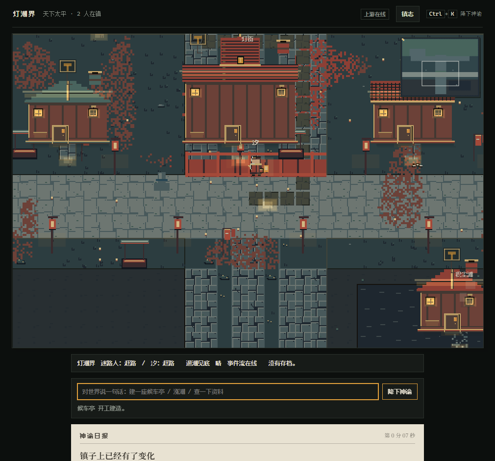
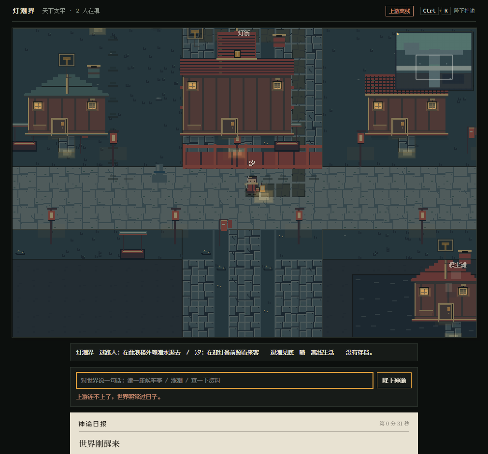

# pixel-world-engine

一个可换设定集的像素世界引擎：世界自己跑，LLM 只能输出白名单内的结构化命令去改变它。



## 这个仓库要做什么

三条支柱，详见 [`docs/SPEC.md`](docs/SPEC.md)：

1. **世界自己跑。** 固定步长模拟、潮汐周期、居民作息、灯油衰减——都不依赖外部服务。
   拔掉服务端，世界照常过日子，只是顶栏改说「上游离线」。
2. **规则约束下的生成。** 模型只输出白名单里的结构化命令，Schema 校验不过就带具体
   原因退回，世界一动没动。世界内核不调模型，也不读全局状态替居民做决定。
3. **记忆是时间线。** Markdown + YAML frontmatter 的编年史，人可读、可 diff、
   不用查数据库。`memory/entries/` 用世界日序号命名（`day-0000.md`），不是日历日期——
   世界时间只有一种，`DAY_MS = 24 * 60 * 60 * 1000`。

## 目录

```text
world-client/            Phaser 前端（模拟内核 + 渲染 + HUD）
├── src/world/           模拟内核（不 import Phaser）
│   ├── memory/          内环：记忆、感知、传播、传说（22 个模块）
│   └── creator/         外环：创世指令白名单、熔断、指标、审校合成器
├── src/render/          渲染层（只读快照）
├── src/settings/        设定集加载器（莞尔镇 / 灯潮界）
├── src/ui/              DOM 覆盖层（编年史面板、神谕面板、存档槽）
├── scripts/             八道闸门里的六个 + 开发/验收脚本
├── eval/                验收截图（`live/` 真实 HTTP，`screens/` 离线自转）
└── test/                221 个测试文件 <!-- claim: test-file-count=221 -->
server/                  FastAPI：规则校验、事件日志、LLM 造物主、记忆写入
├── rules/               七条命令的 Schema 与校验（`COMMAND_CHECKS`）
├── events/              事件日志（取代督办台账）
├── memory/              记忆写入：形状、证据、路径三道关
├── creation_ledger/     造物账本：只增 JSONL（`data/creation-ledger/`）与查询端点
└── oracle/              LLM 造物主接口
docs/                    设计与决策
├── SPEC.md              **唯一权威**（v1 + v2 增补 §8–§15；`SPEC_V2.md` 已冻结归档）
├── iterations/          迭代资料（1027-task-1 内环 / 1027-task-2 外环）
├── adr/                 架构决策记录 <!-- claim: adr-count=10 -->
└── art/                 美术基准（《千与千寻视觉设定集》）
memory/                  时间线记忆：entries / characters / events / rules
```

## 跑起来

```bash
cd world-client && npm ci
```

```bash
cd server && python -m pip install -r requirements.txt
```

一条命令起两半（服务端 `main:app` + 前端 Vite），事件库落在 `tmp/`，不碰 `data/events.db`：

```bash
cd world-client && npm run dev:live
```

- 默认服务端 8000、前端 5188；两个端口都能用 `PIXEL_WORLD_SERVER_PORT` /
  `PIXEL_WORLD_CLIENT_PORT` 改，被占就直接报错，不偷偷换端口。
- 停：`Ctrl+C`，或者 `node scripts/dev-live.mjs --stop`。
- 没有 `server/.env` 也能起：世界照常跑，意图端点回 503，顶栏会写「上游离线」。

要接模型，复制 `server/.env.example` 成 `server/.env` 并填 Key。服务端启动时会读它，
**只打印读到了哪些变量名，不打印值**。

## 选一个世界

两个世界共用同一套模拟、同一套命令协议，只是设定集不同：

| 地址 | 世界 | 地图 | 存档槽 |
| --- | --- | --- | --- |
| `/`（省略参数） | 莞尔镇 | 96×72 | `xiaoxi.pixel-world.save.v1` |
| `/?world=dengchao` | 灯潮界 | 64×48 | `dengchao.pixel-world.save.v1` |

两套存档各自独立：在一个世界里清档、导入或坏档备份都不会碰另一个。存档 schema 是同一份
v4（`CURRENT_SCHEMA_VERSION = 4`，v1→v4 逐级迁移，任一步抛错整次加载失败）。

换设定集不只是换皮：模板表、世界尺寸、合法落位都不一样。灯潮界五个语义区域由数据声明
而不是硬编码坐标，实现范围（哪些真的跑起来了、哪些还没有）见
[`docs/SETTING_DENGCHAO.md`](docs/SETTING_DENGCHAO.md)。

## 世界自己怎么跑



潮汐是世界自己的时钟（灯潮界 12 分钟一个周期，带确定性抖动），真实影响三件事：
低地被淹的画面、寻路代价（涉水很慢但仍可走）、以及**作息选择**——满潮时避开浅滩，
退潮才去轨道与拾荒点。灯油只影响渲染：油尽时人发灰、动作采样放慢；它**不进入**
寻路、任务结算或任何世界判定。

### 时钟：默认是游玩时长

不写参数就是**游玩时间驱动**：页面开着按倍率走（默认 6 倍，一世界日约 4 小时），
**关页面即冻结，重开从存档断点继续**——不补算任何离线时间。因为离线期间页面
没运行、也就没有事件发生，按墙钟补算只能把日历翻过去，等于凭空伪造那几天的历史。

| 入口 | 行为 |
| --- | --- |
| `/`（省略参数） | 游玩时间驱动，默认 6 倍（一世界日约 4 小时），关页面即冻结 |
| `?speed=1`…`60` | 同上，指定倍率 |
| `?clock=fast` | 同上，显式写法 |
| `?clock=real` | 真实时钟 1:1，日界本地 00:00；**只有这个模式**才按墙钟补算离线天数 |
| `?utcOffsetMinutes=480` | 只改日界落在几点，不改日长（只对 `?clock=real` 有意义） |

`?clock=real` 压过 `?speed=`——真实时钟不能被偷偷加速。

**老档日界（只在 `?clock=real` 下出现）**：v1/v4 老档的世界日界常常不在本地
00:00。读档时若偏移超过 5 分钟，页面会提示一次（例如「你的档日界在 07:01，
不是 00:00」）。点「对齐」才把世界时钟向前跳，让下一个日界落在本地 00:00；
历史记忆/事件的 `day` 不改，当前日缩短为 16 小时 59 分（老档实测）。点「暂不」
什么都不动，重启后同一相位不再弹；`?debug=1` 的维护条有「检查日界对齐」与
「撤销对齐」，撤销把 `now` 原样移回。**默认的游玩时间驱动里不检测、不提示，
维护入口置灰并写明只在 real 模式可用。**

## 命令白名单

**两层，各说各的实话**，两层都活着：

- **服务端** `COMMAND_CHECKS`（`server/rules/schema.py`）管「这条命令合法吗」：
  `weather.set`、`tide.setLevel`、`building.add`、`building.remove`、`miracle.spawn`、
  `npc.setSchedule`、`villager.carry`。
- **客户端** `IntentKind`（`world-client/src/world/intent-schema.ts`）管「这个世界能执行吗」：
  十种，`unknown` 是一等公民。

两层差的那一格是真的：`npc.setSchedule` 过得了白名单，但客户端与世界都还没有对应的意图，
所以提示词不列它、端点收到它也落 `unknown`。

## 记忆是时间线

三条铁律写在 `server/memory/` 里**执行**，不是靠人守（[`memory/README.md`](memory/README.md)）：

1. 只有 `direct_observation` 能触发写入。模型可以转述观测到的事——那条路是调用方先观测、
   再把结果作为 `body` 传进来；声称 `llm_generation` 的一律拒。
2. 每条必须带 `source` 与证据链。证据是事件日志里的 id，写入前会**真的去查**；
   有一个查不到，整条记忆被拒。
3. 没有依据时，宁可不写。证据为空一律拒；writer 自己一个字都不编。

写入顺序是刻意的：**先校验、再查日志、最后才碰磁盘**——反过来，一条被拒的记忆可能
已经建好目录、甚至写了一半的文件。

库里现在收着第一次真跑出来的四份文件（`memory/entries/day-0000.md`、`day-0001.md`、
`memory/characters/莞尔.md`、`memory/events/E0001-渡口的第一夜.md`）。它们是**证据，不是产物**。

## 外环：造物主与自治爬梯

> **整合层 `src/creator/engine.ts` 已经在生产路径上。** `SandboxScene` 在 `create()`
> 里建它，世界、种子与时钟都由场景给（引擎不再自造 `'default-seed'` 或读 `Date.now()`）。
> 玩家在造物模式里确认一次，就是一次真实的人工确认；引擎校验后把计划交回场景，
> 由 `Simulation.enqueue({ kind: 'build' })` 落地——与手动造物同一条通道。
> 世界日结束时场景调 `closeWorldDay()` 与 `processDayClosed(vitals)`，并先算一次提案、
> 把门禁读数记进账本；只有 `evaluateFuseDecision` 说 `allow` 时才把计划入队。
>
> **两项观测在落地之后才算**（`src/creator/landing.ts`）：`pathfindingConnected`
> 用落地后的真实网格判门口到不到得了镇心（围死就是 `false`）；`replayHashConsistent`
> 用落地前冻住的 world view 重跑计划，拿「计划内容 + 落地点」的指纹比对。
> 落位前算的这两项都会偏乐观，所以只在 `building.built` 回写之后结算。
>
> **还没有生产数据源的只剩两个**：`metrics.ts`（门禁指标要等真实校验批次）与
> `synthesizer.ts`（逆向审校没有调用方）。`fuse.ts`、`schema.ts`、`config.ts`
> 已经挂在这条路径上。

| 模块 | 干什么 | 测试 |
| --- | --- | --- |
| `creator/schema.ts` | 五条创世指令的白名单与业务规则 | 21 |
| `creator/fuse.ts` | 双向熔断：升级要连续 3 批 / 14 天达标，降级隔离，恢复必须先过回归集 | 30 |
| `creator/metrics.ts` | 逐级门禁指标；`null` 表示「根本没测到」，与「测了没达标」分开处置 | 20 |
| `creator/synthesizer.ts` | 逆向审校合成器：结构化 diff + 自证检测 | 14 |
| `creator/config.ts` | 全量参数定稿表 | 29 |
| `director.ts` | 导演只吃四个标量（`meanValence` / `meanArousal` / `infoEntropy` / `isolatedHoldersCount`），只有两条注入规则 | 21 |

自治爬梯 L0–L4 的目标形态与今天的形态差在哪，
见 [`docs/iterations/1027-task-2/creator-engine-architecture.md`](docs/iterations/1027-task-2/creator-engine-architecture.md)
——那份文档第一节的组件图是**目标**，第六节末写明了哪个入口还没落地。

### 造物账本（外挂日志，不进存档）

每次造物留三条只增记录，用 `proposalId` 挂在一起：

| 记录 | 何时写 | 记什么 |
| --- | --- | --- |
| `creation` | 提案那一刻（过不过都写） | id、世界日、模板/类型、意图文本、目标格位、**逐项门禁读数**（观测值 / 阈值 / 通过与否）、L0–L4 爬梯快照、拒绝原因、回放指纹（种子 + 事件区间） |
| `landing` | `building.built` 之后（或确认没落地） | 是否真的落地、建筑 id、原点/门口、落地后补测的覆盖率 / 寻路 / 碰撞 / 约束 / 不变式 / 回放 |
| `observation` | 落地后第 7 个世界日 | 仍在 / 被拆 / 被改 / 不见了；被改只认占地或门口真的变了、或记忆层改了名 |

- **位置**：`data/creation-ledger/<worldId>.jsonl`（`PIXEL_WORLD_CREATION_LEDGER_DIR`
  可改）。每个世界一本，一行一条 JSON，只追加；`data/` 已在 `.gitignore` 里。
- **不进 v5**：`world.memory` 与存档契约一个字没动；也没有新增 intent 白名单、
  没有改 24 色与瓦片尺寸。
- **写**：`POST /api/creation-ledger/entries`（`recordId` 重复时返回旧记录，
  `duplicate=true`）。**读**：`GET /api/creation-ledger/entries?worldId=&day=&template=&reject=`；
  `reject` 取门禁名（`schema` / `placement` / `coverage` / `pathfinding` / `collision` /
  `constraint` / `traceability` / `invariant` / `replay` / `fuse`）。
- **没测就是 `null`**：拒绝原因因此分成 `below_requirement`（真不达标）与
  `not_measured`（分母为 0 / 样本不足）。
- **世界日口径**：`DAY_MS` 仍是 24 世界小时；节奏 60 只把现实时长压到 24 分钟。
  `day` / `at` / `dueDay` 全用同一把世界时钟尺子，`dueDay = 落地日 + 7 个世界日`
  （`OBSERVATION_WINDOW_DAYS`），不按现实日算。
- **持久化队列**：写失败时记录落 `localStorage`（键
  `pwe-creation-ledger-queue:v1:<worldId>`），页面关掉再开由新出队器读回补发。
  队列上限 **200 条 / 256 KiB**，超限丢最旧的未发送记录并把 `dropped` 计数
  一起持久化；去重键是 `recordId`，同一条重试只入队一次。
- **证据脚本**：`cd world-client && node --import ./test/phaser-hooks.mjs scripts/ledger-evidence.ts`。
  它跑 20 个真实世界日、一条「落地 → 第 7 个世界日」观测、构造一条覆盖率拒绝，
  并量出 30 / 100 天的账本字节数；产物落在 `world-client/tmp/creation-ledger/`。

## 24 色预算

世界层 24 色、UI 层 8 色，分开统计。token 名是闭集，设定集换的是值不是名
（[`docs/adr/ADR_PALETTE_24.md`](docs/adr/ADR_PALETTE_24.md)）。超预算由
`scripts/audit-palette.mjs --strict` 拦在 CI 里。

## 验证

CI 跑八条，前端 job 六条 + 服务端 job 两条（以
[`.github/workflows/ci.yml`](.github/workflows/ci.yml) 为准）：

```bash
cd world-client && npm run check && npm test && npm run build
```

```bash
cd world-client && node scripts/audit-palette.mjs --strict
```

```bash
cd world-client && node scripts/audit-references.ts --strict && node scripts/audit-citations.ts --strict && node scripts/audit-sections.ts --strict && node scripts/audit-claims.ts --strict
```

```bash
cd server && python -m pytest
```

服务端依赖的上下界锁在 `server/requirements.txt`；CI 只有 `pip install -r` 这一层安装，
没有额外 lock。要完全复现时再引 constraints。

**这几条要一起跑。** 后四条的输出有个共同性质：引用对不上、节号不存在、色板超预算，
**全都只让输出变长，不会让 `check`/`test` 变红**。只跑前两条的人会以为自己是绿的，
而四个闸门一个都没过。

2026-11-03 的 CI 快照（[run 41553639144](https://github.com/cs1lion/pixel-world-engine/actions/runs/41553639144)，commit `85a0611`）：`check` 0 错、`test` 1901 通过 / 9 跳过 / 0 失败
（9 条全是 `terrain-edge-visibility.test.ts` 的色板待定项）、`build` 通过、三个引用审计
0 缺陷、`audit-palette` 0 超预算、服务端 `pytest` 496 通过 / 1 跳过。

**通过数只作快照，不设 claim 探针**：它们依赖运行环境，机器只钉能秒算的值（测试文件数、
ADR 数、存档版本、SPEC 权威、iterations 入库数）。数字变了就重跑 CI 并更新这一行与链接。
`main` 合入 #18（真实时钟 +9 项 / 跨会话基线 +8 项）与 #19（感知与记忆 +14 项）后共 1910 项。

**受查处数不写在这儿**：它随文档增长，而这份 README 自己就是增长源——上面那些数字写下
的同一次编辑，就把受查处数从 1885 改成了 1904。要数就现跑，输出第一行就是它。

浏览器验收（真实 HTTP 链路，不是静态测试）：

```bash
cd world-client && npm run test:live
```

它自带隔离端口与事件库，走真实服务：一句话 → 服务端白名单 → 回到世界 → 世界里真的多了
一栋楼；一句办不到的话 → 具体原因回到回执上；停掉服务端 → 世界照常过日子，顶栏改说
「上游离线」。**两个世界各跑一遍**——换设定集不只是换皮。

> 上面那几张截图是 2026-10-26 跑出来的。这台机器现在装了 `@playwright/test`（`node_modules`
> 与浏览器缓存都在），但 2026-11-02 这次核对没有重跑 `test:live`——它会改写 `eval/live/`
> 里已入库的截图。**别把它们当今天的证据读。**

另有一条只验画面的灯潮界验收，不需要服务端（世界用 `?feed=off` 离线自转），
但需要一个跑着的 Vite：

```bash
cd world-client && npm run dev
```

（另开一个终端跑下面这条。）

```bash
cd world-client && PIXEL_WORLD_URL=http://127.0.0.1:5173/ npm run test:setting
```

不设 `PIXEL_WORLD_URL` 时默认找 `http://127.0.0.1:5188/`（`npm run dev:live` 的前端端口）。

遮挡层还有一支可复现的摆位验收：把「沉灯夫人」按固定格钉在摊位后一格 / 前一格，
冻结帧各截一张，两张并排写出 depth 读数（`eval/screens/placement-stall.png`）：

```bash
cd world-client && PIXEL_WORLD_URL=http://127.0.0.1:5173/ npm run test:scene-depth
```

街面光池也有一支证据脚本：同一冻结帧里只换灯态/潮位，量同一块地面的亮度与色温，
并给出距灯 0.5–6 格的衰减（`eval/screens/lamp-pool.png`）：

```bash
cd world-client && PIXEL_WORLD_URL=http://127.0.0.1:5173/ npm run test:lamp-pool
```

立面尺度也留了对照证据：同一机位、同一冻结帧拍「改前 / 改后」，把墙、人、灯柱三把标尺
画在图上，并从截图里逐像素量墙高、石脚与灯体下沿的净空（`eval/screens/setting-scale.png`）：

```bash
cd world-client && PIXEL_WORLD_URL=http://127.0.0.1:5173/ npm run test:setting-scale
```

拍「改前」要先 `git stash` 掉 `src/` 的改动（`SCALE_LABEL=before`），恢复后再拍 `after`；
改后那一跑会顺手合成并排图。

## 状态

> 状态核对日期：2026-11-02（本段以代码为准；测试与审计数字现跑得出）。

**跑着的**：世界内核与渲染、两套设定集与各自的存档槽、v1→v5 迁移链、七条命令的服务端
白名单与十种客户端意图、编年史面板（读 `/api/memory/list`）、`memory/` 的三条铁律。

**半接的**：外环的 `metrics.ts` 与 `synthesizer.ts`——只有测试引用它们，
门禁指标要等真实校验批次接进来；其余外环模块已经进了生产路径（见上一节）。

**造物引擎（第三阶段已接）**：`CreatorEngine` 由 `SandboxScene` 拥有，吃的是场景
这一份 `BuiltWorld`（不再另建第二份权威状态）。种子取设定集 id，时钟取
`snapshot.now`。玩家确认造物时，场景把配色 token 交给 `proposeCreation` 校验，
拿回计划后经 `Simulation.enqueue` 落位；`submitHumanApproval` 只记真的查过的项
（落位三道、覆盖率、来由），门口连通、回放一致与冲突/不变式由 `building.built` 触发的事后判定补上。
冲突与不变式现在有检查次数分母（`conflictChecks` / `invariantChecks`）：没跑过业务规则的窗口
升不了 L2，`false` 才是「查过且没有」。覆盖率改成**每次造物结算都现算一次**（按 `prefabId` 去重），
所以「拆掉一栋、再把同一模板建回来」也会记一次新观测——升级清零窗口之后 L1→L2 不再结构卡死；
没有造物的窗口覆盖率仍是 `null`，不会被默认放行。外环的自动提议可复现：候选模板先排序，
模板下标与扫描起点都从 `seedOf(worldSeed, day, 'creator', …)` 取，不用 `Math.random`、不读墙钟。

**记忆的写面（第二阶段已接）**：浏览器端不再只有 `list()` / `read()`。
世界回写日志成功、拿到事件 id 之后，`SandboxScene` 把它排进 `memoryOutbox`，
在自动存档那一刻（`maybeAutoSave`，与存档共用同一条 30s / 状态变化节流）交一条
到 `POST /api/memory/write`。写不是每拍发一次：空队不请求、同一时刻只有一条在途、
成功才出队。服务端写成功后同步推进 `memory/index.yaml` 的 `last_event_seq`
（`server/memory/writer.py` 的 `_touch_index`）——那句「由谁维护」现在有实现撑着。

**记忆也在存档里**：`world.memory` 是一段自带 `memorySchemaVersion` 的 JSON 字符串
（空串 = 没有记忆）。`Simulation.toSave()` 只负责把它原样写进 v5 存档；读档时由
`SandboxScene` 在 `Simulation.fromSave()` 之后调 `this.memory.fromJSON()` 复原。

## 与旧仓的关系

渲染与模拟内核来自 `cs1lion/xiaoxi` 的 `pixel-world/`。旧仓保留为参考，不再演进。
两边的差异与迁移记录见 [`docs/MIGRATION_FROM_XIAOXI.md`](docs/MIGRATION_FROM_XIAOXI.md)。

## Quick Links

- **规范**：[`docs/SPEC.md`](docs/SPEC.md)（**唯一权威**；v2 增补见 §8–§15）
- **取舍理由**：[`docs/SPEC_DRAFT_20261025.md`](docs/SPEC_DRAFT_20261025.md)
- **术语表**：[`GLOSSARY.md`](GLOSSARY.md)
- **灯潮界实现范围**：[`docs/SETTING_DENGCHAO.md`](docs/SETTING_DENGCHAO.md)
- **架构补充 v1.0**：[`docs/iterations/1027-task-2/architecture-supplement-v1.0-params.md`](docs/iterations/1027-task-2/architecture-supplement-v1.0-params.md)
- **造物引擎架构**：[`docs/iterations/1027-task-2/creator-engine-architecture.md`](docs/iterations/1027-task-2/creator-engine-architecture.md)
- **内环记忆协议**：[`docs/iterations/1027-task-1/world-memory-protocol-v0.1.md`](docs/iterations/1027-task-1/world-memory-protocol-v0.1.md)
- **美术基准**：[`docs/art/README.md`](docs/art/README.md)

## 给 agent 的约定

`docs/agents/` 下三份是**约定文档，不是 `/slash` 命令**（本仓没有 `.claude/skills/`）：

- [`issue-tracker.md`](docs/agents/issue-tracker.md)：GitHub Issues 在 `cs1lion/pixel-world-engine`，走 `gh` CLI
- [`triage-labels.md`](docs/agents/triage-labels.md)：五个默认角色标签（needs-triage / needs-info / ready-for-agent / ready-for-human / wontfix）
- [`domain.md`](docs/agents/domain.md)：单上下文——一份 `GLOSSARY.md` 加 `docs/adr/`
