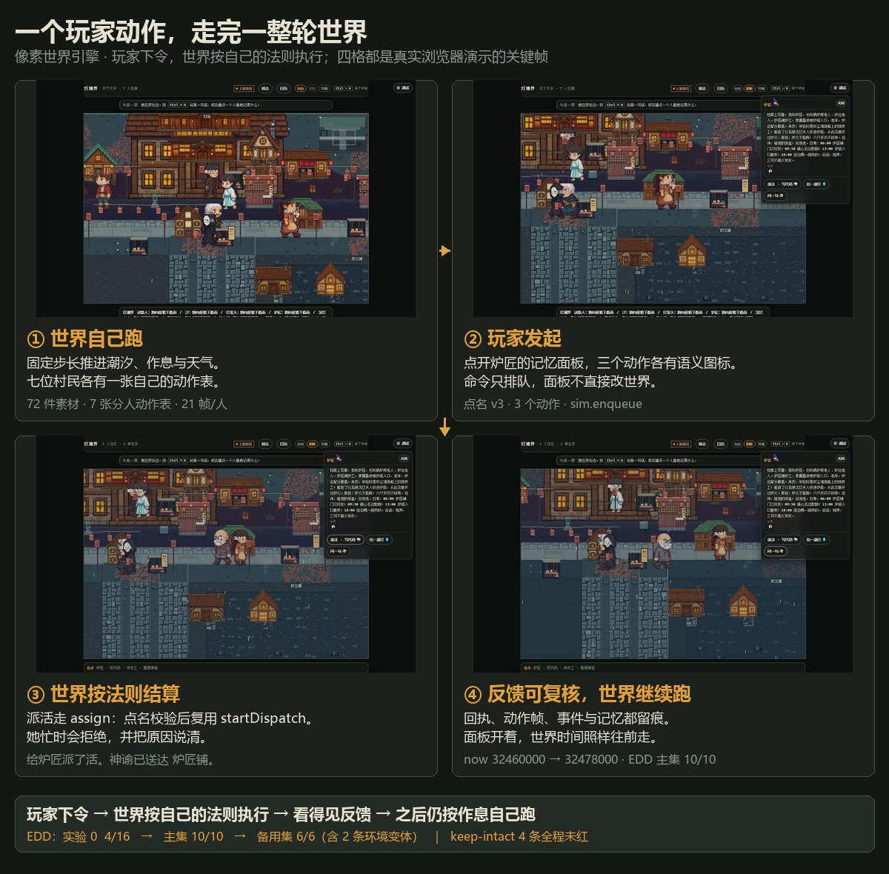

# pixel-world-engine
  
> 一个可换设定集的像素世界引擎：世界自己跑，LLM 只能输出白名单内的结构化命令去改变它。



图里四格是同一段真实浏览器演示的关键帧：点开炉匠的记忆面板，派活、给东西、问一句；
回执分别是「给炉匠派了活。神谕已送达 炉匠铺。」「炉匠现在带着lamp。」
「炉匠说：正赶着手上的活。」。完整动图（约 12 秒，无剪辑）见
[`docs/evidence/interaction-eval/demo-interaction.mp4`](docs/evidence/interaction-eval/demo-interaction.mp4)。

## 这是什么

世界的时间、潮汐、居民作息与资源衰减都由固定步长模拟推进，**拔掉 LLM 服务端也照常运转**。
模型不是世界的驱动者，只是外环的一个提议者：它输出的结构化命令要过 Schema 白名单校验，
没过就带具体原因退回，外环触发熔断保护，非法动作碰不到世界状态。

三大工程设计支柱（详见 `docs/SPEC.md`）：

1. **无模型依赖的确定性模拟**：同一份输入、同一份存档，在任何机器上跑出同一个世界。
2. **白名单 Schema 约束下的 Agent 生成与外环熔断**：模型只能说规则表里有的一句话。
3. **基于 Markdown + YAML Frontmatter 的三道关记忆时间线**：记忆写在 `memory/entries/`
   下，按世界日序号命名（`day-0000.md`），人可读、可 diff，事件链与编年史同源。

## 目录

| 路径 | 职责 |
| --- | --- |
| `world-client/src/world/` | 确定性模拟内核，不依赖 Phaser API |
| `world-client/src/render/` | Phaser 4 渲染：瓦片、建筑、村民、光层、位图素材 |
| `world-client/src/settings/` | 设定集加载器（莞尔镇 / 灯潮界） |
| `world-client/src/ui/` | DOM 覆盖层：编年史、日历、神谕、单位面板 |
| `world-client/public/assets/` | 离线生成的位图素材与 `manifest.json` |
| `world-client/eval/` | 验收截图与基线 |
| `server/rules/` | 命令 Schema 与规则校验引擎 |
| `server/oracle/` | LLM 网关与结构化造物主接口 |
| `server/memory/` | 记忆落盘、证据核对与每日快照 |
| `server/art/` | 生图素材管线（抠底 / 裁边 / 缩放 / 清单） |
| `server/scripts/` | 按需生成素材、批量重画与审计脚本 |
| `docs/` | 规范、ADR、迭代任务、证据与断点记录 |

## 美术

世界画面由**三层**叠出来：几何与地面走 24 色板程序化绘制，建筑 / 村民 / 布景走离线生成
的位图素材，叙事细节靠 Trace 随时间沉积。素材是作品，进版本管理、可评审、可回放；
运行时绝不现场生图。

- 初版视觉基准：《千与千寻视觉设定集》，见 `docs/art/README.md`。
- 第二套视觉基准：2026-11-11 提供的十张参考图（16-bit 硬像素、暖木色与琥珀灯光），
  副本、联系表与可浏览画廊见 `docs/art/reference-20261111/`。
- 四轮落地的决策与取舍：`docs/adr/ADR_ART_REF_20261111.md`；闸门读数、
  前后实拍与改前 / 改后录屏：`docs/evidence/art-ref-1111/README.md`。
- 主界面视觉层：第四轮按桌面 UI 设计稿把玻璃拟态、胶囊命令栏、状态点、
  圆角与柔和阴影做进 `world-client/index.html` 的 CSS；**只改视觉属性**，
  不重排 HUD、不新增按钮、不动 DOM 契约，画布包围盒与面板 rect 保持不变。
  并排对照见 `docs/evidence/art-ref-1111/ui-before-after.png`。
- 素材清单（72 件，含每件的尺寸、sha256 与来源）：`world-client/public/assets/manifest.json`。
- 生成脚本：`server/scripts/gen_asset.py`（单件）、`server/scripts/art_ref_1111.py`
  （立绘与切片）、`server/scripts/art_unify_1111.py`（旧素材统一）、
  `server/scripts/art_plates_1111.py`（画册贴片）。
- 位图默认开，`?art=0` 一笔不装，回落到全程序化绘制——排障与像素基线比对都靠这条退路。

## 交互

**玩家下令，世界按自己的法则执行；世界可以拒绝，拒绝时说清原因；之后它仍按作息自己跑。**
这是三条铁律的延伸，不是例外：`docs/SPEC.md` 的用户故事里就写着「居民按自己的作息活动，
不是围着我转」和「世界拒绝我的时候会说清为什么」。

点开一个村民的记忆面板，有三个动作：

| 动作 | 排进世界的命令 | 世界怎么判 | 看得见的反馈 |
| --- | --- | --- | --- |
| 派活 · 写代码 | `assign`（点名 + 复用既有的派活路径） | 她手上有活、名字抵押或在呼吸段里就拒绝 | 回执 + 动作帧切到赶路 / 干活 |
| 给一盏灯 | `setCarries`（给 / 收是同一个动作的来回） | 只改被点名那个人，不顺手递给旁边的人 | 回执 + `carries` 变化 |
| 问一句 | `ask` | 世界按自己此刻的状态答，不调模型、不解析自由文本 | 回执 + 事件进日志 |

三条设计约束：

- **命令只排队，面板不直接改世界。** 所有动作走同一个入口，由下一个逻辑拍统一结算。
- **不动白名单。** 这三个动作是玩家侧命令，不经 LLM，所以规则层的命令白名单、
  提示词和 `docs/SPEC.md` 的命令表一条都没改——两份白名单不混用。
- **确定性不破。** 动作帧只由快照与世界时间推导，不读墙钟、不用随机数；
  世界冻住后帧号不再变，存档契约与 `schemaVersion` 都没动。

## 交互评测（EDD）

交互这块按 eval-driven development 做：**先写评测集、跑出可判红的基线，再一笔一个行为爬坡**，
每笔改动用同一份评测集逐条比较，主集全绿之后才把评分器接进 CI 当阻断。

- 数据集：`world-client/eval/interaction/main.json`（主集 10 条）与 `held-out.json`
  （备用集 6 条，其中 2 条换世界时刻 / 相位 / 潮位档，防对固定开局过拟合）。
- 评分器：`world-client/scripts/eval-interaction.mjs`。固定程序判别，不用 LLM 打分；
  判的是「一轮往返之后世界留下了什么」——快照字段、事件、记忆、回执、存档字节、
  DOM 可点性。有任意一条不过就 `exit 1`。
- 爬坡：实验 0 是 4/16（12 条红在「功能还不存在」）→ 派活 7/10 → 给东西 8/10
  → 问一句 10/10 → 素材收口 10/10；备用集 6/6。四条 keep-intact 用例全程没有变红。
  逐条读数与实验序列：`docs/evidence/interaction-eval/BASELINE.md`。
- 决策与取舍：`docs/adr/ADR_ACTIONS_INTERACTION_20261112.md`。

## 快速启动

前端（`world-client/`，Node 22）：

```bash
cd world-client
npm ci
npm run dev
```

服务端（`server/`，Python 3.11+）：

```bash
cd server
pip install -r requirements.txt
python main.py
```

服务端读 `server/.env`（已被 `.gitignore` 挡住，不入库）：`LLM_*` 接结构化造物主网关，
`IMAGE_*` 接 Agnes 生图接口。没配 Key 时世界照常跑，只是神谕与离线素材生成不可用。

## 验证

CI 的**十一道闸门**：前端 job 十道、服务端 job 一道，完整清单以
`.github/workflows/ci.yml` 为准。后五道（色板与三份审引用、标注断言）的输出有个共同
性质——断言对不上、节号不存在、色板超预算，都只让输出变长，不会让 `check` / `test`
变红。只跑前三条的人会以为自己是绿的。

最短完整路径：

```bash
cd world-client
npm run check && npm test && npm run build
node scripts/audit-palette.mjs --strict
node scripts/audit-references.ts --strict
node scripts/audit-citations.ts --strict
node scripts/audit-sections.ts --strict
node scripts/audit-claims.ts --strict
cd ../server && python -m pytest
```

另有浏览器验收 job（持久化、渲染预算、四刻可辨性、素材装载、建筑烘焙、**村民交互评测主集**），
只读、截图写到 runner 临时目录。多 worktree 并行时**必须给每棵树固定端口并显式设
`PIXEL_WORLD_URL`**，否则会测到别人的世界；身份闸 `/__tree-id` 就是防这个的。

交互评测单独跑（先 `npm run build` 并起 preview，端口指到本树）：

```bash
PIXEL_WORLD_URL=http://127.0.0.1:52xx/ node scripts/eval-interaction.mjs --split main
PIXEL_WORLD_URL=http://127.0.0.1:52xx/ node scripts/eval-interaction.mjs --split heldout
```

主集接在 CI 里当阻断；备用集不进 CI，合并前或夜跑时手动跑——迭代过程中看它，
就等于拿它调参，防过拟合就失效了。

## 工程纪律

- `docs/SPEC.md` 是唯一权威；历史草案只归档不删除，**禁止新增 `SPEC_*` 文件**，
  新决策写进 `docs/SPEC.md` 或 `docs/adr/`。
- `main` 已开远端分支保护：必须走 PR、四项必需检查全绿才能合，禁强推、禁删除，
  管理员不豁免。本地 `.githooks/pre-push` 是第二道，装法见 `CLAUDE.md`。
- 并行 worktree 在 `docs/WORKTREES.md` 登记；`npm run worktrees:audit` 只列不删，
  回收由 owner 手动做。
- 任务中断前按 `docs/RESUME.md` 覆盖写「当前断点」五项；恢复时先核对
  `git status --short --branch` 与 `git log -1`，再补跑记录之后改动过的闸门。
- 24 色板与 UI 9 色是硬预算，位图层独立管，见 `docs/adr/ADR_ART_PALETTE_DECISION.md`。

## 相关文档

| 想找什么 | 去哪 |
| --- | --- |
| 规范与验收 | `docs/SPEC.md` |
| 决策记录 | `docs/adr/` |
| 未决问题与降级清单 | `docs/OPEN_ISSUES.md` |
| 迁移盘点 | `docs/MIGRATION_FROM_XIAOXI.md` |
| 工程纪律条目 | `docs/ENGINEERING_DISCIPLINE.md` |
| 美术设定与参考图 | `docs/art/` |
| 证据与实拍 | `docs/evidence/` |
| 迭代目标暂存 | `docs/iterations/` |
