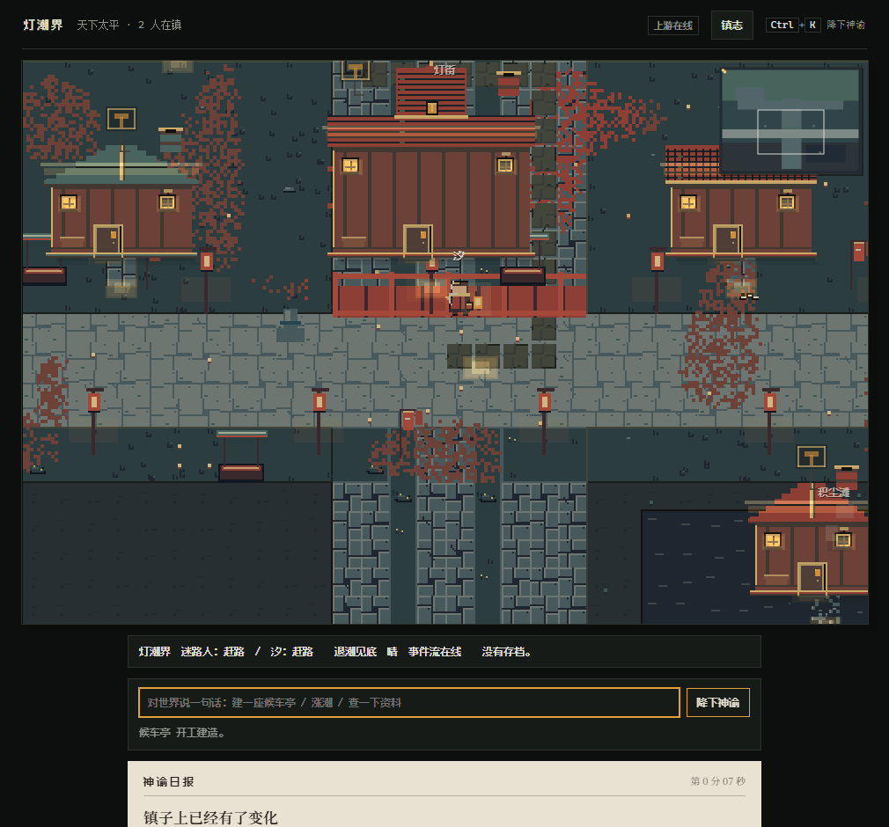
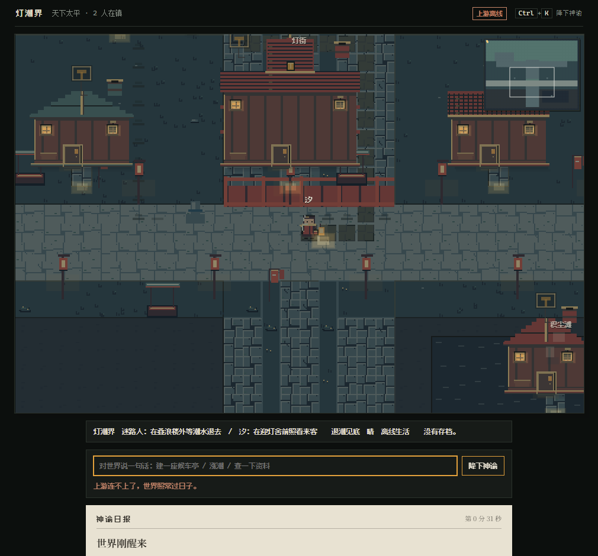

# pixel-world-engine

一个可换设定集的像素世界引擎：世界自己跑，LLM 只能输出白名单内的结构化命令去改变它。



## 这个仓库要做什么

三条支柱，详见 [`docs/SPEC.md`](docs/SPEC.md)：

1. **世界自己跑。** 固定步长模拟、潮汐周期、居民作息、灯油衰减——都不依赖外部服务。
   拔掉服务端，世界照常过日子，只是顶栏改说「上游离线」。
2. **规则约束下的生成。** 模型只输出白名单里的结构化命令，Schema 校验不过就带具体
   原因退回，世界一动没动。世界内核不调模型，也不读全局状态替居民做决定。
3. **记忆是时间线。** Markdown + YAML frontmatter 的编年史，人可读、可 diff、
   不用查数据库。`memory/entries/` 用世界日序号命名（`day-0000.md`），不是日历日期——
   世界时间只有一种，`DAY_MS = 24 * 60 * 60 * 1000`。

## 目录

```text
world-client/            Phaser 前端（模拟内核 + 渲染 + HUD）
├── src/world/           模拟内核（不 import Phaser）
│   ├── memory/          内环：记忆、感知、传播、传说（18 个模块）
│   └── creator/         外环：创世指令白名单、熔断、指标、审校合成器
├── src/render/          渲染层（只读快照）
├── src/settings/        设定集加载器（莞尔镇 / 灯潮界）
├── src/ui/              DOM 覆盖层（编年史面板、神谕面板、存档槽）
├── scripts/             八道闸门里的六个 + 开发/验收脚本
├── eval/                验收截图（`live/` 真实 HTTP，`screens/` 离线自转）
└── test/                160 个测试文件
server/                  FastAPI：规则校验、事件日志、LLM 造物主、记忆写入
├── rules/               七条命令的 Schema 与校验（`COMMAND_CHECKS`）
├── events/              事件日志（取代督办台账）
├── memory/              记忆写入：形状、证据、路径三道关
└── oracle/              LLM 造物主接口
docs/                    设计与决策
├── SPEC.md              v1 规范定稿
├── iterations/          迭代资料（1027-task-1 内环 / 1027-task-2 外环）
├── adr/                 架构决策记录
└── art/                 美术基准（《千与千寻视觉设定集》）
memory/                  时间线记忆：entries / characters / events / rules
```

## 跑起来

```bash
cd world-client && npm ci
```

```bash
cd server && python -m pip install -r requirements.txt
```

一条命令起两半（服务端 `main:app` + 前端 Vite），事件库落在 `tmp/`，不碰 `data/events.db`：

```bash
cd world-client && npm run dev:live
```

- 默认服务端 8000、前端 5188；两个端口都能用 `PIXEL_WORLD_SERVER_PORT` /
  `PIXEL_WORLD_CLIENT_PORT` 改，被占就直接报错，不偷偷换端口。
- 停：`Ctrl+C`，或者 `node scripts/dev-live.mjs --stop`。
- 没有 `server/.env` 也能起：世界照常跑，意图端点回 503，顶栏会写「上游离线」。

要接模型，复制 `server/.env.example` 成 `server/.env` 并填 Key。服务端启动时会读它，
**只打印读到了哪些变量名，不打印值**。

## 选一个世界

两个世界共用同一套模拟、同一套命令协议，只是设定集不同：

| 地址 | 世界 | 地图 | 存档槽 |
| --- | --- | --- | --- |
| `/`（省略参数） | 莞尔镇 | 96×72 | `xiaoxi.pixel-world.save.v1` |
| `/?world=dengchao` | 灯潮界 | 64×48 | `dengchao.pixel-world.save.v1` |

两套存档各自独立：在一个世界里清档、导入或坏档备份都不会碰另一个。存档 schema 是同一份
v4（`CURRENT_SCHEMA_VERSION = 4`，v1→v4 逐级迁移，任一步抛错整次加载失败）。

换设定集不只是换皮：模板表、世界尺寸、合法落位都不一样。灯潮界五个语义区域由数据声明
而不是硬编码坐标，实现范围（哪些真的跑起来了、哪些还没有）见
[`docs/SETTING_DENGCHAO.md`](docs/SETTING_DENGCHAO.md)。

## 世界自己怎么跑



潮汐是世界自己的时钟（灯潮界 12 分钟一个周期，带确定性抖动），真实影响三件事：
低地被淹的画面、寻路代价（涉水很慢但仍可走）、以及**作息选择**——满潮时避开浅滩，
退潮才去轨道与拾荒点。灯油只影响渲染：油尽时人发灰、动作采样放慢；它**不进入**
寻路、任务结算或任何世界判定。

## 命令白名单

**两层，各说各的实话**，两层都活着：

- **服务端** `COMMAND_CHECKS`（`server/rules/schema.py`）管「这条命令合法吗」：
  `weather.set`、`tide.setLevel`、`building.add`、`building.remove`、`miracle.spawn`、
  `npc.setSchedule`、`villager.carry`。
- **客户端** `IntentKind`（`world-client/src/world/intent-schema.ts`）管「这个世界能执行吗」：
  十种，`unknown` 是一等公民。

两层差的那一格是真的：`npc.setSchedule` 过得了白名单，但客户端与世界都还没有对应的意图，
所以提示词不列它、端点收到它也落 `unknown`。

## 记忆是时间线

三条铁律写在 `server/memory/` 里**执行**，不是靠人守（[`memory/README.md`](memory/README.md)）：

1. 只有 `direct_observation` 能触发写入。模型可以转述观测到的事——那条路是调用方先观测、
   再把结果作为 `body` 传进来；声称 `llm_generation` 的一律拒。
2. 每条必须带 `source` 与证据链。证据是事件日志里的 id，写入前会**真的去查**；
   有一个查不到，整条记忆被拒。
3. 没有依据时，宁可不写。证据为空一律拒；writer 自己一个字都不编。

写入顺序是刻意的：**先校验、再查日志、最后才碰磁盘**——反过来，一条被拒的记忆可能
已经建好目录、甚至写了一半的文件。

库里现在收着第一次真跑出来的四份文件（`memory/entries/day-0000.md`、`day-0001.md`、
`memory/characters/莞尔.md`、`memory/events/E0001-渡口的第一夜.md`）。它们是**证据，不是产物**。

## 外环：造物主与自治爬梯

> **这五个模块今天没有任何生产代码 import**（`grep -rn "world/creator/" src --include=*.ts`
> 零命中）。它们各自有测试、各自是绿的，但还没有那个把它们串起来的东西。别把下面这张表
> 读成「已经在跑」。

| 模块 | 干什么 | 测试 |
| --- | --- | --- |
| `creator/schema.ts` | 五条创世指令的白名单与业务规则 | 21 |
| `creator/fuse.ts` | 双向熔断：升级要连续 3 批 / 14 天达标，降级隔离，恢复必须先过回归集 | 30 |
| `creator/metrics.ts` | 逐级门禁指标；`null` 表示「根本没测到」，与「测了没达标」分开处置 | 20 |
| `creator/synthesizer.ts` | 逆向审校合成器：结构化 diff + 自证检测 | 14 |
| `creator/config.ts` | 全量参数定稿表 | 29 |
| `director.ts` | 导演只吃四个标量（`meanValence` / `meanArousal` / `infoEntropy` / `isolatedHoldersCount`），只有两条注入规则 | 21 |

自治爬梯 L0–L4 的目标形态与今天的形态差在哪，
见 [`docs/iterations/1027-task-2/creator-engine-architecture.md`](docs/iterations/1027-task-2/creator-engine-architecture.md)
——那份文档第一节的组件图是**目标**，第六节末写明了哪个入口还没落地。

## 24 色预算

世界层 24 色、UI 层 8 色，分开统计。token 名是闭集，设定集换的是值不是名
（[`docs/adr/ADR_PALETTE_24.md`](docs/adr/ADR_PALETTE_24.md)）。超预算由
`scripts/audit-palette.mjs --strict` 拦在 CI 里。

## 验证

CI 跑八条，前端 job 六条 + 服务端 job 两条（以
[`.github/workflows/ci.yml`](.github/workflows/ci.yml) 为准）：

```bash
cd world-client && npm run check && npm test && npm run build
```

```bash
cd world-client && node scripts/audit-palette.mjs --strict
```

```bash
cd world-client && node scripts/audit-references.ts --strict && node scripts/audit-citations.ts --strict && node scripts/audit-sections.ts --strict
```

```bash
cd server && python -m pytest
```

**这几条要一起跑。** 后四条的输出有个共同性质：引用对不上、节号不存在、色板超预算，
**全都只让输出变长，不会让 `check`/`test` 变红**。只跑前两条的人会以为自己是绿的，
而四个闸门一个都没过。

2026-10-28 在干净 worktree 上量到的：`check` 0 错、`test` 1635 通过 / 9 跳过 / 0 失败
（9 条全是 `terrain-edge-visibility.test.ts` 的色板待定项）、`build` 通过、三个引用审计
0 缺陷、`audit-palette` 0 超预算、服务端 `pytest` 481 通过 / 1 跳过。

**受查处数不写在这儿**：它随文档增长，而这份 README 自己就是增长源——上面那些数字写下
的同一次编辑，就把受查处数从 1885 改成了 1904。要数就现跑，输出第一行就是它。

浏览器验收（真实 HTTP 链路，不是静态测试）：

```bash
cd world-client && npm run test:live
```

它自带隔离端口与事件库，走真实服务：一句话 → 服务端白名单 → 回到世界 → 世界里真的多了
一栋楼；一句办不到的话 → 具体原因回到回执上；停掉服务端 → 世界照常过日子，顶栏改说
「上游离线」。**两个世界各跑一遍**——换设定集不只是换皮。

> 上面那几张截图是 2026-10-26 跑出来的。这台机器今天没装 `@playwright/test`
> （`package-lock.json` 里有，`node_modules` 里没有，`npm ci` 之后才有），所以
> `test:live` 这次没跑过。**别把它们当今天的证据读。**

另有一条只验画面的灯潮界验收，不需要服务端（世界用 `?feed=off` 离线自转），
但需要一个跑着的 Vite：

```bash
cd world-client && npm run dev
```

（另开一个终端跑下面这条。）

```bash
cd world-client && PIXEL_WORLD_URL=http://127.0.0.1:5173/ npm run test:setting
```

不设 `PIXEL_WORLD_URL` 时默认找 `http://127.0.0.1:5188/`（`npm run dev:live` 的前端端口）。

## 状态

**跑着的**：世界内核与渲染、两套设定集与各自的存档槽、v1→v4 迁移链、七条命令的服务端
白名单与十种客户端意图、编年史面板（读 `/api/memory/list`）、`memory/` 的三条铁律。

**半接的**：

- 记忆的**写面**只到服务端 `POST /api/memory/write`。浏览器端没有调用方——记忆客户端
  只有 `list()` 与 `read()`，那是有意的：写收的是「已经观测到的事」，不该由界面按钮发起。
  所以 `memory/` 里那四份文件是手工收进库的，不是跑一遍自动落盘的。
- 记忆在**内存里**是活的：`MemoryRuntime` 接在 `SandboxScene` 上，每拍喂位置、跨日关账、
  抛心电图。但它不进存档，刷新就重来。

**没接的**：外环五个模块（见上一节）、`CreatorEngine`（只有一份未入库的草稿，
不在这个仓库里，今天过不了 `npm run check`）。

**没写入方的**：`memory/index.yaml`。它的文件头写着「由 `server/memory/` 在写入时维护」，
而 `INDEX_NAME` 只在 `paths.py` 里定义了路径，没有任何地方写它。那句话是假的。

## 与旧仓的关系

渲染与模拟内核来自 `cs1lion/xiaoxi` 的 `pixel-world/`。旧仓保留为参考，不再演进。
两边的差异与迁移记录见 [`docs/MIGRATION_FROM_XIAOXI.md`](docs/MIGRATION_FROM_XIAOXI.md)。

## Quick Links

- **规范**：[`docs/SPEC.md`](docs/SPEC.md)（v1 定稿）
- **取舍理由**：[`docs/SPEC_DRAFT_20261025.md`](docs/SPEC_DRAFT_20261025.md)
- **术语表**：[`GLOSSARY.md`](GLOSSARY.md)
- **灯潮界实现范围**：[`docs/SETTING_DENGCHAO.md`](docs/SETTING_DENGCHAO.md)
- **架构补充 v1.0**：[`docs/iterations/1027-task-2/architecture-supplement-v1.0-params.md`](docs/iterations/1027-task-2/architecture-supplement-v1.0-params.md)
- **造物引擎架构**：[`docs/iterations/1027-task-2/creator-engine-architecture.md`](docs/iterations/1027-task-2/creator-engine-architecture.md)
- **内环记忆协议**：[`docs/iterations/1027-task-1/world-memory-protocol-v0.1.md`](docs/iterations/1027-task-1/world-memory-protocol-v0.1.md)
- **美术基准**：[`docs/art/README.md`](docs/art/README.md)

## 给 agent 的约定

`docs/agents/` 下三份是**约定文档，不是 `/slash` 命令**（本仓没有 `.claude/skills/`）：

- [`issue-tracker.md`](docs/agents/issue-tracker.md)：GitHub Issues 在 `cs1lion/pixel-world-engine`，走 `gh` CLI
- [`triage-labels.md`](docs/agents/triage-labels.md)：五个默认角色标签（needs-triage / needs-info / ready-for-agent / ready-for-human / wontfix）
- [`domain.md`](docs/agents/domain.md)：单上下文——一份 `GLOSSARY.md` 加 `docs/adr/`
