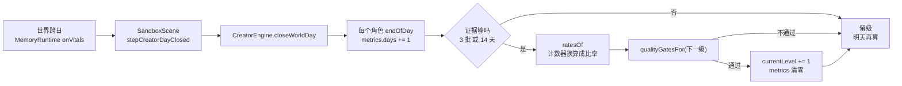
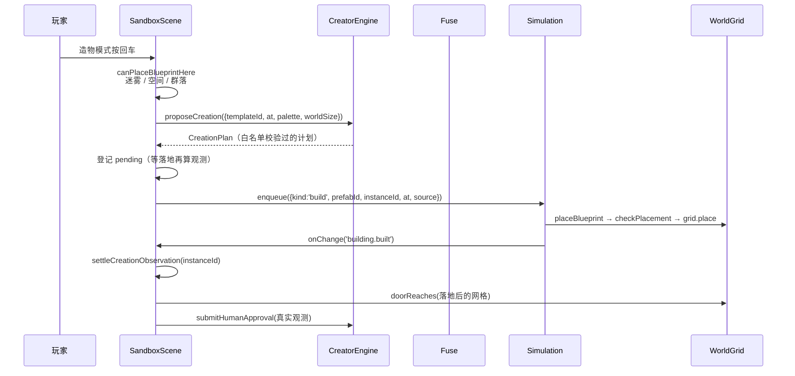
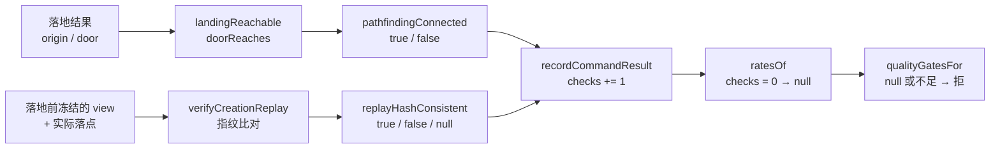

# 外环造物主讲解：它为什么存在、怎么转起来

> 写给第一次读这套代码的人：你不需要先记住函数名。本文先讲**为什么**，再用三条链路
> 把函数串起来，最后才是逐函数表。所有关键结论后面都有行号引用，可以按需跳读。
>
> 建议阅读顺序：一 → 二 → 三.2（一次造物的完整路径）→ 三.3（指标怎么变成门禁）→ 五。
> 三.1（日结算与晋级）可以在看完 3.2、3.3 之后再回头读。

## 一、这套东西到底想做什么

这个仓库里的世界可以被两种方式改变：玩家自己下命令（包括手动造物），或者 LLM 按白名单
输出结构化命令。**外环造物主**是第三种：一组住在客户端、看着世界状态、自己判断
「这个镇子还缺什么」并提议建造的角色。它要解决的不是「生成一栋楼」——那件事
`placeBlueprint` 早就会做——而是**「谁来持续地提出下一步该建什么，并且凭什么相信它」**。

所以外环的核心不是生成能力，而是**自治等级**：它必须先证明自己，才逐渐获得
「不用人确认」的权限。玩家手动造物仍然是基线；外环只决定「建什么、建在哪」，
最后的落位、占格、铺路、事件回写，全部走玩家手动造物也在走的那一条
`Simulation.enqueue` 通道（[SandboxScene.ts](file:///D:/project/pixel-world-engine/world-client/src/scenes/SandboxScene.ts#L1748-L1758)、
[simulation.ts](file:///D:/project/pixel-world-engine/world-client/src/world/simulation.ts#L707-L710)）。

### 每一级，作为玩家你会看到什么

| 等级 | 玩家看到的具体差别 | 代码里的判据 |
|---|---|---|
| **L0** | 你自己进造物模式、移动幽灵、按回车。外环即使算出「缺一座候车亭」，也**不会**替你建。 | `evaluateFuseDecision` 对 L0 返回 `requireReview`（[fuse.ts](file:///D:/project/pixel-world-engine/world-client/src/world/creator/fuse.ts#L683-L685)） |
| **L1** | 和 L0 在操作上一样：每栋都要你按回车。差别是它开始攒「这一天世界稳不稳」的证据。 | 仍然 `requireReview`（[fuse.ts](file:///D:/project/pixel-world-engine/world-client/src/world/creator/fuse.ts#L668-L670)）；按天结算见 `endOfDay`（[fuse.ts](file:///D:/project/pixel-world-engine/world-client/src/world/creator/fuse.ts#L307-L327)） |
| **L2** | 某一天你什么都没点，镇子里自己多了一栋楼。前提是它这一级的通过率记录够好，而且世界确实缺那栋。 | `schemaPassRate >= 0.95` 才 `allow`（[fuse.ts](file:///D:/project/pixel-world-engine/world-client/src/world/creator/fuse.ts#L689-L693)） |
| **L3** | 大部分日子它自己建；**大约十分之一的日子**它不建，因为那天被抽中「要人看一眼」。当前实现里这次机会只是被跳过，没有等你确认的队列。 | `sampleTick` + `sampledIn` 10% 抽检（[fuse.ts](file:///D:/project/pixel-world-engine/world-client/src/world/creator/fuse.ts#L696-L721)） |
| **L4** | 完全不再问你。注意：当前只做到「不再拦住它」，导演该在异常时发出的报警还没有接到界面上。 | 到 L4 直接 `allow`（[fuse.ts](file:///D:/project/pixel-world-engine/world-client/src/world/creator/fuse.ts#L664-L666)） |

一个具体例子：灯潮界有 **10 个模板**，开局只落位 **9 栋**，缺的是 `waiting_shelter`
（[pack.ts](file:///D:/project/pixel-world-engine/world-client/src/settings/dengchao/pack.ts#L116-L158)）。
所以在 L0/L1，玩家必须自己把这栋补上；一旦补齐，覆盖率从 9/10 = 0.9 变成 10/10 = 1.0，
才够 L2 门禁要求的 95%（[fuse.ts](file:///D:/project/pixel-world-engine/world-client/src/world/creator/fuse.ts#L621-L625)）。
这就是「外环提议」和「玩家手动」在同一张图上的配合方式。

## 二、核心概念先讲清

### 世界种子（`worldSeed`）

**一句话**：一个字符串，代表「这是哪一个世界」；同一个种子 + 同一串输入必须得到同一份产出。
**为什么需要**：外环要挑模板、挑落点，还要事后回放比对；只要有一步用了 `Math.random`
或「默认种子」，两次运行就会分岔，回放门禁永远没有意义。**在哪**：场景用设定集 id 当种子
（[SandboxScene.ts](file:///D:/project/pixel-world-engine/world-client/src/scenes/SandboxScene.ts#L780-L785)），
引擎把它拼进 `seedOf(worldSeed, day, 'creator', …)`（[engine.ts](file:///D:/project/pixel-world-engine/world-client/src/creator/engine.ts#L435-L449)），
底层是 FNV-1a（[seed.ts](file:///D:/project/pixel-world-engine/world-client/src/world/memory/seed.ts#L12-L36)）。

### 世界时间（`worldTime`）

**一句话**：由 `Simulation` 维护的毫秒时钟，不是墙钟。
**为什么需要**：同一条输入序列回放两次，如果日志时间戳取 `Date.now()`，两份日志一定不同；
而 L4 的门禁恰好是「同种子回放哈希一致」。**在哪**：场景把 `() => snapshot.now` 递进引擎
（[SandboxScene.ts](file:///D:/project/pixel-world-engine/world-client/src/scenes/SandboxScene.ts#L781-L785)），
熔断器的日志时间戳与升级时间都从这里取（[fuse.ts](file:///D:/project/pixel-world-engine/world-client/src/world/creator/fuse.ts#L187-L206)）。
一个世界日是 86,400,000 毫秒（[config.ts](file:///D:/project/pixel-world-engine/world-client/src/world/memory/config.ts#L47)）。

### `CreatorWorldView`：引擎看到的世界

**一句话**：四样东西——第几天、已经有哪些模板、宽高、以及「这个位置能不能落」这个谓词。
**为什么需要**：世界权威状态在 `Simulation`；引擎不该拥有第二份网格，否则两份状态一分岔，
它算出来的落点和场景看到的网格就不是同一张图。**在哪**：接口定义见
[engine.ts](file:///D:/project/pixel-world-engine/world-client/src/creator/engine.ts#L115-L131)，
场景实现见 [SandboxScene.ts](file:///D:/project/pixel-world-engine/world-client/src/scenes/SandboxScene.ts#L1151-L1165)；
`canPlace` 用的是与手动造物同一套判据（迷雾 + `checkPlacement` + 群落环）。

### `freezeCreatorView`：为什么要冻结

**一句话**：把「此刻每个候选模板在每个格子能不能落」算成位图，之后重跑都用这份位图。
**为什么需要**：`canPlace` 通常闭包在**活网格**上。楼一落地，原点那格就变成占用；
不冻结的话，「重跑」会跳过它、挑下一个位置——那是新算一次，不是回放。**在哪**：
[landing.ts](file:///D:/project/pixel-world-engine/world-client/src/creator/landing.ts#L96-L133)，
场景在跨日自动提议时构造冻结视图（[SandboxScene.ts](file:///D:/project/pixel-world-engine/world-client/src/scenes/SandboxScene.ts#L1061-L1081)）。

### `CreationProposal` / `CreationPlan`：一次提议包含什么

**一句话**：`CreationPlan` 是「模板 + 落点 + 已解析配色」；`CreationProposal` 在它上面再加
一句给人看的原因。**为什么需要**：造物必须是可校验、可入队的数据，不是一段自然语言；
`reason` 只用于日志和界面，不参与落位。**在哪**：`CreationPlan` 见
[creator-schema.ts](file:///D:/project/pixel-world-engine/world-client/src/world/creator-schema.ts#L27-L33)，
`CreationProposal` 见 [engine.ts](file:///D:/project/pixel-world-engine/world-client/src/creator/engine.ts#L133-L136)。
自动提议的字段来源：模板从「缺的模板列表」里按种子挑，落点从种子算出的起点开始行优先扫描，
配色直接取设定集装载时解析好的模板配色（[engine.ts](file:///D:/project/pixel-world-engine/world-client/src/creator/engine.ts#L429-L463)）。
手动造物走 `proposeCreation`，返回 `CreationPlan`，没有 `reason`（[engine.ts](file:///D:/project/pixel-world-engine/world-client/src/creator/engine.ts#L465-L492)）。

### 门禁（gate）与指标（metric）

**一句话**：门禁是「升到下一级需要什么数」，指标是「这次真的观察到了什么数」。
**为什么必须分开**：`replayHashConsistencyRate: 1.0` 曾经挂在配置表里，读起来像「实测回放
一致率 100%」；而真正算它的地方在别处，没跑过就该是 `null`。名字混用会让「要求」被当成
「已达标」。现在配置表改叫 `gateRequirements`，并在注释里写明它不提供读数
（[config.ts](file:///D:/project/pixel-world-engine/world-client/src/world/creator/config.ts#L51-L68)）；
观测值只存在于 `MetricWindow` 计数器（[fuse.ts](file:///D:/project/pixel-world-engine/world-client/src/world/creator/fuse.ts#L66-L99)），
由 `ratesOf` 算出来（[fuse.ts](file:///D:/project/pixel-world-engine/world-client/src/world/creator/fuse.ts#L589-L607)）。
更早的版本里 `submitHumanApproval` 一次写死七个满分，等于每次人工点击都替所有门禁背书；
那段代码已经删掉，理由写在 [engine.ts](file:///D:/project/pixel-world-engine/world-client/src/creator/engine.ts#L315-L347)。

### 熔断

**一句话**：一旦出现「拒绝率 >10%」「不变式违反 ≥1 次」「有人回滚」中的任意一条，角色
立刻掉回 L1 并进入 `isFused`；熔断期间它不再记录证据、也不再尝试升级，直到有人跑过回归集。
**为什么需要**：爬梯是单向上升的棘轮，没有熔断就会「出过事的模块照样继续升」。**在哪**：
触发条件 [fuse.ts](file:///D:/project/pixel-world-engine/world-client/src/world/creator/fuse.ts#L482-L515)，
熔断后 `recordCommandResult` 直接返回（[fuse.ts](file:///D:/project/pixel-world-engine/world-client/src/world/creator/fuse.ts#L257-L258)），
`endOfDay` 也在 `isFused` 时提前返回（[fuse.ts](file:///D:/project/pixel-world-engine/world-client/src/world/creator/fuse.ts#L314)）。
这就是「climb 被中断」：不是降一级，而是**当前这一级的证据窗口整段作废**，恢复必须重新
过回归集（[fuse.ts](file:///D:/project/pixel-world-engine/world-client/src/world/creator/fuse.ts#L356-L392)）。

## 三、三条链路

### 3.1 日结算与晋级

触发点是记忆层关账：`MemoryRuntime` 在跨日时回调 `onVitals`
（[SandboxScene.ts](file:///D:/project/pixel-world-engine/world-client/src/scenes/SandboxScene.ts#L730-L734)），
场景先把日子交给外环（[SandboxScene.ts](file:///D:/project/pixel-world-engine/world-client/src/scenes/SandboxScene.ts#L1047-L1063)）。
`closeWorldDay` 对六个角色各调一次 `endOfDay`（[engine.ts](file:///D:/project/pixel-world-engine/world-client/src/creator/engine.ts#L355-L359)），
后者只做两件事：`metrics.days++`，然后 `tryClimbUp`（[fuse.ts](file:///D:/project/pixel-world-engine/world-client/src/world/creator/fuse.ts#L307-L327)）。

**「熬 14 个世界日」具体指什么**：在**当前这一级**的窗口里，累计 14 次 `endOfDay`
（`climbRequiredDays: 14`，[fuse.ts](file:///D:/project/pixel-world-engine/world-client/src/world/creator/fuse.ts#L167-L170)）。
一个世界日 86,400 秒，默认 `timeScale = 6` 时现实里约 **4 小时**
（沙盒里的换算，属于推断，因为倍率只作用于喂给 `Simulation` 的步长）。

**为什么按天而不是按次**：玩家可以一分钟内连点十次造物；如果「十次点击」等于「十天」，
那么一个下午就能把 L0 刷到 L4，而这十次全是在同一个世界状态下做的同一种操作。
按天结算要求跨过真正的世界日，中间世界自己走过、记忆关过账、情绪与传播更新过——
这才叫「稳定运行了一段时间」。

**窗口怎么算**：窗口不是全局历史，而是「这一级、这一次升级之后」的计数。升级那一刻
`metrics` 被整个换掉（[fuse.ts](file:///D:/project/pixel-world-engine/world-client/src/world/creator/fuse.ts#L478-L479)），
熔断时也会作废。于是 L0→L1→L2 最少是两个 14 天，而不是一个 14 天连跳两级。

**一个带数字的走法**（灯潮界，10 个模板）：
第 1 天玩家手建 `waiting_shelter`，覆盖率 10/10 = 1.0；第 1–13 天每天关账一次，
`days` 到 13，不够；第 14 天关账，`days = 14`，通过率 1.0、人工修改率 0、覆盖率 1.0，
门禁通过 → L1。
如果中途有 3 次造物、其中 2 次门口连不出去，寻路率就是 2/3 ≈ 0.67；L3 门禁要求正好 1，
于是卡在 L2（[fuse.ts](file:///D:/project/pixel-world-engine/world-client/src/world/creator/fuse.ts#L627-L631)）。

**覆盖率现在每次造物都重新观测。** 升级仍然清零窗口、覆盖率仍然变回 `null`，但每个落地结算
都会用**当时的快照**现算「已落地模板数 / 模板总数」并记一次。于是清零之后只要发生一次造物——
包括「拆掉一栋、再把同一模板建回来」——`coverageChecks` 就会 >0、`coverageRate` 恢复成真实值，
L1→L2 随之可过（[creator-business-rules.test.ts](file:///D:/project/pixel-world-engine/world-client/test/creator-business-rules.test.ts#L401-L467)）。

**但零造物的世界仍然过不去**：没有新观测时覆盖率还是 `null`，门禁不会默认放行
（[creator-business-rules.test.ts](file:///D:/project/pixel-world-engine/world-client/test/creator-business-rules.test.ts#L469-L484)）。
也就是说，解除死锁靠的是「发生了一次造物、并真的数了一遍」，不是「清零后自动通过」。

注意：生产路径里**只走了「14 天」这条腿**。`endOfBatch` 没有任何生产调用方
（[fuse.ts](file:///D:/project/pixel-world-engine/world-client/src/world/creator/fuse.ts#L298-L304)，
`src/` 下除定义外零命中），所以「连续 3 批」只在测试里用到。

### 3.2 一次造物的完整路径（手动）

按顺序：

1. **玩家选模板与位置**。场景先用与幽灵预览同一套的 `canPlaceBlueprintHere` 拦迷雾、
   空间与群落（[SandboxScene.ts](file:///D:/project/pixel-world-engine/world-client/src/scenes/SandboxScene.ts#L1730-L1734)）。
2. **拼造物意图**。模板自带的配色是**色值**，而 schema 只接受 token 名，所以先用当前世界的
   色板反查成 token（[SandboxScene.ts](file:///D:/project/pixel-world-engine/world-client/src/scenes/SandboxScene.ts#L1742-L1753)）。
   这一步在灯潮界尤其重要：同名 token 在不同设定集里是不同颜色。
3. **校验**。`proposeCreation` 调 `parseCreationPlan`，后者再调 `parsePlaceBuildingIntent`，
   形状规则只有一份实现（[engine.ts](file:///D:/project/pixel-world-engine/world-client/src/creator/engine.ts#L475-L492)、
   [creator-schema.ts](file:///D:/project/pixel-world-engine/world-client/src/world/creator-schema.ts#L41-L70)）。
4. **入队，而不是直接写世界**。`instanceId` 在这里才由 `sim.nextInstanceId` 领；位置用计划里的
   `at`，`source` 写清来由（[SandboxScene.ts](file:///D:/project/pixel-world-engine/world-client/src/scenes/SandboxScene.ts#L1765-L1775)）。
5. **落地**。下一拍 `Simulation.update` 结算，`build` 先查「同模板已有一栋」，再调
   `spawnBuilding`；后者最终走 `placeBlueprint`：`checkPlacement` → `grid.place` 把占地写成
   不可走、门口写成可走（[simulation.ts](file:///D:/project/pixel-world-engine/world-client/src/world/simulation.ts#L2134-L2153)、
   [setup.ts](file:///D:/project/pixel-world-engine/world-client/src/world/setup.ts#L498-L524)、
   [grid.ts](file:///D:/project/pixel-world-engine/world-client/src/world/grid.ts#L292-L309)）。
6. **回写事件**。楼进了 `buildings` 之后才 `announce('building.built')`（[simulation.ts](file:///D:/project/pixel-world-engine/world-client/src/world/simulation.ts#L2154-L2170)）。
7. **事后结算**。场景的 `onChange` 收到这条事件，调 `settleCreationObservation`
   （[SandboxScene.ts](file:///D:/project/pixel-world-engine/world-client/src/scenes/SandboxScene.ts#L611-L625)、
   [SandboxScene.ts](file:///D:/project/pixel-world-engine/world-client/src/scenes/SandboxScene.ts#L1100-L1147)）。
   它从 `sim.snapshot()` 里取真实落点（[SandboxScene.ts](file:///D:/project/pixel-world-engine/world-client/src/scenes/SandboxScene.ts#L1149-L1158)），
   再用落地后的网格判可达、用落地前冻住的输入跑回放，最后把快照与网格交给
   `checkLandedBuilding` 跑第二重业务规则（冲突 + 不变式）。
8. **记指标**。只有到这一步才调 `submitHumanApproval`，把真实观测交进去。

**逐字段**：`templateId` = 玩家选的模板；`at` = 幽灵格；`palette` = 模板配色换成的四个 token 名；
`worldSize` = 网格宽高；`day` = 确认那一刻的 `snapshot.now / DAY_MS`；
`instanceId` 在入队时才分配；`source` 只是来由，不参与落位；
`coverageRate` 是**落地结算那一刻**用快照现算的「已落地模板数 / 模板总数」，不是登记时的缓存
（[business-rules.ts](file:///D:/project/pixel-world-engine/world-client/src/creator/business-rules.ts#L44-L65)）。

**失败会怎样**：落位被拒时不会有 `building.built`，于是 `settleCreationObservation` 什么也不记。
这是刻意的——没有真实落地结果，就没有「事后观测」可记。

### 3.3 指标从观测到门禁

- **可达性**：`landingReachable` 直接返回布尔值，落地后的网格已经含新楼的不可走占地
  （[landing.ts](file:///D:/project/pixel-world-engine/world-client/src/creator/landing.ts#L30-L38)）。
  进计数器时 `pathfindingChecks++`，可达则 `pathfindingConnectedCount++`
  （[fuse.ts](file:///D:/project/pixel-world-engine/world-client/src/world/creator/fuse.ts#L269-L272)）；
  比率是「连通的次数 / 检查过的次数」（[fuse.ts](file:///D:/project/pixel-world-engine/world-client/src/world/creator/fuse.ts#L598)）。
- **回放**：`verifyCreationReplay` 返回 `true` / `false` / `null`
  （[landing.ts](file:///D:/project/pixel-world-engine/world-client/src/creator/landing.ts#L63-L71)）。
  只有 `true`/`false` 才会被递进 `submitHumanApproval`；`null` 时场景连这个字段都不传
  （[SandboxScene.ts](file:///D:/project/pixel-world-engine/world-client/src/scenes/SandboxScene.ts#L1110-L1128)），
  于是 `replayChecks` 保持 0，比率是 `null`。

**`null`、`0`、`false` 在门禁里各是什么意思**：

| 值 | 含义 | 门禁结果 | 例子 |
|---|---|---|---|
| `null` | 分母为 0：这一项**根本没测过** | 不通过 | 一次造物都没跑过回放 → `replayChecks = 0` → L4 卡住（[fuse.ts](file:///D:/project/pixel-world-engine/world-client/src/world/creator/fuse.ts#L633-L636)） |
| `0` | 测过，但通过率为 0（或碰撞率恰为 0） | 看方向：`pathfinding = 0` 不通过，`collision = 0` 是好事 | 3 次造物全部门被围死 → 寻路率 0/3 = 0 → L3 卡住 |
| `false` | 单次观测失败；进计数器后变成比率 0 | 不通过 | 一次回放指纹对不上 → `replayChecks = 1`、`consistent = 0` → 比率 0 |

三者的关键区别是：`null` 是「没测」，`0` 是「测了，全失败」，`false` 是「这一次失败」。
把 `null` 当 `0` 会把「没检查」记成「检查失败」；把 `null` 当 `1` 就是「白送免审」。
门禁对 `null` 的处置是**拒绝升级**，不是判失败（[fuse.ts](file:///D:/project/pixel-world-engine/world-client/src/world/creator/fuse.ts#L620-L639)）。

**「白送」问题的根源**：`conflictCount` 与 `invariantViolationCount` 曾经是**只有分子、没有分母**
的计数器。没人观测过冲突，它照样是 0；而 L2 的门禁写的是「冲突数 > 0 才拒」
（[fuse.ts](file:///D:/project/pixel-world-engine/world-client/src/world/creator/fuse.ts#L621-L625)）。
于是 50 次造物一次冲突都没查过，门禁仍然认为「冲突 0，达标」。这和 `replayHashConsistencyRate: 1.0`
是同一类错误，只是形状不同：一个是把要求写成读数，一个是把「没查」写成「零」。

现在这两项有了分母：`conflictChecks` / `invariantChecks`。落地后 `checkLandedBuilding`
真跑一遍业务规则，把 `hasConflict` / `invariantViolated` 的布尔值交回计数器；
`undefined` 不碰分母，`false` 才让分母 +1。门禁改成「分母为 0 就拒绝」
（[fuse.ts](file:///D:/project/pixel-world-engine/world-client/src/world/creator/fuse.ts#L646-L654)）。
落地检查的实现见 [business-rules.ts](file:///D:/project/pixel-world-engine/world-client/src/creator/business-rules.ts#L49-L73)。

仍然存在的一处同类缺口：生产里只有**落地成功**才会调 `submitHumanApproval`，
被 schema 或落位拒绝的尝试根本不进 `recordCommandResult`。所以 `totalCommands` 只数成功，
`schemaPassRate` 恒为 1，`manualModificationRate` 恒为 0——L1→L2 的「通过率 ≥98%」
这一条依旧没有失败侧的证据。这一项没有在本轮改动，可选做法见第六节。

## 四、逐函数表

| 函数 | 职责 | 输入 → 输出 | 谁调用 / 什么时机 |
|---|---|---|---|
| `planCreation`（[engine.ts](file:///D:/project/pixel-world-engine/world-client/src/creator/engine.ts#L416-L463)） | 从缺失模板里按种子挑一个，再按种子扫一个合规落点 | `CreatorWorldView` → `CreationProposal \| null` | 场景在跨日、且熔断器说 `allow` 时调用 |
| `proposeCreation`（[engine.ts](file:///D:/project/pixel-world-engine/world-client/src/creator/engine.ts#L465-L492)） | 校验玩家给的模板/位置/配色，返回计划 | 请求对象 → `CreationPlan`（失败抛 schema 错误） | `confirmCreation` 在玩家按回车后调用 |
| `executeCommand`（[engine.ts](file:///D:/project/pixel-world-engine/world-client/src/creator/engine.ts#L269-L313)） | 把熔断决策翻成 `allowed/reason` | 角色 + 指令 → `{allowed, level?, reason?}` | 目前只有测试调用；生产直接用 `getFuseDecision` |
| `submitHumanApproval`（[engine.ts](file:///D:/project/pixel-world-engine/world-client/src/creator/engine.ts#L332-L347)） | 记「人点头了 + 这次真观测到什么」 | 观测对象 → `void`（写进计数器） | 落地成功后由场景调用；测试也直接调 |
| `recordCommandResult`（[fuse.ts](file:///D:/project/pixel-world-engine/world-client/src/world/creator/fuse.ts#L237-L296)） | 按字段累加分子/分母，并实时查降级 | 观测对象 → `void` | 只由 `submitHumanApproval` 调 |
| `closeWorldDay`（[engine.ts](file:///D:/project/pixel-world-engine/world-client/src/creator/engine.ts#L349-L359)） | 六个角色各结算一个世界日 | 无 → `void` | 场景跨日时调 |
| `qualityGatesFor`（[fuse.ts](file:///D:/project/pixel-world-engine/world-client/src/world/creator/fuse.ts#L609-L639)） | 按「要升到的等级」逐项查质量门禁 | 等级 + `MetricRates` → 布尔 | `tryClimbUp` 在证据够之后调用 |
| `landingReachable`（[landing.ts](file:///D:/project/pixel-world-engine/world-client/src/creator/landing.ts#L30-L38)） | 落地后判门口到镇心 | `BuiltWorld` + 落地结果 → 布尔 | `settleCreationObservation` 里调 |
| `creationFingerprint`（[landing.ts](file:///D:/project/pixel-world-engine/world-client/src/creator/landing.ts#L72-L94)） | 计划内容 + 落地点的指纹 | 计划 + 落地 + 天 → 8 位十六进制 | 只由 `verifyCreationReplay` 调 |
| `verifyCreationReplay`（[landing.ts](file:///D:/project/pixel-world-engine/world-client/src/creator/landing.ts#L40-L71)） | 比「实际」与「重跑计划推出的应当」 | 计划/重跑计划/落地/蓝图 → 布尔或 `null` | `settleCreationObservation` 里调 |
| `settleCreationObservation`（[SandboxScene.ts](file:///D:/project/pixel-world-engine/world-client/src/scenes/SandboxScene.ts#L1100-L1147)） | 落地后补可达/回放/业务规则三项观测并记账 | `instanceId` → `void` | `onChange` 收到 `building.built` 时调 |
| `checkLandedBuilding`（[business-rules.ts](file:///D:/project/pixel-world-engine/world-client/src/creator/business-rules.ts#L42-L73)） | 把落地结果包成一条指令，跑第二重门禁 | 世界投影 + 落地 → `{hasConflict, invariantViolated}` | `settleCreationObservation` 里调 |
| `creationCoverage`（[business-rules.ts](file:///D:/project/pixel-world-engine/world-client/src/creator/business-rules.ts#L44-L65)） | 已落地模板数 / 模板总数（按 `prefabId` 去重） | 落地后的快照 → 0–1 | `settleCreationObservation` 里现算 |
| `freezeCreatorView`（[landing.ts](file:///D:/project/pixel-world-engine/world-client/src/creator/landing.ts#L96-L133)） | 把落位许可冻成位图 | 视图 + 候选模板 → 冻结视图 | 场景跨日自动提议时调 |
| `landedCreationOf`（[SandboxScene.ts](file:///D:/project/pixel-world-engine/world-client/src/scenes/SandboxScene.ts#L1149-L1158)） | 从 `Simulation` 快照找那一栋 | `instanceId` → `LandedCreation \| null` | `settleCreationObservation` 里调 |

## 五、五个最容易卡住的点

### 1. 落位前判寻路，为什么一定乐观

**错误理解**：「门口那一格是空的，所以门口一定连得出去。」
**正确理解**：`grid.place` 会把**整块占地**写成 `walkable = false`，只有门口那一格重新设为
可走（[grid.ts](file:///D:/project/pixel-world-engine/world-client/src/world/grid.ts#L292-L309)）。
落位前，占地那些格子还是可走的，BFS 会直接从「未来的墙」里穿过去。
具体到一栋 5×4 的楼：门在 `(20, 16)`，占地盖住 `x 18–22, y 12–15`。落位前，
从门往上走到 `(20, 15)` 是通的；落位后那格是墙，如果左右和下方也被围住，门就死了。
所以 `pathfindingConnected` 只能等 `building.built` 之后算
（[landing.ts](file:///D:/project/pixel-world-engine/world-client/src/creator/landing.ts#L30-L38)）。

### 2. 回放为什么不能拿「实际落地」当两边的共同答案

**错误理解**：「反正是比两次的结果，两边都用实际落地更省事。」
**正确理解**：那样比的是同一份数据，永远相等，门禁恒为 `true`。`verifyCreationReplay` 比较的是
「实际计划 + 实际落地」与「重跑计划 + **由重跑计划按蓝图门口偏移推出的期望落地**」
（[landing.ts](file:///D:/project/pixel-world-engine/world-client/src/creator/landing.ts#L63-L71)，
期望落点见 [landing.ts](file:///D:/project/pixel-world-engine/world-client/src/creator/landing.ts#L135-L147)）。
所以把重跑计划的 `at.x` 加 1，或把实际落地的 `origin.x` 加 1，都会让两侧对不上；
测试里这两个方向各有一条（[creator-landing.test.ts](file:///D:/project/pixel-world-engine/world-client/test/creator-landing.test.ts#L238-L297)）。

### 3. `null` 为什么既不是通过也不是失败

**错误理解**：「没测就当 0，反正保守。」或「没测就当满分，先让它过。」
**正确理解**：`null` 是「分母为 0」，处置是**回去补测**。当 0 会让它看起来像「测了，
而且全失败」；当 1 就是免审白送。门禁对它的判定是拒绝，但拒绝的理由是「没证据」，
不是「证据说它坏」（[fuse.ts](file:///D:/project/pixel-world-engine/world-client/src/world/creator/fuse.ts#L620-L639)）。

### 4. `conflictCount <= 0` 为什么曾经会白送

**错误理解**：「冲突数是 0，说明没有冲突，可以升 L2。」
**曾经的白送**：它只有分子、没有分母。没人传 `hasConflict` 时计数器保持 0，
而门禁只看「> 0 才拒」——「没查」被读成「零冲突」。
**现在的处理**：`conflictChecks` / `invariantChecks` 是分母；没传就是 0，门禁直接拒绝
（[fuse.ts](file:///D:/project/pixel-world-engine/world-client/src/world/creator/fuse.ts#L646-L654)）。
`false` 才让分母 +1，于是「查了且零」与「没查」被分开。落地时真跑检查的入口是
`checkLandedBuilding`（[business-rules.ts](file:///D:/project/pixel-world-engine/world-client/src/creator/business-rules.ts#L42-L73)）。
同样的坑还剩一个：生产里拒绝的尝试根本不记账，`schemaPassRate` 恒为 1。

### 5. 外环状态不存档，玩家会经历什么

**错误理解**：「世界存档了，外环等级当然也在。」
**正确理解**：v5 存档里没有外环的等级、指标窗口或导演历史；这一版新增的只有
`world.memory` 那段记忆（[save.ts](file:///D:/project/pixel-world-engine/world-client/src/world/save.ts#L458-L462)）。
重进世界等于新建一个 `CreatorEngine`，所有角色回到 L0：
**镇子会突然不再自己建东西**，直到玩家重新手动造物、再攒够升级窗口（至少两个 14 天，
而且中间还得有可以观测的造物——见 3.1 提到的覆盖率限制）。
对玩家来说，这看起来像「自治功能时灵时不灵」；对实现者来说，这是一条明确的边界：
要跨会话保持，就得扩存档契约，而那是另一个决定。

## 六、往下做：B 已实现，还剩两件事

**B（已实现）：落地时真跑业务规则。** `checkLandedBuilding`（[business-rules.ts](file:///D:/project/pixel-world-engine/world-client/src/creator/business-rules.ts#L42-L73)）
把一栋楼的落位包成一条 `PlaceBuilding` 指令，交给既有的 `runBusinessRulesCheck`；
`WorldStateView` 的数据只有两处：`Simulation.snapshot()`（楼与摆件）与 `WorldGrid`（可走性）。
`getOccupiedCells` 是**别的楼**的占地投影，自己会被排除。
「检查器接口是 `Promise`」这件事只差一个 microtask：所有读都是同步的，场景用 `.then` 结算，
不跨帧、不跨日（[SandboxScene.ts](file:///D:/project/pixel-world-engine/world-client/src/scenes/SandboxScene.ts#L1124-L1146)）。

实现的不变式与各自的违反条件：

1. **占地越界**：原点或 `w×h` 超出世界。正常落位过不了 `checkPlacement`，但检查器面对的是
   快照/导入数据，所以这一条仍要查。
2. **门口落在占地内**：蓝图门口偏移指进自家占地——那会让楼里的门永远走不出去。
3. **占地覆盖镇心**：占地包含 `world.altar`。装载期只查「门口到得了镇心」，没查「镇心能不能被盖」，
   所以这条是**收紧**：它不撤楼，只把这次落地记成一次不变式违反。
4. **占地覆盖既有摆件**：占地包含一盏灯/一棵树/一幅幌布。摆件不占格，`checkPlacement` 拦不住，
   这是最容易被真实落位踩到的一条。
5. **门口到不了镇心**：用落地后的网格判 `doorReaches`。楼自己可能把唯一通路堵死。

冲突只有一条：**占地与既有建筑重叠**。正常落位不会产生，测试用一个「两栋楼压在同一块地」的快照
来构造它（[creator-business-rules.test.ts](file:///D:/project/pixel-world-engine/world-client/test/creator-business-rules.test.ts#L206-L249)）。

**A（没有采用）：只加分母，不真跑检查。** 那样 L2 在生产里会永远升不上去——分母有了，
但没有检查来源。加分母是必要的，但它必须和 B 一起落地才有意义；只做 A 等于把门禁锁死。

**仍然存在的两件事**：

- **`schemaPassRate` 的失败侧缺失。** 生产里只有落地成功才记账，被 schema/落位拒绝的尝试不进
  `recordCommandResult`，所以通过率恒为 1，人工修改率恒为 0。可选做法：把被拒尝试也记成
  `schemaPassed: false`（但玩家点错位置会不会连累外环，是个产品判断）；或只记外环自动提议的失败；
  或正式把这条门禁改成「落地成功率」并接受这个口径。三种都要先定语义，不宜顺手改。
- **覆盖率的卡死已按拍板解除。** 每次造物结算都现算覆盖率并记一次，所以「拆掉一栋、再把同一
  模板建回来」也会让 `coverageChecks > 0`、`coverageRate = 1.0`，L1→L2 可过
  （[creator-business-rules.test.ts](file:///D:/project/pixel-world-engine/world-client/test/creator-business-rules.test.ts#L401-L467)）。
  前提是**确实发生了一次造物**：零造物的世界仍停在 L1（同文件的 L469-L484），
  那是「不白送」的另一半，不是遗漏。

另有两条已知但**不影响当前 fuse 链路**的事项：`metrics.ts` 里的 `relationSymmetryRate`
只有 `null` 路径（没有关系图数据源），而 `metrics.ts` 本身还没有生产调用方；
L4 的「报警」也还没有接到界面。
