# 可验证流程总表（2026-11-04 至 2026-11-06）

本文把这几天各条 worker 线产出的东西逐项转成「可复制执行、有数值判据、有反向用例、有产物落点」的流程。

> 口径说明：本文中的测量值若非判据，一律标注日期或改为取当前值的命令；判据（阈值、面积上限、块数上限、预算）保持写死。

> **2026-11-07 补形态 + 复跑**：每条流程有了稳定 ID `F1`–`F10`，任务节点 ID `T1`–`T10`，并补齐三件套（第 1.3–1.5 节）。同日按「能跑就真跑」逐条执行，逐条读数在 1.1 节、降级说明在各流程末尾的「2026-11-07 复跑」段。**原有判据与结论一条未改**；与本次读数冲突处只增注，不删原句。

## 0. 规范依据与盘点边界

- 本机存在 `poteto-mode`，来源 `backnotprop/pstack@poteto-mode`，安装命令 `npx skills add backnotprop/pstack@poteto-mode -g -y`，装到 `C:\Users\18712\.agents\skills\poteto-mode`，并已通过 `C:\Users\18712\.trae-cn\skills\poteto-mode` 的 Junction 对 Trae 可见。
- 本文采用的规范文件是 poteto-mode 安装目录下的 SKILL.md（本机路径 C:\Users\18712\.agents\skills\poteto-mode\SKILL.md）的 `## Principles` 与 `## Playbooks`（Investigation），以及本地 pstack 叶技能 `principle-build-the-lever`、`principle-prove-it-works`、`principle-sequence-verifiable-units`、`principle-explain-the-number`、`principle-encode-lessons-in-structure`。
- 盘点阶段按 Investigation 的只读口径执行：只新增文档与脚本，不改任何既有判据的数值、不放宽阈值、不删用例；不 `stash`、不动别人的工作树。入库（合 main 与 push）由用户在本轮单独授权，动作记录见第 7 节。
- 证据标签：`[实测]` 本次实际运行；`[证据]` 读自已归档的证据文件；`[文档]` 只有书面记录、无执行判据。
- 端口纪律：**5188 / 5191 / 5202 / 5203 一律不用**。下面所有浏览器命令都显式改到 `5211`；客户端 URL 默认值已统一跟随 `PIXEL_WORLD_CLIENT_PORT`（未设置时回落 `5211`），见 `smoke.mjs:29`、`check-render-budget.mjs:43` 与四个抓拍脚本 `homecoming-capture.mjs:17`、`interior-capture.mjs:18`、`material-capture.mjs:28`、`material-determinism.mjs:22`。多工作树并行时每棵树必须导出自己的 `PIXEL_WORLD_CLIENT_PORT`；漏设时身份闸会判红，不会静默测到隔壁树的应用。

## 1. 总表

| # | ID | 流程 | 触发命令（摘要） | 判据（摘要） | 反向用例 | 产物 | 现状 | 本次执行（2026-11-07） | 入汇总 |
|---|---|---|---|---|---|---|---|---|---|
| 1 | F1 | 钉子契约 | `node --import ./test/phaser-hooks.mjs --test test/pin-shot-state.test.ts`；浏览器 `check-shot-actor-pin.mjs` | 三档 1200/2800/5000 精确 0.0000%、可见 0.0000%、结构块 0；未登记渲染字段为空 | `five-shift`、`trail-shift` 必须判红（读数跑本流程取） | `EVAL_OUT/*.png`、`runs.json` | 单测与浏览器均可跑（5211）；2026-11-07 复跑落盘在 `tmp/actor-pin`（未跟踪），`eval/screens/actor-pin` 仍空 | 离线 exit=0（26 测试 / 577 ms / 23:43:38）；浏览器 exit=0（48.4 s / 23:50:09） | 单测已入 |
| 2 | F2 | 三层结构差 | `python scripts/screens-diff.py --old ... --new ... --out ... --structure-spec ...` | 精确差任通道 >0；可见差 RGB ≥8；结构块面积落在 `[minArea,maxArea]` | `verify-screens-diff-selfcheck.py` 正/反向自检（例数看脚本），含 2900 与差 7 级必红 | `screens-diff.json`、`masks/*.png` | 自检已跑通；2026-11-07 用 pwe-anim r1/r2 代用图跑真图，exit=1（3 张结构断言失败） | 自检 exit=0（5/5 例 / 1735 ms / 23:43:40）；真图 exit=1（140.9 s / 止 23:47:09） | 已入 |
| 3 | F3 | 相位帧弱判据 | `node scripts/check-phase-frames.mjs --ref ... --cur ...` / `npm run verify:phase` | 区外差 0 px；区内面积 ≤ `ceil(union*1.4)`；块数 ≤ `ceil(union*1.5)` | `--self-test` 平移出区、面积 ×1.5 必红 | stdout（无文件） | 仅 pwe-anim，需 Chromium | **未执行**（汇总 SKIP）：主仓无脚本、无 verify:phase、无 phase-regions.json；前置 = pwe-anim 工作树 + Chromium + r1/r2 截图 | 主仓 SKIP |
| 4 | F4 | 抓拍夹具与账本 | 四个 `check-*.mjs` + `EVAL_OUT`；`verify:reset`、`verify:compare` | 抓拍脚本只测量不判红；ledger 比对逐像素 sha 全等、尺寸相同 | 改一张 PNG 即 `pixel-diff`，`compare` 退出 1 | `*-pixel-ledger.json` | 需浏览器 + 服务；2026-11-07 四支抓拍 exit=0，账本比对仍未跑（工具只在 pwe-anim） | 四支抓拍 exit=0（60 / 40 / 63 / 94 s，23:52:35–23:55:53）；账本比对未执行 | 未入 |
| 5 | F5 | render-budget（硬闸 + 记录项） | `node --import ./test/phaser-hooks.mjs --test test/render-budget-throttle.test.ts`；浏览器 `check-render-budget.mjs` | **硬闸**：指令 <30000、Graphics <40、无 JS 报错；**记录项（不阻塞）**：拖动 ≥0.9 静止、后台 <前台且 ≤1/3 或 ≤12、恢复 ≥0.5 前台 | 单测 `(60,58)`、`(60,21)`、`(37,12.5)`、`NaN` 必红；浏览器反例 `RENDER_BUDGET_FORCE_COMMANDS=20000` 硬闸必红 | `render-budget-samples.json`（`EVAL_OUT` 或 `tmp/render-budget/`） | 单测与浏览器均可跑；2026-11-07 复跑硬闸 3 项 + 记录项 **4** 项（判据写 3 项，多出一项见流程 5） | 离线 exit=0（3 测试 / 419 ms / 23:47:40）；浏览器 exit=0（86.6 s / 23:51:35） | 单测已入 |
| 6 | F6 | 入口配色 9 色位 | `node scripts/audit-palette.mjs --strict` + `test/palette-budget.test.ts` | 世界 ≤24、UI ≤9、并集 ≤32、共享恰为 `#e3a13c`；边框对比 ≥3.0（3.49/3.15 是 2026-11-05 历史读数，见流程 6） | 值层测试换值必红；加第 10 个 UI hex 时 `--strict` 退出 1 | `palette-9/*.txt` | 离线可跑；2026-11-07 复跑两条命令 exit=0 | 离线 exit=0（350 ms / 23:47:40 + 526 ms / 23:43:41）；**第 10 色红例未执行** | 已入 |
| 7 | F7 | 疲劳与睡眠 | `node --import ./test/phaser-hooks.mjs --test test/fatigue.test.ts test/homecoming.test.ts` | 0.5/天、睡 4/天、阈 0.8、跨阈 1.6 天、睡段 0.2 天；默认两天 0 次、强制场景 1 次 | 强制跨阈场景必触发 1 次，默认世界必须 0 | 无 | 离线可跑 | exit=0（15 测试 / 1141 ms / 23:43:42） | 已入 |
| 8 | F8 | 行为/环境/需求 | 六个 `test/*.test.ts` | 规则注册表、环境标志闭集、`delivery_failed` 载荷、旁观分桶 | 交换规则顺序结果变、饥饿到顶必失败、室内只同屋记得 | 无 | 离线可跑；`test:buttons` 404 | exit=0（29 测试 / 3122 ms / 23:43:45） | 已入 |
| 9 | F9 | 账本与旁证 | `node scripts/eval-ledger.ts`、`verify-ledger-selfcheck.ts`、`memory-witnessed-corroboration.test.ts` | 12 必填字段；`script_sha` 不符即红；外部来源必须钉输入；旁证 `violations===0` | 自检绿例 + 六种红例都按预期（例数看脚本） | `eval/ledger.json`、`witnessed-corroboration.json` | 离线可跑；2026-11-07 三条命令 exit=0 | exit=0（265 / 292 / 511 ms，23:43:45–23:43:46） | 已入 |
| 10 | F10 | 动画基线账本 | `node scripts/verify-animation-baseline.mjs` | 157 行、六类 73/29/28/18/2/7、12 位哈希、7 位提交 | `--self-test` 删行/坏哈希/改归类必红 | stdout | 文档在 `pwe-anim`；新增结构校验；2026-11-07 复跑 exit=0 | exit=0（200 ms + 203 ms / 23:43:46） | 已入 |

执行状态口径：`已执行` = 本次实际跑过且退出 0；`未执行` = 本次没有跑，哪怕同一流程在汇总入口里记 SKIP 也不算通过；`浏览器半边未执行` = 一条流程里只有离线半边跑了，浏览器部分登记在第 4 节。

**验证边界（2026-11-07 起补，规范见第 5 节）**：每行结论归四类之一。`5.1` 自动通过 = 命令、退出码、本次读数三者俱在 1.1 节；`5.3` 人工确认 = 确认人、时间、对象三者齐全；`5.4` 人工声称但未验证；`[需人工]` 是形态不是状态。**本次没有退出码的行不写「通过」**：跑过的记 5.1，跑不动的记 5.4「未验证」，只能人跑的记 `[需人工]`，并在 1.2 节写「谁跑 / 判绿口径 / 未覆盖什么」。

> 一条给审计看的口径：本文件所有 `exit=0` 的行按 `5.1` 记账，证据是 1.1 节的命令 + 退出码 + 本次读数；`exit=1` 或没跑的行一律不按通过记。

### 1.1 执行记录（2026-11-07，本机）

工作目录统一为 `world-client`（下表的相对路径都相对它）；浏览器命令一律先起 5211（`--strictPort`，起前查占用、跑完停），产物写 `EVAL_OUT`。时刻是本机**命令结束**时刻。

| 流程 | 命令（摘要） | 退出码 | 耗时 | 时刻 | 输出里最关键的一行 | 边界 |
|---|---|---|---|---|---|---|
| F1 | `node --import ./test/phaser-hooks.mjs --test test/pin-shot-state.test.ts` | 0 | 577 ms | 23:43:38 | `# pass 26` / `# fail 0` | 5.1 |
| F1 | `node scripts/check-shot-actor-pin.mjs`（5211，`EVAL_OUT=tmp/actor-pin`） | 0 | 48.4 s | 23:50:09 | `逐字节负控：三档等待全同；两条反向全异` | 5.1 |
| F2 | `python scripts/verify-screens-diff-selfcheck.py` | 0 | 1735 ms | 23:43:40 | `screens-diff 自检通过：5/5 例按预期判绿或判红` | 5.1 |
| F2 | `python scripts/screens-diff.py --old pwe-anim r1 --new r2 --out tmp/screens-diff/r1-vs-r2 --structure-spec <仓根>/docs/evidence/pin-shots/structure-spec.json` | 1 | 140.9 s | 止 23:47:09 | `结构断言失败 3 张：02-working.png, 03-deliver.png, 05-build.png`（共 152 张图，另有 `stall-motion-rain` 0.17%） | 5.4（红读数，是否代用图不同构待人工判，见 H3） |
| F3 | 无（主仓无 check-phase-frames.mjs、无 `verify:phase`、无 phase-regions.json） | — | — | 未执行 | 汇总入口记 SKIP | `[需人工]`（H1） |
| F4 | `node scripts/check-scene-motion.mjs`（5211） | 0 | 60.0 s | 23:52:35 | `残留…0.00% 像素 0 max=0 池指令 0 / 0` | 5.1 |
| F4 | `node scripts/check-stall-motion.mjs`（5211） | 0 | 40.0 s | 23:53:15 | `帧号 141 168 / 127 150`；`峰值指令 晴 35002 雨 37958` | 5.1 |
| F4 | `node scripts/check-banner-smoke.mjs`（5211） | 0 | 63.3 s | 23:54:19 | `烟囱起飘高度 [164,180,164,532]` 两次相同；`峰值指令 34938` | 5.1 |
| F4 | `node scripts/check-ground-shadow.mjs`（5211，第二次） | 0 | 94.2 s | 23:55:53 | `[记账] 设计目标 30000 / 实测峰值 34666 / 天花板 34666，债务 4666`；`[判据] 绿` | 5.1 |
| F4 | `node scripts/check-ground-shadow.mjs`（5211，首次，窗口 23:37–23:42） | 1 | 未逐秒记 | — | `全关同刻两页 2.43%（13712 px）` | 5.4（外因，非 HMR；2026-11-08 证伪，见流程 4 复跑段） |
| F4 | 两跑账本比对 `npm run verify:compare -- <左> <右>` | — | — | 未执行 | 工具只在 pwe-anim | `[需人工]`（H2） |
| F5 | `node --import ./test/phaser-hooks.mjs --test test/render-budget-throttle.test.ts` | 0 | 419 ms | 23:47:40 | `# pass 3` | 5.1 |
| F5 | `node scripts/check-render-budget.mjs`（5211） | 0 | 86.6 s | 23:51:35 | `渲染预算：硬闸门 3 项通过；记录项 4 项不阻塞` | 5.1（记录项条数与判据「3 项」不符，见流程 5） |
| F6 | `node scripts/audit-palette.mjs --strict` | 0 | 350 ms | 23:47:40 | `paper/panel: 13.46:1` | 5.1 |
| F6 | `node --import ./test/phaser-hooks.mjs --test test/palette-budget.test.ts` | 0 | 526 ms | 23:43:41 | `# pass 13` | 5.1 |
| F6 | `--strict` 第 10 色红例（临时给 `index.html` 加一个 UI hex） | — | — | 未执行 | 只读约束下未改文件 | `[需人工]`（H4） |
| F7 | `node --import ./test/phaser-hooks.mjs --test test/fatigue.test.ts test/homecoming.test.ts` | 0 | 1141 ms | 23:43:42 | `# pass 15` | 5.1 |
| F8 | 六个 `test/*.test.ts`（`--test-concurrency=1`） | 0 | 3122 ms | 23:43:45 | `# pass 29` | 5.1 |
| F9 | `node scripts/eval-ledger.ts` | 0 | 265 ms | 23:43:45 | `ledger: metrics=25 ok elapsed=6.59ms` | 5.1 |
| F9 | `node scripts/verify-ledger-selfcheck.ts` | 0 | 292 ms | 23:43:45 | `eval-ledger 自检通过：1 绿 + 6 红按预期判定` | 5.1 |
| F9 | `node --import ./test/phaser-hooks.mjs --test test/memory-witnessed-corroboration.test.ts` | 0 | 511 ms | 23:43:46 | `# pass 1` | 5.1 |
| F10 | `node scripts/verify-animation-baseline.mjs` | 0 | 200 ms | 23:43:46 | `动画基线账本绿：157 行，六类计数 甲·可信=73 / 甲·基线不可复现=29 / 乙=28 / 丙=18 / 丁=2 / 参照=7` | 5.1（只证结构，语义真值见 H5） |
| F10 | `node scripts/verify-animation-baseline.mjs --self-test` | 0 | 203 ms | 23:43:46 | 三条 `红（符合预期）` | 5.1 |
| F1–F10 | `node scripts/verify-all.mjs`（`VERIFY_ALL_OUT=D:\project\pwe-verify-out\verify-all`） | 0 | 4130 ms | 23:49:20 | `汇总：pass=8 fail=0 skip=1 elapsed=3830ms` | 5.1 |

端口账：5211 起服务前 `Get-NetTCPConnection -LocalPort 5211` 为空，跑完 `StopCommand` 停掉后复查为 FREE，没占用 5188/5191/5202/5203。1.1 之外所有标 `[证据]` 的段落都是历史读数、带日期，不计入本次通过。

### 1.2 `[需人工]` 清单（本次 5 条）

| 编号 | 对象 | 谁跑 | 判绿口径 | 未覆盖什么 |
|---|---|---|---|---|
| H1 | F3 相位帧真跑 | 能切到 `D:\project\pwe-anim`、有 Chromium/Playwright 的人 | `npm run verify:phase -- --ref ../tmp/anim-verify/r1/screens --cur ../tmp/anim-verify/r2/screens` 退出 0，且 stdout 每张图区外 0 px、区内面积 ≤ `ceil(union×1.4)`、块数 ≤ `ceil(union×1.5)`；`--self-test` 两条必红 | 本仓 main 无脚本、无 spec，本文件给不出本仓读数；只覆盖这两跑目录，不覆盖全量场景 |
| H2 | F4 两跑账本比对 | 能切到 `pwe-anim` 的人 | `npm run verify:compare -- <左> <右>` 退出 0 且 `counts.ok === total`（逐像素 sha256 全等 + 尺寸相同）；只改 1 个像素的副本必退出 1 | 主仓无 pixel-ledger.mjs/compare-ledger.mjs；本次没跑，抓拍脚本本身不是闸门 |
| H3 | F2 真图红读数复核 | 有 `pin-d` 真截图（不是代用图）的负责人 | 确认 `02-working.png`、`03-deliver.png`、`05-build.png` 三张失败属「代用图与 spec 不同构」，或定位为真实回归并给出差图 | 本次用 `pwe-anim` 的 `tmp/anim-verify/r1|r2` 代用，不是 `pin-d` 三跑；结构 spec 的 `minArea/maxArea` 是否按这套图录的没人核对 |
| H4 | F6 第 10 色红例 | 持一次性 worktree 的人 | 给 `index.html` 加第 10 个 UI hex 后 `node scripts/audit-palette.mjs --strict` 退出 1 且 `overBudgetUi=1`，之后丢弃该改动 | 本次只读约束下没改文件，红样路径整条没走 |
| H5 | F10 语义真值 | 重录截图的人 | 逐张确认「该变」的图确对应到本次改动，否认的图没有变 | 脚本只钉 157 行结构、六类计数、12 位哈希、7 位提交，判不了「哪张图该变」 |

### 1.3 工作流程图（T1–T10，失败去向必须存在）

节点 ID 与 1.4 任务清单一一对应；每个节点的「非 0 / 未跑」分支写明失败去向，不留在图里无出口。

```mermaid
flowchart TD
  T1["T1 · F1 钉子契约<br/>入：pin-shot-state.ts、5211 页面<br/>出：六图 + runs.json"] --> G1{"exit = 0"}
  G1 -- "0" --> P1["5.1：读数入 1.1"]
  G1 -- "非 0 / 超时" --> X1["失败去向：记 5.4 未验证；先查 EVAL_OUT 是否落在 vite 服务根、再查 pin 字段集合"]

  T2["T2 · F2 三层结构差<br/>入：两跑同名 PNG、structure-spec.json<br/>出：screens-diff.json + masks"] --> G2{"exit = 0"}
  G2 -- "0" --> P2["5.1：结构断言全过"]
  G2 -- "1" --> X2["失败去向：逐张读 structureFailures；先判「代用图不同构」→ H3，再判回归"]

  T3["T3 · F3 相位帧<br/>入：r1/r2 截图、phase-regions.json<br/>出：仅 stdout"] --> G3{"本仓可执行"}
  G3 -- "否" --> X3["失败去向：[需人工] H1（换 pwe-anim + Chromium 真跑）"]
  G3 -- "是，exit 非 0" --> X3b["失败去向：区外像素/面积/块数超限，记 5.4"]

  T4["T4 · F4 抓拍夹具与账本<br/>入：5211 页面、EVAL_OUT、两跑 PNG<br/>出：PNG/JSON/HTML、pixel-ledger.json"] --> G4{"抓拍四支 exit = 0"}
  G4 -- "0" --> P4["5.1：四支读数入 1.1"]
  G4 -- "非 0" --> X4["失败去向：核 vite 日志是否 HMR 重载（假红），否则记 5.4"]
  P4 --> G4b{"账本比对可跑"}
  G4b -- "否" --> X4b["失败去向：[需人工] H2（工具只在 pwe-anim）"]
  G4b -- "是，exit 非 0" --> X4c["失败去向：该图 pixel-diff / 尺寸不符，退出 1 即红"]

  T5["T5 · F5 render-budget<br/>入：阈值纯函数、5211 页面<br/>出：render-budget-samples.json"] --> G5{"exit = 0"}
  G5 -- "0" --> P5["5.1：硬闸 3 项通过（记录项不阻塞）"]
  G5 -- "非 0" --> X5["失败去向：指令 ≥30000 / Graphics ≥40 / 页面报错 三项之一"]

  T6["T6 · F6 入口配色<br/>入：index.html 等、调色板提案表<br/>出：stdout / palette-9/*.txt"] --> G6{"exit = 0"}
  G6 -- "0" --> P6["5.1：预算与对比度读数入 1.1"]
  G6 -- "1" --> X6["失败去向：overBudgetWorld/Ui > 0 → 红样校验见 H4"]

  T7["T7 · F7 疲劳与睡眠<br/>入：fatigue.ts、homecoming.ts<br/>出：stdout"] --> G7{"exit = 0"}
  G7 -- "0" --> P7["5.1：15 测试通过"]
  G7 -- "非 0" --> X7["失败去向：跨阈/睡段阈值或用例红"]

  T8["T8 · F8 行为/环境/需求<br/>入：六个测试文件<br/>出：stdout"] --> G8{"exit = 0"}
  G8 -- "0" --> P8["5.1：29 测试通过"]
  G8 -- "非 0" --> X8["失败去向：规则顺序/饥饿失败/室内记得 任一变红"]

  T9["T9 · F9 账本与旁证<br/>入：eval/ledger.json、soak 快照<br/>出：stdout、tmp/witnessed-corroboration.json"] --> G9{"exit = 0"}
  G9 -- "0" --> P9["5.1：25 条账本 + 自检 6 红 + 旁证 0 违规"]
  G9 -- "非 0" --> X9["失败去向：12 字段缺项 / script_sha 不符 / 旁证 violations > 0"]

  T10["T10 · F10 动画基线账本<br/>入：SCREENSHOT_BASELINE_CHANGES.md（pwe-anim）<br/>出：stdout"] --> G10{"exit = 0"}
  G10 -- "0" --> P10["5.1 结构绿；语义真值仍走 H5"]
  G10 -- "非 0" --> X10["失败去向：行数/六类计数/哈希/提交任一不符"]

  P1 --> AGG["T1–T10 汇总入口 verify-all.mjs<br/>出：pass/fail/skip 汇总行 + last-run.json"]
  P2 --> AGG
  P4 --> AGG
  P5 --> AGG
  P6 --> AGG
  P7 --> AGG
  P8 --> AGG
  P9 --> AGG
  P10 --> AGG
  X1 --> HALT["失败去向总闸：不写「通过」，按 5.4 / [需人工] 回填 1.1"]
  X2 --> HALT
  X3 --> HALT
  X3b --> HALT
  X4 --> HALT
  X4b --> HALT
  X4c --> HALT
  X5 --> HALT
  X6 --> HALT
  X7 --> HALT
  X8 --> HALT
  X9 --> HALT
  X10 --> HALT
```



### 1.4 任务清单（T1–T10 ↔ F1–F10 ↔ 1.5 脚本）

| ID | 任务 | 输入 | 输出 | 入口 | 判据 | 状态 | owner |
|---|---|---|---|---|---|---|---|
| T1 | F1 钉子契约 | `src/render/pin-shot-state.ts`、`docs/evidence/pin-shots/04-RENDER-INPUT-TABLE.md`、5211 页面 | 六图 + `runs.json` | `world-client/scripts/check-shot-actor-pin.mjs` + `test/pin-shot-state.test.ts` | 三档等待逐字节同、两条反向全异、未登记渲染字段为空 | 已执行（5.1） | 本次复跑：本机 |
| T2 | F2 三层结构差 | 两跑同名 PNG、`structure-spec.json` | `screens-diff.json` + `masks/*.png` | `world-client/scripts/screens-diff.py` + `scripts/verify-screens-diff-selfcheck.py` | 精确/可见/结构三层；结构块面积在区间内 | 自检已执行（5.1）；真图 exit=1 未验证 | 本次复跑：本机；真图复核：H3 |
| T3 | F3 相位帧 | r1/r2 截图、phase-regions.json | 仅 stdout | world-client/scripts/check-phase-frames.mjs（仓外） | 区外 0 px、面积/块数上限 | `[需人工]`（H1） | pwe-anim + Chromium 持有者 |
| T4 | F4 抓拍夹具与账本 | 5211 页面、`EVAL_OUT`、两跑 PNG | PNG/JSON/HTML、`*-pixel-ledger.json` | `world-client/scripts/check-scene-motion.mjs` 等四支 + scripts/compare-ledger.mjs（仓外） | 抓拍只测量；账本逐像素 sha 全等 | 抓拍已执行（5.1）；账本 `[需人工]`（H2） | 本次复跑：本机；账本：pwe-anim 持有者 |
| T5 | F5 render-budget | 阈值纯函数、5211 页面 | `render-budget-samples.json` | `world-client/scripts/check-render-budget.mjs` + `test/render-budget-throttle.test.ts` | 硬闸 3 项；记录项不阻塞 | 已执行（5.1） | 本次复跑：本机 |
| T6 | F6 入口配色 | `index.html` 等、调色板提案表 | stdout、`palette-9/*.txt` | `world-client/scripts/audit-palette.mjs` + `test/palette-budget.test.ts` | 世界 ≤24、UI ≤9、并集 ≤32、共享色恰为 amber | 已执行（5.1）；第 10 色红例 `[需人工]`（H4） | 本次复跑：本机；红例：一次性 worktree 持有者 |
| T7 | F7 疲劳与睡眠 | `fatigue.ts`、`homecoming.ts` | stdout | `world-client/test/fatigue.test.ts` + `test/homecoming.test.ts` | 0.5/天、睡 4/天、阈 0.8、跨阈 1.6 天 | 已执行（5.1） | 本次复跑：本机 |
| T8 | F8 行为/环境/需求 | 六个测试文件 | stdout | `world-client/test/needs-failure.test.ts` 等六个 | 规则顺序、环境闭集、失败载荷、旁观分桶 | 已执行（5.1） | 本次复跑：本机 |
| T9 | F9 账本与旁证 | `eval/ledger.json`、soak 快照 | stdout、`tmp/witnessed-corroboration.json`（运行期生成，不入仓） | `world-client/scripts/eval-ledger.ts` + `scripts/verify-ledger-selfcheck.ts` | 12 字段、script_sha 复核、旁证 violations 0 | 已执行（5.1） | 本次复跑：本机 |
| T10 | F10 动画基线账本 | SCREENSHOT_BASELINE_CHANGES.md（pwe-anim） | stdout | `world-client/scripts/verify-animation-baseline.mjs` | 157 行、六类 73/29/28/18/2/7、12 位哈希、7 位提交 | 已执行（5.1，仅结构）；语义 `[需人工]`（H5） | 本次复跑：本机；语义：重录人 |

「入口」里的 scripts/check-phase-frames.mjs、scripts/compare-ledger.mjs 在 1.5 里标为「仓外」，指它们只存在于 `D:\project\pwe-anim`；本仓跑不了，所以对应任务的状态不是「已执行」。

### 1.5 脚本清单

「在 CI」按 `.github/workflows/ci.yml` 实跑的命令填：`npm test`（= `node --import ./test/phaser-hooks.mjs --test "test/**/*.test.ts"`）与 `npm run test:render-budget` 覆盖到的记「是」，其余记「否」。

表里几个仓外文件（pwe-anim 分支上的 check-phase-frames.mjs、pixel-ledger.mjs、compare-ledger.mjs、SCREENSHOT_BASELINE_CHANGES.md，以及仓外产物 last-run.json）**故意不写反引号**：本仓没有这些文件，写成反引号会被 `audit-citations` 记成「引用不存在」，而那 18 处全是真话（它们确实只在另一棵树）。这是审计判据的已知局限，不是把文档改绿。

| 脚本 | 入口命令 | 输入 | 输出 | 退出码含义 | 在 CI | 状态 |
|---|---|---|---|---|---|---|
| `scripts/verify-all.mjs` | `node scripts/verify-all.mjs` | 注册的 9 条 check + `VERIFY_ALL_OUT` | 汇总行、仓外 last-run.json | 0 = 无 FAIL（SKIP 不算失败）；非 0 = 任一 FAIL | 否 | 已实现，人工手动入口 |
| `scripts/check-shot-actor-pin.mjs` | `node scripts/check-shot-actor-pin.mjs` | 5211 页面、`EVAL_OUT` | 六图 + `runs.json` | 0 = 六图落盘且逐字节对照成立；非 0 = 页面报错或对照失败 | 否 | 已实现，需浏览器 |
| `test/pin-shot-state.test.ts` | `node --import ./test/phaser-hooks.mjs --test test/pin-shot-state.test.ts` | `pin-shot-state.ts` | stdout TAP | 0 = 全过；非 0 = 任一断言失败 | 是 | 已实现 |
| `scripts/screens-diff.py` | `python scripts/screens-diff.py --old … --new … --out … --structure-spec …` | 两跑同名 PNG、`structure-spec.json` | `screens-diff.json` + `masks/*.png` | 0 = 结构断言全过；1 = 有结构断言失败 | 否 | 已实现 |
| `scripts/verify-screens-diff-selfcheck.py` | `python scripts/verify-screens-diff-selfcheck.py` | 自合成 200×200 PNG | stdout 逐例判定 | 0 = 5/5 按预期；非 0 = 判据漂移 | 否 | 已实现 |
| scripts/check-phase-frames.mjs | `node scripts/check-phase-frames.mjs --ref … --cur …` | 两跑截图、phase-regions.json | 仅 stdout | 0 = 全部 ok；非 0 = 区外/面积/块数超限 | 否 | 仓外（仅 pwe-anim），本仓未验证 |
| `scripts/check-scene-motion.mjs` | `node scripts/check-scene-motion.mjs` | 5211 页面、`EVAL_OUT` | PNG/JSON/HTML | 0 = 跑完且页面无报错；非 0 = 页面抛异常；测量器不判红 | 否 | 已实现，需浏览器 |
| `scripts/check-stall-motion.mjs` | `node scripts/check-stall-motion.mjs` | 5211 页面、`EVAL_OUT` | PNG/JSON/HTML | 0 = 跑完且页面无报错；非 0 = 页面抛异常；测量器不判红 | 否 | 已实现，需浏览器 |
| `scripts/check-banner-smoke.mjs` | `node scripts/check-banner-smoke.mjs` | 5211 页面、`EVAL_OUT` | PNG/JSON/HTML | 0 = 跑完且页面无报错；非 0 = 页面抛异常；测量器不判红 | 否 | 已实现，需浏览器 |
| `scripts/check-ground-shadow.mjs` | `node scripts/check-ground-shadow.mjs` | 5211 页面、`EVAL_OUT` | PNG/JSON/HTML | 0 = `[判据] 绿`；1 = `[判据] 红`（`:977` 置 `process.exitCode`） | 否 | 已实现，需浏览器 |
| scripts/compare-ledger.mjs | `npm run verify:compare -- <左> <右>` | 两跑 `*-pixel-ledger.json` | stdout 逐图判定 | 0 = `counts.ok === total`；1 = 有 pixel-diff 或尺寸不符 | 否 | 仓外（仅 pwe-anim），本仓未验证 |
| `scripts/check-render-budget.mjs` | `node scripts/check-render-budget.mjs` | 5211 页面、`EVAL_OUT`、`RENDER_BUDGET_FORCE_COMMANDS` | `render-budget-samples.json` | 0 = 硬闸 3 项通过；1 = 指令/Graphics/报错任一超限 | 是 | 已实现 |
| `test/render-budget-throttle.test.ts` | `node --import ./test/phaser-hooks.mjs --test test/render-budget-throttle.test.ts` | 阈值纯函数 | stdout TAP | 0 = 全过；非 0 = 边界用例红 | 是 | 已实现 |
| `scripts/audit-palette.mjs` | `node scripts/audit-palette.mjs --strict` | `index.html` 等 | stdout、`--json`/`--md` | 0 = 世界/UI 未超预算；1 = `--strict` 下超预算 | 否 | 已实现 |
| `test/palette-budget.test.ts` | `node --import ./test/phaser-hooks.mjs --test test/palette-budget.test.ts` | 调色板提案表 | stdout TAP | 0 = 全过；非 0 = 换值或裸 hex | 是 | 已实现 |
| `test/fatigue.test.ts` | `node --import ./test/phaser-hooks.mjs --test test/fatigue.test.ts` | `fatigue.ts` | stdout TAP | 0 = 全过；非 0 = 阈值或跨阈用例红 | 是 | 已实现 |
| `test/homecoming.test.ts` | `node --import ./test/phaser-hooks.mjs --test test/homecoming.test.ts` | `homecoming.ts` | stdout TAP | 0 = 全过；非 0 = 归零或两天 0 次用例红 | 是 | 已实现 |
| `test/environment-frame.test.ts` | `node --import ./test/phaser-hooks.mjs --test test/environment-frame.test.ts` | `environment.ts` | stdout TAP | 0 = 全过；非 0 = 环境闭集红 | 是 | 已实现 |
| `test/observation-rules.test.ts` | `node --import ./test/phaser-hooks.mjs --test test/observation-rules.test.ts` | `observation-rules.ts` | stdout TAP | 0 = 全过；非 0 = 规则命中数红 | 是 | 已实现 |
| `test/behavior-queue.test.ts` | `node --import ./test/phaser-hooks.mjs --test test/behavior-queue.test.ts` | `behavior.ts`、`behavior-rules.ts` | stdout TAP | 0 = 全过；非 0 = 顺序交换后行为未变 | 是 | 已实现 |
| `test/needs.test.ts` | `node --import ./test/phaser-hooks.mjs --test test/needs.test.ts` | `needs.ts` | stdout TAP | 0 = 全过；非 0 = 速率/阈值红 | 是 | 已实现 |
| `test/needs-failure.test.ts` | `node --import ./test/phaser-hooks.mjs --test test/needs-failure.test.ts` | `needs.ts`、`delivery-failure.ts` | stdout TAP | 0 = 全过；非 0 = 强制饥饿后未失败 | 是 | 已实现 |
| `test/delivery-failure-event.test.ts` | `node --import ./test/phaser-hooks.mjs --test test/delivery-failure-event.test.ts` | `delivery-failure.ts` | stdout TAP | 0 = 全过；非 0 = 旁观分桶红 | 是 | 已实现 |
| `scripts/eval-ledger.ts` | `node scripts/eval-ledger.ts` | `eval/ledger.json` | stdout 条数 + 校验结论 | 0 = 账本 12 字段全过；非 0 = 校验失败 | 否 | 已实现 |
| `scripts/verify-ledger-selfcheck.ts` | `node scripts/verify-ledger-selfcheck.ts` | 内存副本 | stdout 逐例判定 | 0 = 1 绿 + 6 红按预期；非 0 = 自检漂移 | 否 | 已实现 |
| `test/memory-witnessed-corroboration.test.ts` | `node --import ./test/phaser-hooks.mjs --test test/memory-witnessed-corroboration.test.ts` | soak 90 天快照 | `tmp/witnessed-corroboration.json`（运行期生成，不入仓） | 0 = violations 为 0；非 0 = 有未解析且无引用的 witnessed | 是 | 已实现，依赖仓外快照 |
| `scripts/verify-animation-baseline.mjs` | `node scripts/verify-animation-baseline.mjs` | SCREENSHOT_BASELINE_CHANGES.md（pwe-anim） | stdout | 0 = 结构全对；非 0 = 行数/计数/哈希/提交不符 | 否 | 已实现 |

**未执行清单（2026-11-06 读数，原样保留；不计入通过，也不代表当前）**

1. **流程 3 相位帧真跑**。原因：主仓没有 check-phase-frames.mjs、没有 verify:phase、没有 phase-regions.json（三者在 pwe-anim 分支上才有），汇总入口因此记 SKIP。前置：切到 D:\project\pwe-anim（`feat/animation-express`），备好 `tmp/anim-verify/r1|r2` 两跑截图，并安装 Chromium/Playwright。
2. **流程 4 抓拍与账本比对**。原因：四支抓拍要浏览器 + 5211 本地服务，账本工具只在 pwe-anim 分支上。前置：一个能自动起停 dev server 的 harness；把 pixel-ledger.mjs 与 compare-ledger.mjs（当前 main 上不存在，只在 pwe-anim 分支上）合进 main。
3. **流程 6 的 `--strict` 第 10 色红例**。原因：构造红样要临时给 `index.html` 加第 10 个 UI hex，本次只读约束下没有改文件。前置：在一次性 worktree 里改样、跑 `--strict`、确认退出 1 后丢弃该改动。

**未执行清单（2026-11-07 增量，均不计入通过）**

1. **F2 真图复核**：自检半边已执行（5.1），真图这次用 `pwe-anim` 的 `tmp/anim-verify/r1|r2` 代用，`exit=1`（3 张结构断言失败）；属「代用图不同构」还是真回归没人判，记 5.4 未验证（H3）。原文「自检已跑通」只覆盖自检，不覆盖真图。
2. **F4 两跑账本比对**：pixel-ledger.mjs/compare-ledger.mjs 只在 pwe-anim，主仓无（H2）。四支抓拍本身已执行（5.1），但它们是测量器，不构成通过。
3. **F6 第 10 色红例**：只读约束下没改 `index.html`，红样路径整条没走（H4）。
4. **F3 相位帧真跑**：与 2026-11-06 第 1 条同因，本仓不可跑（H1）。
5. **F10 语义真值**：结构校验已执行（5.1），「哪张图该变」仍要重录后由人确认（H5）。

## 2. 每条流程

### 流程 1：钉子契约

**触发命令**

```powershell
# 离线：守卫单测（条数看当前运行输出）
cd D:\project\pixel-world-engine\world-client
node --import ./test/phaser-hooks.mjs --test test/pin-shot-state.test.ts

# 浏览器：先起 5211，再拍六图 + 两次偏移对照
node node_modules/vite/bin/vite.js --port 5211 --strictPort
cd D:\project\pixel-world-engine\world-client
$env:PIXEL_WORLD_URL='http://127.0.0.1:5211/'
$env:EVAL_OUT='tmp/actor-pin'
node scripts/check-shot-actor-pin.mjs
```

**输入**：`pinShotState` / `pinActors` / `pinTrails` / `unpinShotState`（`world-client/src/render/pin-shot-state.ts`）；渲染输入登记表 `docs/evidence/pin-shots/04-RENDER-INPUT-TABLE.md`；抓拍夹具 `check-shot-actor-pin.mjs`。钉住的画面是 07:34、潮位 0、相机锚 (52,32)×16 px、收尾静置 2600 ms；角色 v0 `(52,32) down idle frame0`、v1 `(48,36) up idle frame1`，痕迹 `(49,36) strength 2`。

**判据**：三档等待 1200/2800/5000 的精确差 0.0000%、可见差 0.0000%、结构块 0（`04-RENDER-INPUT-TABLE.md:94-108`，`[证据]`）；`five-2800`/`five-5000` 必须与 `five-1200` 逐字节相同，`five-shift`/`trail-shift` 必须不同（`check-shot-actor-pin.mjs:243-253`）。逻辑守卫 `unregisteredRenderFields(snapshot)` 与 `missingRenderFields(snapshot)` 必须为空，pin 字段集合恰为 `['now','tide','trails','villagers']`，25 个快照键 = 4 pin + 10 stable + 11 dom，11 个 dom 字段在绘制路径 0 命中（`test/pin-shot-state.test.ts:403-479`）。`[实测]` 本次单测通过。

**反向用例**：`five-shift` 把 v0 `pos.x` +1 格，`trail-shift` 把痕迹从 `(49,36)` 移到 `(48,36)`，两条都必须判红。具体读数会随夹具重录变化，跑本流程取当前；2026-11-04 至 11-06 的归档记录是 `five-shift` 精确 2.6396%、可见 2.4920%、最大块 14704 px（148×124），`trail-shift` 精确=可见 0.0104%（64 px，8×8），出处 `docs/evidence/pin-shots/`。两条都在原阈值下判红，不需要改阈值。

**产物落点**：`<EVAL_OUT>/<name>.png` 六张与 `<EVAL_OUT>/runs.json`；归档在 `docs/evidence/pin-shots/actor-pin/<组>/screens-diff.json` 与 `masks/`。

**现状**：离线单测可直接跑。浏览器夹具需要 5211 的 dev server；`world-client/eval/screens/actor-pin` 当前为空，六图与 `runs.json` 未落盘，要重跑生成。文档有一处矛盾：2026-11-04 至 11-06 归档的 `03-ACTOR-PIN.md:11-12` 记五钉 1200 vs 2800 = 0.0104%，`04-RENDER-INPUT-TABLE.md:106` 记 0；以 `04`（第六钉加入后）为准。这两处是历史读数，不代表当前。

**2026-11-07 复跑**：离线 `exit=0`（`# pass 26` / 577 ms / 23:43:38）；浏览器 `exit=0`（48.4 s / 23:50:09），六图与 `runs.json` 落在 `tmp/actor-pin`（未跟踪），`eval/screens/actor-pin` 仍为空——原文「未落盘」指的是入库位置，没变。三档等待逐字节相同、`five-shift`/`trail-shift` 均异。读数见 1.1。

### 流程 2：三层结构差

**触发命令**

```powershell
cd D:\project\pixel-world-engine\world-client
python scripts/screens-diff.py --old <旧图目录> --new <新图目录> --out <输出目录> --structure-spec docs/evidence/pin-shots/structure-spec.json

# 判据自检（不需要浏览器）
python scripts/verify-screens-diff-selfcheck.py

# 生成物默认落在 world-client/tmp（gitignore）；要写到仓外就设 VERIFY_FLOWS_OUT
$env:VERIFY_FLOWS_OUT='D:\project\pwe-verify-out\screens-diff'
python scripts/verify-screens-diff-selfcheck.py
```

**输入**：旧/新两跑的同名 PNG；`docs/evidence/pin-shots/structure-spec.json` 里 smoke 类 `02/03` 为 3000–5200、rain 类 `04` 为 38–85、`05` 为 60–160；自检脚本自己合成 200×200 PNG。

**判据**：精确差 = 任一 RGBA 通道 ≠0（`screens-diff.py:259-260`）；可见差 = RGB 任一通道 ≥8（`:261`）；结构差 = 可见掩膜 8 邻接连通块，最大块面积落在 `[minArea,maxArea]`（`:184-222`）。不满足结构断言时 `SystemExit(1)`（`:374-376`）。没有块数上限，也没有最小块尺寸；区域清单另有 `min_area=16` 且只保留前 25 条。

**反向用例**：`docs/evidence/pin-shots/reverse-structure-check.py` 四类样本：真实 02 两跑、真实 04 两跑、合成「烟柱 2900 px」、合成「雨丝全无」；`2900` 与 `0` 都必须判红。新增的 `verify-screens-diff-selfcheck.py` 把这条链变成可重跑脚本，`[实测]` 正例与必红例都按预期判绿/判红（具体例数看脚本运行输出），覆盖：`pass-3000` 绿、`fail-2900` 红、差 7 级红（可见掩膜 0）、差 8 级绿、同图两跑红。

**产物落点**：`<out>/screens-diff.json`（含 `structureFailures` 与逐文件 `records`）和 `<out>/masks/<stem>-exact.png`、`<stem>-visible.png`；自检产物在 `world-client/tmp/verify-flows/screens-diff/`。

**现状**：脚本与 spec 齐备，Python 依赖（numpy/PIL）在。真图需要两跑截图目录；主仓没有 `pin-d/run1..3`，`pwe-anim` 的 `tmp/anim-verify/r1|r2|r3` 有三套可代用截图（张数看目录当前内容）。自检不需要真图。

**2026-11-07 复跑**：自检 `exit=0`（5/5 例 / 1735 ms / 23:43:40）。真图这次用 `pwe-anim` 的 `tmp/anim-verify/r1` 与 `r2` 共 152 张代用，`exit=1`（140.9 s / 止 23:47:09）——`02-working.png`、`03-deliver.png`、`05-build.png` 三张结构断言失败，另有 `stall-motion-rain` 0.17%。**该红读数未归因**：代用图与 spec 的 `02/03/05` 是否同构（同场景、同分辨率、同裁剪）没人确认，所以只记「未验证」，不判回归也不判通过（H3）。

### 流程 3：相位帧弱判据

**触发命令**

```powershell
cd D:\project\pwe-anim\world-client
npm run verify:phase -- --ref ../tmp/anim-verify/r1/screens --cur ../tmp/anim-verify/r2/screens
# 反向自检
node scripts/check-phase-frames.mjs --self-test --ref ../tmp/anim-verify/r1/screens --cur ../tmp/anim-verify/r2/screens
```

**输入**：pwe-anim 分支上的 scripts/lib/phase-regions.json（当前 main 上不存在；schema:1、outsidePixels:0、margin.area:1.4、margin.components:1.5，逐张图的 bbox 与 observed.unionPixels/unionComponents）；同分支的 PHASE_FRAME_CRITERIA.md；两跑截图目录。

**判据**：区外差异像素必须为 0（RGBA 逐像素、容差 0）；区内面积 ≤ `ceil(unionPixels × 1.4)`；区内连通块 ≤ `ceil(unionComponents × 1.5)`；尺寸不一致直接 FAIL。`[证据]` PHASE_FRAME_CRITERIA.md 第 54-73 行（pwe-anim 分支）记 2026-11-05 的观测读数：`01-salute.png` 24663 px/9 块（当时允许 34529 px/14 块）、`06` 2173 px/9 块、`ground-shadow-*` 174/2 或 168/2；这些是历史读数，不代表当前值，当前值跑本流程取。

**反向用例**：`--self-test` 把真实差区平移到画面底部，期望区外 >0；再把面积沿四邻域生长到 `ceil(union × 1.5)`，期望超上限。两条都必须红，否则脚本退出 1。`[证据]` 已记录实测。

**产物落点**：只有 stdout 的 `ok/FAIL/missing` 与总计，**没有 JSON、没有掩膜**。这是本条流程的证据缺口。

**现状**：只存在于 D:\project\pwe-anim（`feat/animation-express`），主仓没有脚本、没有 verify:phase、没有 phase-regions.json（后两者在 pwe-anim 分支上）。需要 Chromium/Playwright；r1/r2/r3 三套截图齐备（张数看目录当前内容），今天可跑。主仓 `verify-all.mjs` 显式 SKIP。

**2026-11-07 复跑**：未执行，`[需人工]` H1——本仓没有脚本、没有 phase-regions.json、没有 `verify:phase`，汇总入口记 SKIP。原文「今天可跑」说的是 pwe-anim 那棵树，本仓不可跑。

### 流程 4：抓拍夹具与账本

**触发命令**

```powershell
# 起服务，端口必须避开 5188/5191/5202/5203
cd D:\project\pixel-world-engine\world-client
npm run dev -- --port 5211

# 四支抓拍，各自独立 EVAL_OUT
cd D:\project\pixel-world-engine\world-client
$env:PIXEL_WORLD_URL='http://127.0.0.1:5211/'
$env:EVAL_OUT='tmp/capture/run1'
node scripts/check-scene-motion.mjs
$env:EVAL_OUT='tmp/capture/run1'; node scripts/check-stall-motion.mjs
$env:EVAL_OUT='tmp/capture/run1'; node scripts/check-banner-smoke.mjs
$env:EVAL_OUT='tmp/capture/run1'; node scripts/check-ground-shadow.mjs

# 两跑账本比对（仅 pwe-anim 有 verify:compare）
cd D:\project\pwe-anim\world-client
npm run verify:compare -- <左目录> <右目录>
```

**输入**：`EVAL_OUT` 目录；四支脚本默认输出到未跟踪的 `tmp/screens/<脚本名>/`，写回 `world-client/eval/screens` 须显式 `--write-baseline` 或 `EVAL_OUT=eval/screens`（`check-scene-motion.mjs:35`、`check-stall-motion.mjs:31`、`check-banner-smoke.mjs:33`、`check-ground-shadow.mjs` 的 `resolveShotDir('check-ground-shadow')`）；pixel-ledger.mjs（当前 main 上不存在，只在 pwe-anim 分支上）给每张图记 file + 逐像素 sha256 + 尺寸 + now + tide + camera。

**判据**：四支抓拍脚本是**测量器，不是闸门**：全仓这四个文件没有 `process.exit`，唯一失败路径是页面报错抛异常。读数里「应为 0」的对照（全关、暂停、残留）与确定性对照都只是打印，当前值跑脚本取。真正的硬判据在 compare-ledger.mjs（当前 main 上不存在，只在 pwe-anim 分支上）：逐像素 sha256 全等且尺寸相同，counts.ok === total 才退出 0，否则退出 1。`[证据]` `scene-motion/README.md:76-79,267`、compare-ledger.mjs 第 102-136 行。

**反向用例**：复制 `run1` 为 `run2`，只改其中一张 PNG 的 1 个像素，再 `verify:compare run1 run2`，该图变 `pixel-diff`，整体退出 1；或把 `capturePair` 两边都传 `motion: null`，ROI 差立刻非 0。不需要改阈值。

**产物落点**：`<EVAL_OUT>/*.png`、`*.json`、`*.html`；`pwe-anim` 还会写 `<name>-pixel-ledger.json`。

**现状**：需要浏览器 + 本地服务；主仓没有 pixel-ledger.mjs、compare-ledger.mjs、verify:reset、verify:compare，这些只在 pwe-anim 分支上。主仓 `verify-all.mjs` 未纳入，原因见第 4 节。

**2026-11-07 复跑**：四支抓拍全部 `exit=0`（60.0 / 40.0 / 63.3 / 94.2 s，23:52:35–23:55:53），读数见 1.1。**同一命令首跑曾 `exit=1`**：`check-ground-shadow` 打印 `全关同刻两页 2.43%（13712 px）`，窗口 23:37–23:42；第二次同命令 `exit=0`、`[判据] 绿`、`实测峰值 34666`。**2026-11-08 复核推翻了「HMR 重载」这个归因**（详见第 5 节第 8 条）：vite 日志里那条 `page reload tmp/.../*.html` 只是服务端发消息，`world-client/node_modules/vite/dist/client/client.mjs（`full-reload` 分支在 1096–1100 行）` 只重载「payload 与当前文档同名」的 html，探针实测写 tmp 后 0 次导航、页面 token 存活、world 时刻不变；把同样的 html 写到仓外（不经过 vite）后同一条命令照样红（54.99% / 309870 px / maxDelta 4），两次不写盘的控制跑都是 0.00%。逐帧证据：`closed-a` 两跑不同，`closed-b` 与 `closed-t1` 跨跑逐字节相同（`00412DE273AD`）——收敛后的画面是确定的，只有首张被提前拍下。故该红读数是「首张『同刻』图在整屏调色收敛前抓拍」，记 5.4，不归因代码、不改判据。账本比对仍未执行（H2）。另核到 `check-ground-shadow.mjs:972` 有 `process.exitCode = 1`，所以第 4 节「脚本无退出码」那一行按事实收窄为「三支没有、ground-shadow 有」。

### 流程 5：render-budget（硬闸 = 指令数 + Graphics；fps 三类为记录项）

**触发命令**

```powershell
cd D:\project\pixel-world-engine\world-client
node --import ./test/phaser-hooks.mjs --test test/render-budget-throttle.test.ts

# 浏览器：硬闸 3 项 + 记录项 3 项
node node_modules/vite/bin/vite.js --port 5211 --strictPort
cd D:\project\pixel-world-engine\world-client
$env:PIXEL_WORLD_URL='http://127.0.0.1:5211/'
$env:EVAL_OUT='tmp/render-budget'
node scripts/check-render-budget.mjs
```

**输入**：`scripts/render-budget-threshold.ts` 的纯函数；`test/render-budget-throttle.test.ts`；`docs/evidence/render-budget-threshold/README.md`。

**判据（2026-11-06 起）**：**硬闸门**——绘制指令 `stats.totalCommands < 30000`；Graphics 对象 `<40`；`session.errors.length === 0`（非 fps 指标，保持硬闸）。**记录项**（只打印 + 落盘，不 `exit 1`）——拖动帧率 ≥ 静止 ×0.9；后台降频 `back < front` 且（`back ≤ front/3` 或 `back ≤ 12`）；回前台末秒中位 ≤ `front/0.9` 且每个 1 秒窗 ≥ `front × 0.5`。采样 4 次 × 1 秒，丢首个取后 3 次中位。

**为什么把 fps 降为记录项（写进证据）**：共享 runner 上 fps 分不清「机器慢」与「引擎变重」——同一份代码前台 19 帧 vs 57 帧；`前台/3` 在 19 帧时算出 6.33，已贴 Chrome 后台约 10 帧地板，**结构上不可达**。**这是放宽**：代价是中小幅度的真实性能退化在 CI 里看不见，只能靠本地口径已钉住的 `scripts/fps-protocol.mjs`；保留的硬闸仍抓大幅退化（指令翻倍即 >30000）。完整说明见 [GATE_CALIBRATION.md](../GATE_CALIBRATION.md) §9.2。

**反向用例**：`[实测 2026-11-06]` `RENDER_BUDGET_FORCE_COMMANDS=20000` 把计分轮读数抬到 **35515**，硬闸 `exit 1`；同一轮三条 fps 记录项仍 `pass`——证明降的只是 fps，不是整条预算闸门。单测边界 `(60,58)`、`(60,21)`、`(37,12.5)`、`NaN` 仍必红（双条件纯函数原样保留）；`(19,10)` 在旧规则下 false、新规则 true，证明修的是假红。

**产物落点**：`render-budget-samples.json`——`EVAL_OUT` 存在时写该目录，否则写 `world-client/tmp/render-budget/`（`tmp/` 已在 ignore 内）。新增 `records` 数组（逐条 `verdict`/`label`/`detail`）与 `commands.forGate`。

**现状**：离线单测可直接跑；浏览器需要服务，主仓 CI 用 5188，本次命令改 5211。2026-11-06 本机实测：硬闸 3 项通过（指令 15515、Graphics 28、无报错），记录项 3 项 pass。

**2026-11-07 复跑**：离线 `exit=0`（3 测试 / 419 ms / 23:47:40）；浏览器 `exit=0`（86.6 s / 23:51:35），硬闸 3 项通过、**记录项实际打印 4 项**（比原文判据多一项「绘制指令债务」）。只加注、不改判据文字；条数差异已登记在 1.1 与第 5 节。

### 流程 6：入口配色 9 色位

**触发命令**

```powershell
cd D:\project\pixel-world-engine\world-client
node scripts/audit-palette.mjs --strict
node --import ./test/phaser-hooks.mjs --test test/palette-budget.test.ts
```

**输入**：`scripts/audit-palette.mjs`、`test/palette-budget.test.ts`、`docs/adr/ADR_PALETTE_24.md`、`docs/evidence/palette-9/*.txt`。

**判据**：`BUDGET = {world:24, ui:9}`（`audit-palette.mjs:31`）；测试 `WORLD_BUDGET=24`、`UI_BUDGET=9`、`UNION_BUDGET=32`，共享色必须恰为 `[hex(WORLD.amber)]`（`palette-budget.test.ts:21-24,118-124`）；`--strict` 只在 `overBudgetWorld>0 || overBudgetUi>0` 时退出 1。九个 UI 槽是 U1 ink `#e8e2d2`、U2 paper-ink `#24211b`、U3 dim `#8e968c`、U4 panel `#171b18`、U5 line `#666a62`、U5b line-faint `#2b322c`、U6 amber `#e3a13c`、U7 base `#0c0f0d`、U8 warn `#c8876a`。边框对比的历史读数是 `line/base=3.49`、`line/panel=3.15`（2026-11-05 归档，出处 `palette-9/contrast.txt:9-17`；门槛 3.0 是判据，当前值跑 `audit-palette`）。`audit.txt` 记 2026-11-05 的世界/UI 引用条数（当时 335/183）与预算判定 24/9/32（24/9/32 是预算判据；引用条数当前值跑 `--json` 取）。

**反向用例**：值层测试对 `WORLD`/`UI` 逐 token deepEqual 提案表，换值必红（`palette-budget.test.ts:109-116`）；另有一批 render/scenes 文件禁裸 `0xRRGGBB`（`:126-142`）。`--strict` 的红样是给 `index.html` 加第 10 个 UI hex（UI=10 → 退出 1），但这种构造要改文件，本次没有执行。`[实测]` 本次 `--strict` 与测试都通过。

**产物落点**：stdout；`--json`/`--md` 输出；归档在 `docs/evidence/palette-9/`。

**现状**：纯静态文件扫描，不需要浏览器/服务/端口。`palette-9/audit.txt` 的 root 写的是 `D:\project\pwe-lively\world-client`，是从另一棵树录的；`palette.txt:180` 的复跑段落路径已过时。

**2026-11-07 复跑**：`--strict` `exit=0`（350 ms / 23:47:40，`paper/panel: 13.46:1`）；`test/palette-budget.test.ts` `exit=0`（13 测试 / 526 ms / 23:43:41）。第 10 色红例仍未执行（H4），所以「红样能判红」这句话本次没有退出码支撑。

### 流程 7：疲劳与睡眠

**触发命令**

```powershell
cd D:\project\pixel-world-engine\world-client
node --import ./test/phaser-hooks.mjs --test test/fatigue.test.ts test/homecoming.test.ts

# 只跑 homecoming 的三个新用例
node --import ./test/phaser-hooks.mjs --test --test-name-pattern "进屋即睡下|默认大世界连跑两天|睡眠账与疲劳读数" test/homecoming.test.ts
```

**输入**：`world-client/src/world/fatigue.ts`、`homecoming.ts`、`simulation.ts` 的 `settleRestAt`；`docs/evidence/fatigue/`。

**判据**：`NEEDS_FATIGUE_PER_DAY=1/2`、`NEEDS_SLEEP_DECAY_PER_DAY=4`、`NEEDS_SLEEP_THRESHOLD=0.8`、`NEEDS_WAKE_THRESHOLD=0`、跨阈 `1.6` 世界日、睡段 `0.2` 世界日（`fatigue.test.ts:84-89`）；`settleRestAt` 三个入口是 `enterHome`、黎明 `restGoal`、`wakeUp`，外加读档重锚 `simulation.ts:906`。三个新用例分别断言：进屋那一拍疲劳归零；默认大世界连跑两天 `crossings===0`、`spans.length===0`；同初始时刻两跑逐拍 pos/visible/疲劳/睡眠账逐字相同。`[证据]` `fatigue/readings.txt` 记 2026-11-05 的历史读数（跨阈 228,240,000 ms / 第 2.6417 天、睡段 4.85 h、差值 0.00 h、终局疲劳 0.1330/0.1344），不代表当前值；当前值跑本流程取。

**反向用例**：`fatigue.test.ts:134` 在强制场景断言 `crossings===1`，并断言睡段 `|sleptMs - 0.2*DAY_MS| <= 4000`、就地睡标签、`rules.filter(r=>r==='sleep').length===1`、疲劳归零、`goalInterruptCount()===0`；而 `homecoming.test.ts` 新用例 2 断言默认世界 `crossings===0`。这就是「必须触发」与「必须不触发」的双向对照，不改阈值。

**产物落点**：测试本身不落盘；证据在 `docs/evidence/fatigue/readings.txt`、`gates.txt`、`fingerprints-old-new.txt`、`decisions-diff.txt`。

**现状**：离线可跑，`[实测]` 通过。`gates.txt` 记 2026-11-05 的全量读数（当时 `npm test` 2113 通过 / 0 失败 / 9 跳过），不代表当前值；当前值跑 `npm test` 看汇总行。`test:buttons` 退出 2（已知缺口，见流程 8）。

**2026-11-07 复跑**：`exit=0`（15 测试 / 1141 ms / 23:43:42）。两跑逐拍一致与「默认两天 0 次」都在这 15 条里，读数见 1.1。

### 流程 8：行为/环境/需求

**触发命令**

```powershell
cd D:\project\pixel-world-engine\world-client
node --import ./test/phaser-hooks.mjs --test --test-concurrency=1 `
  test/environment-frame.test.ts test/observation-rules.test.ts test/behavior-queue.test.ts `
  test/needs.test.ts test/needs-failure.test.ts test/delivery-failure-event.test.ts
```

**输入**：`environment.ts`、`observation-rules.ts`、`behavior.ts`、`behavior-rules.ts`、`needs.ts`、`delivery-failure.ts`；`scripts/behavior-decisions.ts`、`scripts/needs-probe.ts`。

**判据**：环境标志闭集 10 项（`rain|storm|wet|fog|lowTide|highTide|quiet|workEnded|lampsLit|lampsOut`，`environment.ts:29-39`）；观察规则 9 个键、一次改变只命中一条（`observation-rules.ts:111-135`）；行为规则顺序 `[verification, pre-cover, sleep, rest, eat, routine]`（`behavior-rules.ts:71-78`）；需求速率 `1/3` 每天、饿阈 `0.9`、失败阈 `1`、跨阈约 2.7 天（`needs.ts:19-50`）；`delivery_failed` 载荷是 `{taskId, taskKind, reason:'hunger', repeat}`，文本 `${workerName}饿得手抖，${summary}这一趟没送到。`（`delivery-failure.ts:51-91`），服务端 `FAILURE_REASONS=("hunger",)`（`server/events/world_changes.py:110`）。`[实测]` 本次六文件通过。

**反向用例**：`behavior-queue.test.ts:128` 交换规则顺序后 `orderedIds()` 变、决策结果变；`needs-failure.test.ts:72` 强制 `hunger===1` 后 `runUntilSettled==='failed'`、`deliveries.local===0`、气泡 `/没送到/`、`events.length===1`、`failure.reason==='hunger'`；`delivery-failure-event.test.ts:133` 室内失败只有同房间两个角色记得（`['worker','mate']`、`facts.length===1`、`entries.length===2`）；`observation-rules.test.ts:156` 断言源码里不允许直接写 `change.change === 'weather'` 分支。

**产物落点**：无；证据在 `docs/evidence/fatigue/`、`docs/evidence/needs/` 及测试本身。

**现状**：离线可跑。只能浏览器演示的部分仍卡住：`test:buttons` 因 `/api/memory/list` 回 404 退出 2，镇志抽屉点不到；`smoke`、`phases`、`persistence`、`setting` 各自套件需要浏览器与服务（条数看各命令当前输出）。

**2026-11-07 复跑**：六个文件 `exit=0`（29 测试 / 3122 ms / 23:43:45，`--test-concurrency=1`）。`test:buttons` 的 404 缺口没变。

### 流程 9：账本与旁证

**触发命令**

```powershell
cd D:\project\pixel-world-engine\world-client
node scripts/eval-ledger.ts
node scripts/verify-ledger-selfcheck.ts
node --import ./test/phaser-hooks.mjs --test test/memory-witnessed-corroboration.test.ts
```

**输入**：`eval/ledger.json`；`world-client/scripts/eval-ledger-lib.ts`；`docs/evidence/soak/witnessed-corroboration.json`；`test/memory-witnessed-corroboration.test.ts`。旁证测试会从 `$PWE_SOAK/docs/evidence/soak/soak-a/save-90d.json`、仓库内同名文件、或 `../pwe-soak/...` 三处找快照。

**判据**：12 个必填字段 `id/value/unit/seed/weather/rainSeed/denominator/source/script_sha/judge/measured_at/gate`（`eval-ledger-lib.ts:24-37`）；`script_sha` 是 64 位小写 sha256 或 `not_measured`，填了 `script` 就按当前文件内容复核（CRLF→LF 归一化，`:62-64,135-150`）；`value===0 && source==='not_measured'` 直接红；外部来源 `pwe-soak/` 必须给 `input_sha` 或 `input_status='not_measured'` + 非空 `input_note`（`:152-174`）。旁证断言 `violations.length===0`，即每一条未解析 `eventRef` 的 witnessed 都必须至少被 `claims`/`beliefs`/`legends` 引用一次。`[证据]` 2026-11-05 读数：witnessed 71 条、未解析 12 条（分桶 0 / 10 / 2），出处 `docs/evidence/soak/witnessed-corroboration.json`；不代表当前值，当前条数跑旁证测试取。`[实测]` 本次账本条数跑 `node scripts/eval-ledger.ts` 取当前值，校验通过；`verify-ledger-selfcheck` 的绿例与六种红例均按预期判绿/判红（例数看脚本）；旁证测试通过。

**反向用例**：新增的 `verify-ledger-selfcheck.ts` 在内存副本上构造六种坏账本：缺 `seed`、`value=0` 且 `source=not_measured`、`script_sha` 篡改、外部来源删 `input_sha`、重复 `id`、`version=2`。六种都必须红且错误含指定关键词，否则脚本退出 1。

**产物落点**：`eval/ledger.json`（`eval-ledger-sha.ts --write` 才会回写）；旁证测试默认只写 `world-client/tmp/witnessed-corroboration.json`（gitignore；运行期生成，不入仓），并把读出内容与已跟踪证据做 EOL 归一化比对；仅 `PWE_WRITE_WITNESSED=1` 时才覆盖写 `docs/evidence/soak/witnessed-corroboration.json`（固定键序、无时间戳、末尾 `\n`）。`[实测]` 2026-11-07 改后连跑两遍 `npm test`，该文件不再出现 ` M`，`git hash-object` 前后一致。

**现状**：离线可跑，但旁证测试依赖 `pwe-soak` 90 天快照；快照不随仓提交时这条会红，不能当绿。

**2026-11-07 复跑**：三条命令 `exit=0`（265 / 292 / 511 ms，23:43:45–23:43:46）；`eval-ledger.ts` 打印 `ledger: metrics=25 ok`，自检 1 绿 + 6 红按预期。旁证测试这次能过，是因为本机有 `pwe-soak` 快照；换台没快照的机器仍会红。

### 流程 10：动画基线账本

**触发命令**

```powershell
cd D:\project\pixel-world-engine\world-client
node scripts/verify-animation-baseline.mjs
node scripts/verify-animation-baseline.mjs --self-test
```

**输入**：pwe-anim 分支上的 docs/evidence/animation-express/SCREENSHOT_BASELINE_CHANGES.md（总行数跑脚本取当前；判据是 157 行逐张清单）。

**判据**：新增的结构校验断言标题声明 157 张、行数 157、编号连续 1..157、六类计数恰为 `甲·可信=73 / 甲·基线不可复现=29 / 乙=28 / 丙=18 / 丁=2 / 参照=7`、每行旧/新基线是 12 位小写哈希、对应提交是 7 位哈希。`[实测]` 本次通过。

**反向用例**：`--self-test` 三种变异必须红：删掉第 157 行、打坏一个新基线哈希、改掉一行归类。`[实测]` 三种变异均按预期判红（例数看脚本）。

**产物落点**：stdout；文档本身在 `pwe-anim`。

**现状**：这份账本原来没有任何脚本校验，只有 `PROGRESS.md:125` 与 PHASE_FRAME_CRITERIA.md 第 7 行（pwe-anim 分支）两处引用。现在能校验「账本自己的结构」，仍不能校验「哪张图真的该变」；语义真值仍需重录后由人确认。

**2026-11-07 复跑**：`exit=0`（200 ms，157 行、六类 73/29/28/18/2/7）；`--self-test` `exit=0`（203 ms，三条红均符合预期）。结构绿，语义真值仍是 `[需人工]` H5。

## 3. 汇总入口

```powershell
cd D:\project\pixel-world-engine\world-client
$env:VERIFY_ALL_OUT='D:\project\pwe-verify-out\verify-all'
node scripts/verify-all.mjs
```

**定位（写死）**：这是**人工手动入口**，不得接进 CI、不得挂进 `npm test`/`npm run ci`、不得作为合并闸门。它会拉起浏览器与本机服务，接进 CI 会把机器差异变成假红。已核对：根 `package.json` 只有 `check:hooks`/`worktrees:audit`，`world-client/package.json` 的 scripts 没有 `verify-all`，`.github/workflows/ci.yml` 也没有引用它。

`VERIFY_ALL_OUT` 指到仓外，避免往仓库里写生成物；不设时默认 `world-client/tmp/verify-all`（gitignore）。旁证测试不再改写已跟踪证据（默认只写 `world-client/tmp/`），入口里为此存在的 `PRESERVE` 备份/还原已在 2026-11-07 删除；`[实测]` 连跑两遍 `npm test` 后工作区无该文件改动。

`[证据]` 2026-11-06 的历史读数（出处：本次运行写在仓外的 verify-all 产物 last-run.json，不代表当前值）：

```text
汇总口径：8 通过 / 0 失败 / 1 跳过 / 3 未执行
verify-all 原始：pass=8 fail=0 skip=1 elapsed=4769ms
```

当前值跑 `node scripts/verify-all.mjs` 看汇总行与仓外产物 last-run.json。该读数里的 `8 通过` 是当时 `verify-all` 实测 pass 的条数；`1 跳过` 是汇总入口里的 `phase-frames`；`3 未执行` 是流程 3 真跑、流程 4、流程 6 的 `--strict` 第 10 色红例，原因与前置见第 1 节未执行清单。三者都不计入通过，也不把 SKIP 折算成绿。流程 1、流程 5 的浏览器半边只在第 4 节登记，不计入这四个数字。

入口自身的反向验证：

```powershell
node scripts/verify-all.mjs --self-test
```

`[实测]` 注入 `node -e "process.exit(1)"` 后整体判红，脚本打印「自检通过：必红项使整体判红」并退出 0。证明入口不是永远绿。

`--list` 会逐条打印 RUN/SKIP 与原因；`--only palette-9,eval-ledger` 只跑指定流程；任一 FAIL 退出 1。

`[实测]` 2026-11-07 复跑读数（同一命令，`VERIFY_ALL_OUT=D:\project\pwe-verify-out\verify-all`，23:49:20 结束，4130 ms，退出码 0）：

```text
汇总：pass=8 fail=0 skip=1 elapsed=3830ms
```

与 2026-11-06 的 `8 通过 / 0 失败 / 1 跳过` 同形，差异只在 `elapsed`。`1 跳过` 仍是 `phase-frames`；`skip` 不计入 pass，也不折算成绿。

## 4. 还不能进汇总入口的流程

| 流程 | 不能进的原因 | 卡在哪 |
|---|---|---|
| 钉子六图 `check-shot-actor-pin.mjs` | 需要浏览器 + 本地服务 | 5211 dev server；`eval/screens/actor-pin` 当前为空（2026-11-07 复跑产物在未跟踪的 `tmp/actor-pin`） |
| 抓拍四支 `check-*-motion/smoke/shadow` | 需要浏览器 + 本地服务 | 5211 dev server；`check-scene-motion`/`check-stall-motion`/`check-banner-smoke` 无阈值、无退出码，`check-ground-shadow` 有 `process.exitCode = 1`（`:977`，2026-11-07 复跑首跑确实退出 1） |
| `verify:compare` 跨进程账本 | 工具只在 pwe-anim 分支上 | 主仓无 pixel-ledger.mjs / compare-ledger.mjs |
| 相位帧真跑 | 需要 Chromium + 两跑截图 | 主仓无脚本；`pwe-anim` 需 r1/r2/r3 |
| render-budget 浏览器（硬闸 3 项 + 记录项 4 项） | 需要浏览器 + 本地服务 | 5211 预览；离线只覆盖纯函数边界（原文写「记录项 3 项」，2026-11-07 实跑打印 4 项，见流程 5） |
| smoke / phases / persistence / buttons | 需要浏览器 + 本地服务 | `test:buttons` 仍因 `/api/memory/list` 404 退出 2 |

这些流程不是「没写」，是「当前 checkout 不能无浏览器复算」。要进汇总，需要先补两样东西：一个能自动起停 dev server 的 harness，以及把 `pwe-anim` 的 `pixel-ledger`/`compare-ledger`/`phase-frames` 合进 main。两者都不在本次只读盘点的范围内。

## 5. 盘点结论

1. **能立刻重跑的流程都进了 `verify-all.mjs`**（条数跑 `node scripts/verify-all.mjs --list` 取当前；2026-11-06 读数是 8 条）；每条都有反向用例，入口本身也有必红自检。本次口径的历史读数见第 3 节（2026-11-06：8 通过 / 0 失败 / 1 跳过 / 3 未执行），不代表当前值；SKIP 与未执行都不算通过。
2. **最大的空判风险在流程 4**：四个抓拍脚本没有阈值、没有 `process.exit`，打印出来的对照百分比与确定性计数只是读数，不是闸门（当前值跑脚本取）。真正能判红的是 `compare-ledger` 的逐像素 sha 全等。
3. **第二个空判风险在流程 3**：相位帧只有 stdout，没有 JSON/掩膜；判据本身有效（区外 0 + 面积/块数上限），但证据不可复算。
4. **流程 10 只能校验账本结构，不能校验语义**：157 行、六类计数、哈希与提交都能钉住，但「哪张图该变」仍要重录后由人确认。
5. **2026-11-07 起工作区不再有测试带来的脏文件**：此前 `docs/evidence/soak/witnessed-corroboration.json` 会因旁证测试以 `\n` 写盘而显示 ` M`（`git diff` 为空、仅 LF→CRLF 警告）；该测试已改为只写 `world-client/tmp/` 并做内容比对。
6. **端口纪律必须写进每条浏览器命令**：脚本默认 5188/5202，恰好落在禁用名单；不覆盖就会占用被禁端口。
7. **读数不一致要如实列出**：render-budget 有 2026-11-05/06 的两套历史读数（15514/28 与 16130/27，出处见第 3 节末尾）；`03-ACTOR-PIN.md` 与 `04-RENDER-INPUT-TABLE.md` 对五钉 1200 vs 2800 记了 0.0104% 与 0（2026-11-04 至 11-06 归档，出处 `docs/evidence/pin-shots/`）；`palette-9/audit.txt` 的 root 指向 `pwe-lively`。这些都是历史读数、不代表当前值；它们不是「新发现」，是盘点时必须标出的证据缺口。
8. **假红的正确归因（2026-11-08 复核，推翻 2026-11-07 的「HMR 重载」说法）**
   - **症状**：`check-ground-shadow` 的 `全关同刻两页` / `跨 t` 偶发非 0——2026-11-07 一次 `2.43% / 13712 px / maxDelta 2`，2026-11-08 两次 `54.99% / 309870 px / maxDelta 4`；bbox 覆盖整画面，差值只有 2–4 级，`[判据] 红`、`exit=1`。同一命令另有两次 `0.00%`、`[判据] 绿`、`exit=0`。
   - **根因**：不是 HMR，也不是服务根或输出目录。①vite 确实会对 `tmp/**/*.html` 打 `page reload`，但 `world-client/node_modules/vite/dist/client/client.mjs（`full-reload` 分支在 1096–1100 行）` 只重载「payload 与当前文档同名」的 html；5211 上探针实测：写 tmp 的 html 后 0 次导航、`window.__PROBE_TOKEN__` 存活、world 时刻不变，而 touch `index.html` 的正对照立刻重载（导航 +1、token 变 null）。②把同样的 html 写到**仓外**（`D:\project\pwe-verify-out\outside-writer`，完全不经过 vite）后，同一条命令照样红（`54.99% / 309870 px`）。③`closed-a` 两跑互不相同，`closed-b` 与 `closed-t1` **跨跑逐字节相同**（`00412DE273AD`）：收敛后的画面是确定的，只有首张被提前拍下。**结论**：首张「同刻」图在整屏调色（昼夜色调）收敛前抓拍；机器上有别的写盘进程时更容易落在过渡中。精确触发时序仍未定，按 5.4 记。
   - **为什么容易误判成回归**：判据原文是「同一时刻两页必须一模一样」，红了自然先查渲染/投影层；而差值只有 2–4 级、均匀铺满画面，正是色调过渡的形态，不是几何或遮挡错误。11-07 那版只看到 vite 日志有 `page reload` 行就写成「HMR 重载」，**没验证浏览器是否真的导航**——日志里有这条不等于页面重载了。
   - **两个候选修法都被实验否掉**：`server.watch.ignored` 挡不住仓外写盘（第②条那跑产物仍在 `tmp/` 根内，红的触发者却在根外）；把默认 `EVAL_OUT` 挪出服务根也挡不住同一个仓外写盘进程。真要修得改判据侧（例如先证明同一页连拍两次稳定、再比两页），那是改判定口径，不在本次授权范围，故本次**零改动**。

## 6. 本次新增文件

| 文件 | 作用 |
|---|---|
| `docs/evidence/VERIFIABLE_FLOWS.md` | 本文，流程总表与逐条口径 |
| `world-client/scripts/verify-all.mjs` | 汇总入口，任一 FAIL 退出 1；`--self-test` 证明会判红 |
| `world-client/scripts/verify-screens-diff-selfcheck.py` | 结构差判据的正/反向自检（例数看脚本） |
| `world-client/scripts/verify-ledger-selfcheck.ts` | 账本校验器的绿例与六种红例自检 |
| `world-client/scripts/verify-animation-baseline.mjs` | 157 行动画基线账本的结构校验与反向自检 |

未改任何既有判据的数值、阈值或用例；未 `stash`、未动别人的工作树。

## 7. 入库记录

由用户授权，在盘点完成后执行 `--no-ff` 合 main 与 push；动作与 CI 结果记录在提交说明与最终交接中，本表不因此改动任何判据。
