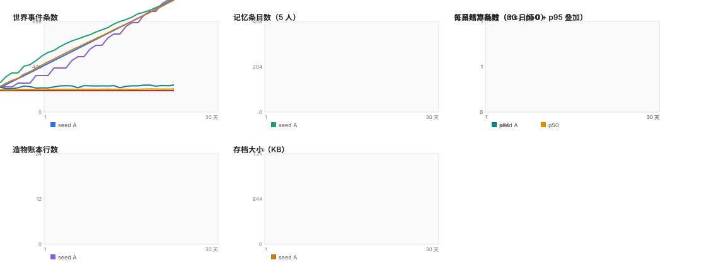

# 30 / 90 日长周期联合浸泡读数

> 夹具：`world-client/test/soak-support.ts`；跑数入口：`node scripts/soak-30d.ts`（30 天）、
> `node scripts/soak-retrospect.ts`（90 天回溯审计）；本报告由 `node scripts/soak-report.mjs`
> 从 30/90 日 summary、`retrospect-90d.json`、`profile*.json`、`determinism.json` 生成，不重跑世界。
> 分支 `feat/soak-30d`（基线 `origin/main` `eab9e36`）；证据目录 `docs/evidence/soak/`。

## 场景

- 5 名居民（迷路人 / 汐 / 灯笼头 / 炉匠 / 沉灯夫人）全部在场，走默认环线（醒 / 打水 / 市面四拍 / 睡）；
- 天气三档晴 / 雨 / 暴雨每 3 天拨一次；潮汐全程开；
- 造物主第 0/3 天（L0/L1）被熔断拒绝，第 6 天用真实观测爬梯到 L3，之后每 3 天拆掉最早一栋再提一次（含落地与 7 日观测）；
- 步长固定 6000ms（倍率 60，一世界日 14,400 步 / 24 分钟）；`wallClock` 固定为 0，不接模型；
- 两轮不同种子 `soak-a` / `soak-b`，外加 `soak-a` 同种子复跑一遍。

## 1. 存量增长

单位：事件/条目/行数为条数；账本/存档为 KB。日均增量 = (第 30 天 − 第 1 天) / 29；末段 = (第 30 天 − 第 22 天) / 7。

| 指标 | 第1天 | 第7天 | 第15天 | 第22天 | 第30天 | 日均增量 | 末段 7 日/天 |
| --- | --- | --- | --- | --- | --- | --- | --- |
| 引擎事件条数 `eventCount()` | 24 | 164 | 355 | 527 | 719 | 23.97 | 27.43 |
| 世界事件条数（`world.event`，记忆消费） | 30 | 208 | 448 | 658 | 898 | 29.93 | 34.29 |
| 记忆条目数（5 人合计） | 35 | 134 | 193 | 196 | 200 | 5.69 | 0.57 |
| 关系账本条数 | 16 | 20 | 20 | 20 | 20 | 0.14 | 0.00 |
| 造物账本行数 | 1 | 4 | 9 | 17 | 24 | 0.79 | 1.00 |
| 造物账本字节（KB） | 2.6 | 8.7 | 16.4 | 28.2 | 36.8 | 1.2 | 1.2 |
| 存档字节（KB） | 80.0 | 418.9 | 809.1 | 1078.1 | 1374.8 | 44.7 | 42.4 |
| 记忆 JSON 字节（KB） | 63.3 | 355.0 | 690.6 | 921.1 | 1177.0 | 38.4 | 36.5 |

种子 `soak-b` 的第 30 天读数用于交叉核对：事件 719 / 世界事件 898 / 记忆 200 / 关系 20 / 账本 24 行 / 存档 1365.0 KB——与 A 同量级，差异只在记忆条目的个体分配。

### 存档「每角色每年」口径

| 口径 | 值 | 对照 1.7 KB/角色年 |
| --- | --- | --- |
| 第 30 天存量（`saveKB × 365 / (5 × 30)`） | 3345.4 KB | **1967.9×** |
| 第 30 天边际（日均增量 × 365 / 5） | 3259.5 KB | **1917.3×** |
| 其中记忆 JSON 边际 | 2803.3 KB | 1649.0× |

**结论：1.7 KB/角色年的基线仍然被打破，但增长已经被预算关进笼子。** 这个世界每天约 30 件事，90 天实测 1318.5 KB/角色年；旧口径按的是稀疏世界，在这里结构性不成立（见第 7 节）。改前的「每世界日 +44.7 KB、第 31.5 天撞 2 MB」已经不再成立：第 60–90 天只涨 +2.93 KB/天。2 MB 上限（`IMPORT_MAX_BYTES`，`src/ui/save-store.ts:88`）没有动，二进制压缩也没有用。

### 记忆库分项（第 1 天 → 第 30 天，字节 KB）

| 分项 | 第1天条数 | 第1天 KB | 第30天条数 | 第30天 KB | 增量 KB | 日均 KB |
| --- | --- | --- | --- | --- | --- | --- |
| entries | 35 | 20.5 | 249 | 154.8 | +134.3 | 4.6 |
| facts | 30 | 10.5 | 898 | 321.7 | +311.2 | 10.7 |
| claims | 20 | 7.0 | 598 | 211.4 | +204.4 | 7.0 |
| written | 5 | 6.0 | 150 | 184.1 | +178.1 | 6.1 |
| beliefs | 39 | 5.6 | 1099 | 162.1 | +156.6 | 5.4 |
| cooldowns | 60 | 3.9 | 882 | 59.4 | +55.5 | 1.9 |
| tells | 39 | 2.3 | 914 | 54.6 | +52.3 | 1.8 |
| legends | 0 | 0.0 | 86 | 16.0 | +16.0 | 0.6 |

条目层现在每个桶都有**条数 + 字节**双预算。`day` 层 5 × 16 = 80 条；`legend` 层从 `Infinity` 收到 **24 条/持有者 / 16 KB**，第 30 天剩下 169 条（106.1 KB）：5 位居民与 3 个地点 holder **全部正好卡在 24 条**，碑文不再随「事 × 人 × 地点」无限刻下去。表里 `entries` 是全库 249 条（含地点 holder），第 1 节「记忆条目数」按居民时间轴合计 200 条，两个口径都对，别混着比。表里单独的 `legends` 行是碑文库（86 条记录），和 `entries` 里 `tier='legend'` 的记忆条目不是同一个库。

### 预算（第 1 条）：改前 vs 改后（30 天末）

改前指本轮修之前那一轮（`summary-30d-before.json`）；改后是当前代码同种子同场景重跑。**这一栏是「第 1 条」的验收数。**

| 指标 | 改前 | 改后 | 差 |
| --- | --- | --- | --- |
| 存档字节 | 1687.5 | 1374.8 | -312.7（-18.5%） |
| 记忆 JSON 字节 | 1449.6 | 1177.0 | -272.6（-18.8%） |
| 记忆条目（居民时间轴） | 408 | 200 | -208 |
| `facts` 条数 | 898 | 898 | 0 |
| 日均存档增量 | 55.6 KB | 44.7 KB | — |

30 天窗口里预算**刚刚开始咬合**（`facts` 898 条还没到 `facts` 的字节上限），所以日均只从 55.6 降到 44.7 KB；真正的「贴顶」发生在第 30–45 天之间，见下表。

| 层 | 条数预算 | 字节预算 |
| --- | --- | --- |
| 条目 · `day`（每人） | 16 | 11.7 KB |
| 条目 · `long`（每人） | 64 | 31.3 KB |
| 条目 · `legend`（每人） | 24 | 15.6 KB |
| 条目 · `impression`（每人） | 32 | 7.8 KB |
| `facts`（全库） | 1200 | 341.8 KB |
| `claims`（全库） | 800 | 224.6 KB |
| `beliefs`（全库） | 1400 | 161.1 KB |
| `cooldowns`（全库） | 1000 | 58.6 KB |
| `tells`（全库） | 1000 | 53.7 KB |
| `written`（全库） | 200 | 195.3 KB |
| `legends`（全库） | 120 | 27.3 KB |

取值口径：按 90 天稳态下每条的平均字节反推条数，让 90 天末记忆 JSON 落在 ~1.2 MB，连同世界存档留出 2 MB 上限的约 26% 余量。**没有用二进制压缩，也没有动 `IMPORT_MAX_BYTES`。**

#### 90 日实跑（seed A，同一场景，不是外推）

| 天 | 世界事件 | facts | 记忆 KB | 存档 KB | pruned 累计 | sim p50 (ms) | dayClose (ms) |
| --- | --- | --- | --- | --- | --- | --- | --- |
| 1 | 30 | 30 | 64.3 | 81.1 | 0 | 0.0045 | 10.0 |
| 7 | 208 | 208 | 363.3 | 428.3 | 0 | 0.0051 | 20.1 |
| 15 | 448 | 448 | 709.6 | 830.4 | 87 | 0.0045 | 17.0 |
| 22 | 658 | 658 | 949.5 | 1110.0 | 515 | 0.0045 | 20.1 |
| 30 | 898 | 898 | 1215.9 | 1418.6 | 1424 | 0.0044 | 28.6 |
| 45 | 1348 | 944 | 1287.4 | 1501.2 | 4687 | 0.0045 | 23.3 |
| 60 | 1796 | 933 | 1318.8 | 1537.6 | 8161 | 0.0045 | 23.0 |
| 75 | 2246 | 922 | 1354.6 | 1578.3 | 12026 | 0.0046 | 23.4 |
| 90 | 2693 | 920 | 1397.0 | 1625.5 | 16605 | 0.0045 | 31.4 |

**90 天末存档 1625.5 KB，占 2 MB 的 79.4%，没有撞上限。** 曲线在第 30–45 天之间由「线性长」转成「贴顶」：第 60 → 90 天只涨 87.9 KB（+2.93 KB/天），而改前是 **+55.6 KB/天**——按那条直线第 31.5 天就撞 2 MB。90 天实测的 `sim p50` 0.0045 ms 与第 1 天 0.0045 ms 同量级，没有「越跑越慢」。

- **facts / 世界事件比**：第 30 天 898 / 898 = **1.000**；第 90 天 920 / 2693 = **0.342**。比值从 1 掉到 0.34，说明事实库在 90 天里裁掉了约三分之二的旧事实——留下的按「重要度 → 新」排序，不是按先进先出。
- **淘汰原因**：90 天累计按层记在 `memory.pruned` 事件里（seed A，按淘汰量降序）：`cooldowns` 5538（条数触发 0 / 字节触发 5538）、`tells` 3376（条数触发 0 / 字节触发 3376）、`beliefs` 3156（条数触发 0 / 字节触发 3156）、`facts` 1773（条数触发 0 / 字节触发 1773）、`entries` 1180（条数触发 1138 / 字节触发 42）、`claims` 1160（条数触发 0 / 字节触发 1160）、`written` 292（条数触发 0 / 字节触发 292）、`legends` 130（条数触发 130 / 字节触发 0）。`entries` 以条数超限为主（少量由字节触发），其余六库全部由**字节**超限触发——这也解释了为什么只加条数上限没用：这些库的问题先出在字节。

#### 90 日 seed B 复跑（不同种子、同场景、同 90 天）

| 指标 | seed A | seed B |
| --- | --- | --- |
| 末存档 | 1625.5 KB | 1572.5 KB |
| 占 2 MB 上限 | 79.4% | 76.8% |
| 第 60→90 天增速 | +2.93 KB/天 | +1.75 KB/天 |
| facts / 世界事件 | 920 / 2693 = 0.342 | 920 / 2692 = 0.342 |
| 预算淘汰累计 | 16605 | 12942 |
| 其中 `facts` / `legends` / `entries` | 1773 / 130 / 1180 | 1772 / 69 / 879 |
| 末 legend 条数 / 字节 | 120 / 23.4 KB | 120 / 21.7 KB |

**seed B 没有更贵**：76.8%，低于 85% 警戒线，没有撞顶。 两个种子的末存档差 53.0 KB，都在「预算贴顶后低斜率增长」的同一档；2 MB 上限没有动，也没有用二进制压缩。

#### 回溯完整度（从第 90 天回看第 20/45/60/89 天）

分母是**当天应有的条数**：事实用「当天写入的事实数」，时间轴用「当天结束时可读的条目数」，不用 90 天总数。seed A（改后，legend 28 KB）：

| 回溯到 | 当日世界事件 | 事实可读 / 应读 | 事实缺失 | 条目层还剩 | 时间轴可读（条目+摘要）/ 当天末 | 时间轴缺失 | 事件可追溯 / 应读 | 事件缺失 |
| --- | --- | --- | --- | --- | --- | --- | --- | --- |
| 第 20 天 | 30 | 12 / 30 | 60.0% | 0 | 59 / 59 | 0.0% | 20 / 30 | 33.3% |
| 第 45 天 | 30 | 12 / 30 | 60.0% | 1 | 61 / 61 | 0.0% | 20 / 30 | 33.3% |
| 第 60 天 | 30 | 12 / 30 | 60.0% | 2 | 57 / 57 | 0.0% | 20 / 30 | 33.3% |
| 第 89 天 | 30 | 12 / 30 | 60.0% | 47 | 59 / 59 | 0.0% | 20 / 30 | 33.3% |

**改前改后，同一把尺子（seed A，时间轴分母 = 当天结束时的条目数）：**

| 回溯到 | 改前可读 / 当天末 | 改前缺失 | 改后可读 / 当天末 | 改后缺失 | 目标 | 判定 |
| --- | --- | --- | --- | --- | --- | --- |
| 第 20 天 | 0 / 59 | 100.0% | 59 / 59 | 0.0% | 可达即 <50% | 达标 |
| 第 45 天 | 1 / 61 | 98.4% | 61 / 61 | 0.0% | **<10%** | 达标 |
| 第 60 天 | 2 / 57 | 96.5% | 57 / 57 | 0.0% | 60 天内可回答 | 达标 |
| 第 89 天 | 47 / 59 | 20.3% | 59 / 59 | 0.0% | >20% 要解释 | 达标 |

改前读数取自上一轮 90 天实跑（提交 `58345ce` 的 REPORT），改后是本轮同一脚本的读数；**改前的时间轴缺失是 100% / 98.4% / 96.5% / 20.3%，改后四天全部 0.0%**，第 45 天低于 10% 的目标已满足，第 89 天也不再需要「浓度递减」的豁免。

- **第 89 天不再 >20%**：不是靠保留窗变长，而是因为摘要把每天的拍子记成了 id 列表。远档（>30 天）仍在，但**时间轴条数与当天末对得上**：第 89 天 59 / 59。
- **事实缺失仍是 60%**：日摘要不救 `facts` 库——它救的是「那天怎么过的」，不是「每件事实的原句」。这一点不要混为一谈（见下面的日摘要专项）。
- seed B 同口径：第 20 天 事实 60.0% 缺 / 时间轴 0.0% 缺；第 45 天 事实 60.0% 缺 / 时间轴 0.0% 缺；第 60 天 事实 60.0% 缺 / 时间轴 0.0% 缺；第 89 天 事实 60.0% 缺 / 时间轴 0.0% 缺。两个种子同形，不是单种子的偶然。

**日摘要专项（SOAK-BUG-5 的存法）**

| 读数 | seed A | seed B |
| --- | --- | --- |
| 条数 / 上限 | 90 / 120（75.0%） | 90 / 120（75.0%） |
| 字节 / 上限 | 116.9 KB / 160 KB（74.8%） | 112.5 KB / 160 KB（72.0%） |
| 覆盖天数 | 90 天（第 1–90 天） | 90 天（第 1–90 天） |
| 全量档 / 浓缩档 | 31 / 59 | 31 / 59 |
| 每天最多几条 | 1 条 digest / 0 条异常原句 | 1 条 digest / 0 条异常原句 |

存法三档，**每天都降一档浓度，不是「留得久一点」**：

1. **近档（0–6 天）**：逐条时间轴，和改前一样。条目还在，`what` / `where` / 时刻都在。
2. **中档（7–30 天）**：每天一条 `DayDigest`。固定字段：`people`（那天几个人在）、`firstEvent`/`lastEvent`（最先/最后一个活动拍）、`places`（去过哪些地点）、`flags`（`quiet`/`social`/`work`/`dispute`/`anomaly`/`major`/`other` 枚举）、`events`（事件 id + kind 枚举）、`beats`（谁记下了哪一拍）、异常原句 ≤3 条。没有散文摘要。
3. **远档（>30 天）**：只留日摘要 + 事件 id 指针。`places` 与 `anomalies` 清空，`events` 的地点下标一律 `-1`；`people` / `firstEvent` / `lastEvent` / `flags` / `events`（id + kind）/ `beats` 保留。

**玩家视角会失去什么（远档）：**
- 失去「在哪」：事件表不再带地点，面板只能写「地点不明」；`places` 列表是空的。
- 失去异常原句：只剩 `flags` 里的 `dispute`/`anomaly`/`major` 三个布尔——知道「那天出过事」，不知道「出了什么事」。
- 失去原句与时刻：`dayTimelineFor` 补回来的行 `whenKnown=false`（面板写「时刻不明」）、`what=null`；只有当那条事件的事实还活着，才补得回原句、地点与当事人。
- **保住的是**：那天有几个人、从哪一拍开始到哪一拍结束、大致属于哪类活动（kind）、谁参与了哪一拍。所以远档能回答「那天有没有事、大致做了什么」，不能回答「具体说了什么」。

**判断题：被淘汰的事实是永久消失，还是仍能从更高层反查回来？**

机制上不是绝对永久：只要该事件的 `eventId` 还留在某条存活条目 / 断言 / 信念 / 传说 / 痕迹 / **日摘要**的 id 列表里，就能顺着引用读回上下文。实测 seed A 90 天淘汰 1773 条事实，最终存档里还能在别处找到指针的 **873 条（49.2%）**，其中 **403 条只在日摘要里留着一个指针**（知道「哪天、哪类事、什么地点」，原句已不在）。抽 3 条实际淘汰记录：

| eventId | 发生日 | 类型 | importanceHint | 淘汰日 | 能找回 | 找到于 | 原文 |
| --- | --- | --- | --- | --- | --- | --- | --- |
| `soak-4` | 第 1 天 | daily_water | 0.35 | 第 32 天 | 能（指针） | entries / legends / digests | 迷路人去河湾打水，顺手冲了冲河岸 |
| `soak-6` | 第 1 天 | street_greet | 0.38 | 第 77 天 | 能（指针） | legends / digests | 迷路人与灯笼头碰面，互相问了个好。 |
| `soak-2664` | 第 90 天 | routine_done | 0.35 | 第 90 天 | 能（指针） | entries / claims / digests | 迷路人在祭坛边睡下了 |

**结论分两层，别混：** 原文仍然找不回（事实一删，`what`、当事人、地点就没有任何一层存原句）；指针找得回，靠的是日摘要与存活的 entry/legend 引用。

**改前的 3 / 1773（0.17%）不能直接和改后比。** 旧脚本的引用索引只收「对象属性值是字符串」的引用，`eventRefs: ['soak-1']` 这种**数组里的 id** 全被漏掉——0.17% 里大部分是口径 bug，不是真的没人引用。本轮先修了索引，再用日摘要补最后一层指针；改后的 873 里，403 条只靠日摘要、其余靠存活条目与传说。旧结论「被淘汰的事实实际上永久消失」要修正为：**原文永久消失，指针多数找得回**。

#### `legend` 预算专项（90 天）

| 读数 | seed A | seed B |
| --- | --- | --- |
| 条数上限 | 120 | 120 |
| 字节上限 | 28 KB（28000 字节） | 28 KB（28000 字节） |
| 实际条数 | 120（100.0%） | 120（100.0%） |
| 实际字节 | 23.4 KB（85.7%） | 21.7 KB（79.5%） |
| 90 天淘汰传说 | 130 | 69 |
| 存活传说的最早 formedDay | 4 | 4 |
| 被淘汰传说的 formedDay 范围 | 36–83 | 37–82 |
| 淘汰样本 | `legend_3656`（第 40 天 / reach 0）、`legend_3807`（第 42 天 / reach 0）、`legend_3821`（第 42 天 / reach 0） | `legend_3948`（第 43 天 / reach 0）、`legend_4173`（第 46 天 / reach 0）、`legend_3794`（第 41 天 / reach 0） |

**排序是什么**：「enforceBudgets」里 `legends` 先按 **reach 降序（传得多远）**，同 reach 再按 **formedDay 升序（更早立起来的先留）**，最后按「legendId」。所以淘汰的是 **reach 最低、且同 reach 里最年轻的**那批：被淘汰样本 reach = 0，formedDay 36–83。按「最新优先」会把世界最早那批传说先扔掉；改成 formedDay 升序后，存活最早回到第 4 天。

**20 KB → 28 KB 的代价（实测，同一种子同一场景）：**

| 读数 | 20 KB（改前上限） | 28 KB（改后上限） | 差 |
| --- | --- | --- | --- |
| seed A 末存档 | 1621.3 KB | 1625.5 KB | +4.21 KB |
| seed A 第 60→90 天日增 | 2.88 KB/天 | +2.93 KB/天 | +0.05 KB/天 |
| seed A 末 legend | 101 条 / 19.6 KB（100.5%） | 120 条 / 23.4 KB（85.7%） | 19 条 / +3.84 KB |
| seed A 淘汰传说 | 149 | 130 | -19 |
| seed B 末存档 | 1570.0 KB | 1572.5 KB | +2.49 KB |
| seed B 第 60→90 天日增 | 1.75 KB/天 | +1.75 KB/天 | +0.00 KB/天 |
| seed B 末 legend | 107 条 / 19.5 KB（99.7%） | 120 条 / 21.7 KB（79.5%） | 13 条 / +2.25 KB |
| seed B 淘汰传说 | 82 | 69 | -13 |

**判定：提上限，不加第三条排序项。** 代价是 seed A +4.2 KB（1621.3 → 1625.5）、seed B +2.49 KB；两个种子离 1800 KB 的硬预算还差 174.5 KB / 227.5 KB，没有逼近。尾段日增变化在 ±0.1 KB/天以内，仍低于 3 KB/天的线。条数上限 120 已经先卡住（seed A 恰好 120/120），所以 28 KB 买到的是「字节侧不再一刀切」，不是再多存几十条碑文。

为什么没加第三条排序项：如果 28 KB 让 A/B 逼近 1800 KB，才会改用「reach 降序 → formedDay 升序 → legendId」之外的稳定项来防单条新碑引发连锁淘汰；实测没有逼近，再维护一条排序规则只是多一层没人验证的复杂度。

#### 为什么 `T_promote=0.60` 没动（二选一里的选项 b）

30 天、5 位居民、共 1156 条日层片段的显著度分布：

| 显著度 | 条数 | 占比 |
| --- | --- | --- |
| 0.303 | 4 | 0.3% |
| 0.438 | 178 | 15.4% |
| 0.463 | 38 | 3.3% |
| 0.475 | 39 | 3.4% |
| 0.495 | 844 | 73.0% |
| 0.499 | 27 | 2.3% |
| 0.503 | 26 | 2.2% |

| 门槛 | 越线条数 |
| --- | --- |
| ≥ 0.45 | 974 |
| ≥ 0.48 | 897 |
| ≥ 0.495 | 897 |
| ≥ 0.5 | 26 |
| ≥ 0.55 | 0 |
| ≥ 0.6 | 0 |

**p50 = p90 = 0.495，p99 = max = 0.502875，0.60 在整条分布之上**——日常世界跑多久都晋升不了，`promoted = summaries = archived = 0`，压缩这层空转。

降阈值不安全：实测「听来的」条目显著度 **0.575**，「亲历且重要」的 **0.775**；`T_promote=0.50` 会把前者也晋升，而 `makeSummary` 写死 `sourceMode: 'witnessed'`、`sourceChain: []`，传闻的来历与保真度当场消失（`test/memory-archive-reach.test.ts` 的注释里有复现步骤）。0.60 正好卡在这两档之间，是设计里「至少两个维度突出才进日摘要」的数值位置。

所以机制不是坏了，是**场景不够**：`test/memory-archive-reach.test.ts` 用「每 7 天一件亲历大事」跑 90 天，晋升、日摘要、周摘要、归档四步依次发生——实测 90 天后 **日/周摘要 68 条（周摘要 60 条）、归档 30 条（全部是摘要）**。这条路径是通的，只是纯日常走不到。

## 2. 性能

单位 ms；`sim p50/p95` 为每逻辑步 `Simulation.update(6000)` 的百分位；`dayClose` 是跨日那一拍的记忆关账；`dayWall` 是整天墙钟（含快照、同步与分配）。

| 天 | sim p50 | sim p95 | mem p50 | mem p95 | dayClose | creatorClose | dayWall |
| --- | --- | --- | --- | --- | --- | --- | --- |
| 1 | 0.0045 | 0.03 | 0.00 | 0.01 | 9.9 | 0.8 | 993.8 |
| 2 | 0.0030 | 0.01 | 0.00 | 0.01 | 4.7 | 0.2 | 883.0 |
| 3 | 0.0031 | 0.02 | 0.00 | 0.01 | 5.5 | 0.2 | 874.3 |
| 4 | 0.0045 | 0.02 | 0.00 | 0.01 | 5.3 | 0.2 | 1200.0 |
| 5 | 0.0044 | 0.02 | 0.00 | 0.01 | 8.3 | 0.2 | 1229.2 |
| 6 | 0.0042 | 0.02 | 0.00 | 0.01 | 8.0 | 0.1 | 1159.1 |
| 7 | 0.0046 | 0.02 | 0.00 | 0.01 | 8.7 | 0.2 | 1245.2 |
| 8 | 0.0047 | 0.02 | 0.00 | 0.01 | 10.5 | 0.1 | 1271.1 |
| 9 | 0.0045 | 0.02 | 0.00 | 0.01 | 9.3 | 0.2 | 1220.1 |
| 10 | 0.0047 | 0.02 | 0.00 | 0.01 | 9.1 | 0.2 | 1247.7 |
| 11 | 0.0046 | 0.02 | 0.00 | 0.01 | 9.9 | 0.1 | 1203.3 |
| 12 | 0.0046 | 0.02 | 0.00 | 0.01 | 12.4 | 0.7 | 1263.3 |
| 13 | 0.0046 | 0.02 | 0.00 | 0.01 | 16.6 | 0.2 | 1260.3 |
| 14 | 0.0045 | 0.02 | 0.00 | 0.01 | 15.7 | 0.2 | 1191.6 |
| 15 | 0.0046 | 0.02 | 0.00 | 0.01 | 17.0 | 0.1 | 1244.9 |
| 16 | 0.0048 | 0.02 | 0.01 | 0.01 | 18.5 | 0.2 | 1253.4 |
| 17 | 0.0045 | 0.02 | 0.00 | 0.01 | 17.9 | 0.1 | 1212.0 |
| 18 | 0.0045 | 0.02 | 0.01 | 0.01 | 20.3 | 0.1 | 1235.3 |
| 19 | 0.0047 | 0.02 | 0.01 | 0.01 | 22.1 | 0.1 | 1265.2 |
| 20 | 0.0047 | 0.02 | 0.01 | 0.01 | 20.3 | 0.3 | 1251.4 |
| 21 | 0.0046 | 0.02 | 0.01 | 0.01 | 15.7 | 0.1 | 1216.6 |
| 22 | 0.0046 | 0.02 | 0.01 | 0.01 | 18.8 | 0.2 | 1236.8 |
| 23 | 0.0047 | 0.02 | 0.01 | 0.01 | 20.2 | 0.1 | 1256.8 |
| 24 | 0.0046 | 0.02 | 0.01 | 0.01 | 23.5 | 0.1 | 1278.8 |
| 25 | 0.0050 | 0.02 | 0.01 | 0.01 | 37.4 | 0.2 | 1347.2 |
| 26 | 0.0051 | 0.02 | 0.01 | 0.01 | 31.7 | 0.1 | 1341.1 |
| 27 | 0.0045 | 0.02 | 0.01 | 0.01 | 23.2 | 0.1 | 1202.4 |
| 28 | 0.0046 | 0.02 | 0.01 | 0.01 | 29.7 | 0.3 | 1288.2 |
| 29 | 0.0046 | 0.02 | 0.01 | 0.01 | 28.0 | 0.8 | 1302.5 |
| 30 | 0.0046 | 0.02 | 0.01 | 0.01 | 35.5 | 0.1 | 1294.4 |

- **整步在涨，但不是算法级的涨。** 种子 A 的 `sim p50` 0.0045 → 0.0046 ms（+2%）、`p95` 0.0324 → 0.0182 ms；种子 B 从 0.0046 → 0.0049 ms（+7%）。绝对值仍在 6 秒步长预算的 0.3% 以内，不是「世界越大越卡」的复杂度问题。
- **函数级定位（`profile.json`）**：改前随天数涨的 `stepDecrees`（p50 7.6 → 11.6 µs、p95 14.9 → 25.9 µs）已经修掉——它原来每步调用 `snapshot()` 做全量对象分配。改后 p50 恒定 0.1 µs、p95 0.2 µs，堆峰值也从 88 MB 降到 55 MB。`stepTide` 修复后恒定（p50 0.2 → 0.3 µs）。
- **确定随存量线性增长的两项**：`dayClose` 9.9 → 35.5 ms（记忆关账要扫全库 + 序列化）；`dayWall` 993.8 → 1294.4 ms（每步快照与 `syncHolders` 的分配压力）。这两项是「跑久了」真正要盯的读数。
- 修复前实测的「越跑越慢」在 `tideLevelAt`：`stepTide` p50 从 0.3 µs 涨到 17.9 µs（60×），30 日耗时 73.6 s。改成 64 周期检查点 + 二分后，`stepTide` 恒定 ~1 µs，30 日 50.3 s。详见「修了什么」。

### 浏览器端（第 30 日末）

把 `save-30d.json` 注进 `dengchao.pixel-world.save.v1`，在本 worktree 的端口 5311 打开页面读档：

- URL：`http://127.0.0.1:5311/?world=dengchao&feed=off&debug=1&time=noon&speed=60`
- 读档结果：世界日 30（now=2592018240，第 30 日末）、居民 5 人、楼 10 栋、天气 clear、记忆 `closedThroughDay=29`
- 采样 20 秒：`actualFps=58.0`（`fpsLimit=0`，未限频）、`updateCount=1175`、`advanceCount=1175`
- 绘制指令：`graphicsObjects=47`、`totalCommands=21169`，最大五层 8729 / 1584 / 1513 / 1338 / 1304
- 页面报错：0 条
- 存档在 localStorage 里 1314.0 KB

第 1 天同口径对照（新世界、同一端口、同一采样时长）：

| 读数 | 第1天（新世界） | 第30天末（读档） | 变化 |
| --- | --- | --- | --- |
| `actualFps` | 57.9 | 58.0 | 持平 |
| `graphicsObjects` | 46 | 47 | +1 |
| `totalCommands` | 12371 | 21169 | +71.1% |
| 最大单对象命令数 | 1584 | 8729 | 7145 |
| 居民 | 7 | 5 | — |
| 楼 | 9 | 10 | +1 |

**帧率没有掉**：58.0 fps 与第 1 天的 57.9 持平（`fpsLimit=0`，未限频，跑的就是浏览器 vsync）。**但绘制指令随天数涨了 71.1%**（12371 → 21169），其中单个 Graphics 从 1584 条涨到 8729 条——这是下一轮要定位的对象（本轮的 `renderStats()` 只给命令数、不给对象名，没继续加诊断字段）。60 fps 还在，所以它不是「越跑越慢」，是「每帧要画的线变多」的余量问题。

## 3. 清理机制是否生效

| 计数（第 30 天，累计） | 值 |
| --- | --- |
| `memory.consolidated` 事件 | 528 |
| 摘要条目数 `summaries` | 0 |
| 晋升 `promoted` | 0 |
| 归档 `archived` | 0 |
| 整理内裁掉 `dropped` | 1115 |
| **预算淘汰 `memory.pruned`** | **1424** |
| 时间轴被裁条数 | 0 |
| 地点不明条数 | 0 |
| 面板会写「时刻不明」的格子 | 30 天 0；90 天 8 |

第 30 天淘汰按层（`memory.pruned`，累计）：

| 层 | 淘汰条数 | 条数超限 | 字节超限 |
| --- | --- | --- | --- |
| `entries` | 338 | 338 | 0 |
| `cooldowns` | 831 | 0 | 831 |
| `tells` | 220 | 0 | 220 |
| `beliefs` | 35 | 0 | 35 |

- **预算裁剪在真跑，而且分得清原因**：30 天累计淘汰 1424 条，`entries` 由条数触发、其余各库由字节触发。改前这里只有一个 `dropped`（1117）且全部来自整理，答不出「哪一层、为什么」。
- **压缩入口是通的（选项 b 的证明）**：日常世界的日层显著度 p99 = max = 0.502875，够不着 `T_promote=0.60`，所以 30 天 `summaries=promoted=0` 是**场景不够**，不是坏了。`test/memory-archive-reach.test.ts` 用「每 7 天一件亲历大事」跑 90 天，晋升 → 日摘要 → 周摘要 → 归档依次发生；同时它钉住了另一条边界：阈值降到 0.50 会把 0.575 的「听来的」条目也压成 `witnessed` 摘要，来源链断裂。审计见「为什么 `T_promote=0.60` 没动」。
- **事件日志只增不改**：`eventCount()` 逐日单调（不变量 `event-count-monotonic` 每天核对）；世界事件累计 898 条，无删除路径。**事实库只减不删世界事件**：`facts` 被裁 898 条是记忆表里的一行，世界事件日志本身不动。
- **造物账本只有 append**：每天核对「今天的文件必须以昨天完整字节为前缀」（`ledger-append-only`），30 天 0 违反；行数 1 → 24 单调。
- **「被裁掉的事实写时刻不明」有了实现与样本**：`dayTimelineFor` 现在给每一格 `whenKnown`；事实被裁掉（或这一格是摘要、`when` 是日号）时为 `false`，面板写「时刻不明」而不是拿 `clockOf` 算出一个 00:00。样本在 `test/memory-budget.test.ts`（裁掉 `ev_low` 后它的格子 `whenKnown=false`、`what=null`、`placeId=null`）与 `test/unit-status.test.ts`（渲染出 `clock: '时刻不明'`）。第 30 天是 0：时间线只覆盖昨天，昨天的条目所指事实都还在；到第 90 天事实被预算裁掉 1773 条，面板上出现 8 格「时刻不明」——这是真跑样本，不是只靠测试断言。

## 4. 不变量

每天跑一次，30 天 ×2 种子共 60 次，**违反 0 条**（`violations: []`）：

| 规则 | 内容 |
| --- | --- |
| `now-finite` | 世界时间有限且非负 |
| `event-count-monotonic` | 引擎事件计数不回退 |
| `villager-pos-finite` / `villager-on-walkable` | 居民坐标有限、且站在可走格 |
| `bond-finite` / `bond-to-known` | 关系数值有限、对象是已知居民 |
| `save-schema-v5` / `save-villager-count` / `save-memory-present` | 存档版本、居民数、记忆字段 |
| `save-roundtrip` | 存档 JSON 可解析 |
| `ledger-rows-monotonic` / `ledger-append-only` | 账本行数单调、文件只追加 |

## 5. 确定性

同种子 `soak-a` 跑两遍，四项指纹逐项相同：

| 指纹 | 第一遍 | 第二遍 | 结果 |
| --- | --- | --- | --- |
| world | `5b7131d89bbd438c…` | `5b7131d89bbd438c…` | 相同 |
| memory | `5f4190f2a9fcf380…` | `5f4190f2a9fcf380…` | 相同 |
| creator | `926f57e5fcfb1f13…` | `926f57e5fcfb1f13…` | 相同 |
| events | `9ea842d560463b87…` | `9ea842d560463b87…` | 相同 |

账本原始字节：`fec72999408e…` vs `ce91f33f77e6…`，**不同**。原因是 `newRecordId` 用 `crypto.randomUUID()` 生成防撞键；剔除 `recordId`/`proposalId` 后的内容指纹相同（上表 creator）。这是键、不是行为。

## 6. 行为是否退化（第 1 天 vs 第 30 天）

按天计数（打水/市面从累计值还原成当日增量）：

| 行为 | 第1天 | 第30天 | 倍数 |
| --- | --- | --- | --- |
| 走动步数 | 14360 | 14495 | 1.01× |
| 离场次数 | 141 | 150 | 1.06× |
| 夜间走动步数 | 0 | 95 | — |
| 出摊/市面步数 | 3780 | 4200 | 1.11× |
| 睡下步数 | 21000 | 20900 | 1.00× |
| 街头互动次数 | 12 | 12 | 1.00× |
| 会改关系的小事 | 0 | 0 | — |
| 打水事件 | 1 | 1 | 1.00× |
| 打水到达 | 1 | 1 | 1.00× |

| 市面四拍（当日条数） | 第1天 | 第30天 |
| --- | --- | --- |
| market_open | 1 | 1 |
| work_end | 1 | 1 |
| night_market | 1 | 1 |
| market_close | 1 | 1 |

- 居民**没有塌成只剩巡逻**：走动、离场、出摊、夜行、睡下的量级都在；夜行从 0 到 95 步是天气/潮汐把个别行程推到了夜里，不是退化。
- 打水每天 1 次、全部「到达」，30 天 1 次到达，没有落空。
- **关系账本 30 天有 20 条（10 对 × 双向）**：`incidents` 仍然恒为 0，但日常照面走独立通道入了账；warmth 均值 0.237、familiarity 均值 0.495、|trust| 最大 0.000。第 1 天只有 16 条（8 对当天见过面），第 30 天 10 对全部有账——「越处越亲」现在可读了。
- 天气三档都出现过：计划第 2/5/8… 天各拨一次，`weatherSeen` 在对应日读到 `rain` / `storm`；当日采样点落在夜里，读数是「全天出现过的档位」并集。

## 7. 发现了什么 / 修了什么 / 还剩什么

### 修了（产品代码）

**`tideLevelAt` 的线性扫描**（`src/world/tide.ts`）：原来每次查询从周期 0 逐周期累加，成本随世界时间线性增长，而 `Simulation.stepTide` 每 6 秒调一次。改为 64 周期检查点 + 二分查找 + 检查点内最多 64 次扫描；曲线逐点与原实现一致，由 `test/tide-checkpoint.test.ts` 钉住（0–31 天采样点逐点比对，且查询顺序无关）。

| 读数 | 修复前 | 修复后 |
| --- | --- | --- |
| `stepTide` p50 | 0.3 µs → 17.9 µs（60×） | 恒定 ~1 µs |
| 30 日整轮耗时 | 73.6 s | 50.3 s（含插桩） |

**记忆预算与清理层（第 1 条）**：

1. **六个无预算的库补上条数 + 字节双预算**（`src/world/memory/config.ts` 的 `libraryBudget`）：`facts` / `claims` / `beliefs` / `cooldowns` / `tells` / `written` / `legends`。每个库按自己的价值轴淘汰（事实按重要度→新，冷却与传话按新旧，传说按传播面），不再一律按写入顺序。
2. **碑文层从 `Infinity` 收到 24 条/持有者 / 16 KB**（`budget.legend`），并给条目四个桶都加了字节上限。
3. **淘汰留痕**：新增 `memory.pruned` 事件（层 / 淘汰数 / 条数超限数 / 字节超限数 / 原因 / 剩余），每层每天至多一条；同时修正`memory.archived` 原先「每天把全部已归档条目重发一遍」的累计口径。
4. **归档/晋升不改阈值，补可达性证明**（选项 b）：`test/memory-archive-reach.test.ts`。
5. **面板不再编造时刻**：`whenKnown` 从 `dayTimelineFor` 一路透到 `unit-status`，事实被裁或摘要日号都写「时刻不明」。
6. **`stepDecrees` 不再每步全量 `snapshot()`**（第 2 条）：`awaitingDecree` 现在只收 `Pick<WorldSnapshot,'tasks'>`，`decreeView()` 直接返回 `{ tasks: this.tasks }`，同一个数组引用、零分配；`hasDecree` 与每换班一次的调用也走同一条路。改前/改后（同 seed `soak-profile`、30 天）：

| 读数 | 改前 | 改后 |
| --- | --- | --- |
| `stepDecrees` p50（第 1 天 → 第 30 天） | 7.6 → 11.6 µs | 0.1 → 0.1 µs |
| `stepDecrees` p95 | 14.9 → 25.9 µs | 0.5 → 0.2 µs |
| `sim` p50 | 13.8 → 20.6 µs | 7.4 → 8.7 µs |
| `sim` p95 | 57.1 → 57.5 µs | 36.8 → 21.7 µs |
| 堆峰值 | 88 MB | 55 MB |

7. **日常照面独立小额通道（第 3 条选 b）**：门槛 0.4 保留，它量的是「事情重不重要」；「street_greet / street_yield / street_together」另走一条**按天结算**的通道，同一对一天见几次只积一次，familiarity 向 0.75 缓动、warmth 向 0.4 缓动且照常吃 15%/天衰减，trust 不动。30 天后 warmth 0.209–0.250（均值 0.237），familiarity 0.468–0.530（均值 0.495）——有账，但离满格远。
8. **`legend` 同 reach 改为留更早**：改前同 reach 留最新，90 天存活传说最早只到第 56 天；改后最早回到第 4 天。最早那批碑文不再先被扔掉。

| 读数 | 改前 | 改后 |
| --- | --- | --- |
| 30 天末存档 | 1687.5 KB | 1374.8 KB |
| 90 天末存档 | 外推 ~5 MB（第 31.5 天撞 2 MB） | 1625.5 KB（未撞上限） |
| 90 天日均增量 | +55.6 KB/天 | +2.93 KB/天（第 60–90 天） |

### 发现了（按口径记 todo + BUGS_FOUND）

1. **回溯完整度（SOAK-BUG-5）：已修（时间轴层）/ 部分修（事实层）。** 改前（保留窗约 6 天）回看第 20 / 45 / 60 / 89 天，时间轴缺失 **100% / 98.4% / 96.5% / 20.3%**，事实每天只剩 12 / 30；改后同口径四天全部 **0.0%**（可读 / 当天末 = 59/59、61/61、57/57、59/59），第 45 天 <10% 的目标达成，第 89 天不再需要「浓度递减」豁免。代价是 90 天末存档 seed A 1625.5 KB（+4.21）、seed B 1572.5 KB（+2.49），第 60–90 天日增 A 2.93 KB/天、B 1.75 KB/天，都没撞 1800 KB / 3 KB 的线。**剩下什么：** 事实缺失仍是 60%——日摘要记的是「那天怎么过的」，不是每件事实的原句；远档（>30 天）只剩 id 指针 + 枚举，原文找不回，能回答「那天有没有事、大致做了什么」，答不了「具体说了什么、在哪」。
2. **`T_promote=0.60` 在日常场景走不到**——本报告已用分布解释并证明机制可达（选项 b），因此这条不再是缺陷，而是场景边界；剩余风险是「听来的 0.575 与 0.60 之间只隔 0.025」，场景一变就得重看分布。回填缺口正是它的下游：没有摘要层接住归档的日条目。

### 还剩什么

- **回溯完整度**（SOAK-BUG-5，时间轴已修 / 事实部分修）：日摘要已经接住旧日时间轴，三档浓度按天递减；没做到的是「事实原句的回溯」——那不归摘要层，要另立条目，别把 60% 的事实缺失算成 BUG-5 未修。
- `stepDecrees` / 关系账本 / 传说排序已修完，`[SOAK-BUG-1]` 已从 todo 转正。
- `docs/BUGS_FOUND.md` 的「长周期浸泡」小节已同步：BUG-2 降级为「场景边界 + 可达性测试」，BUG-3/BUG-4 翻正。
- 九道闸门。
